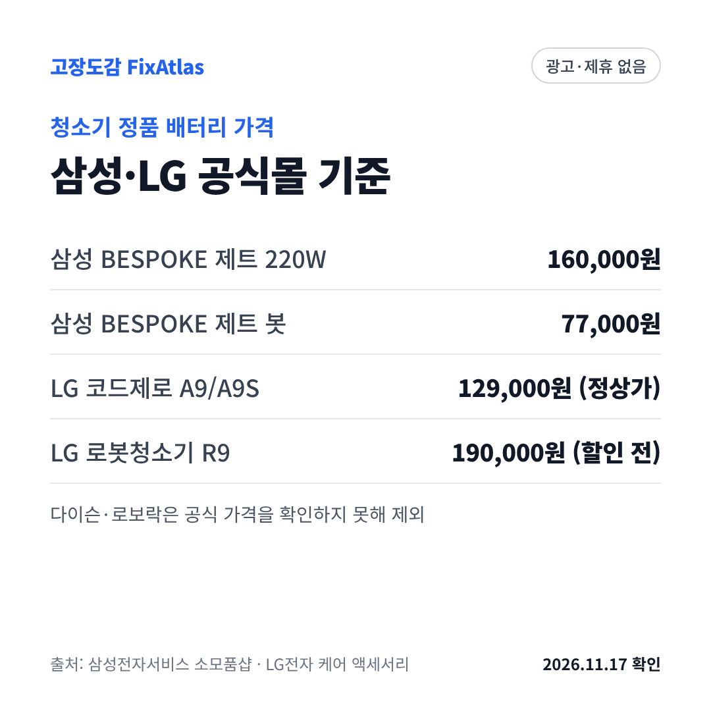
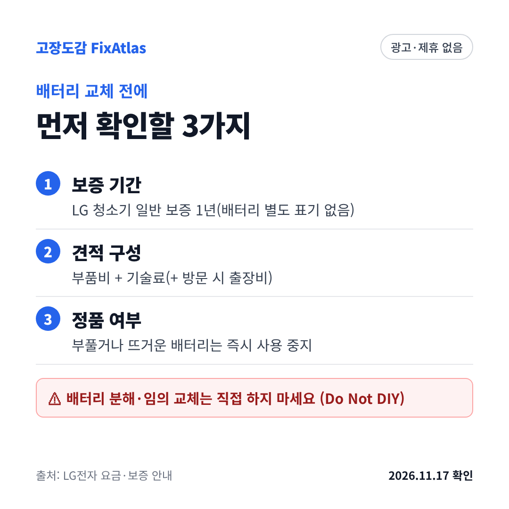
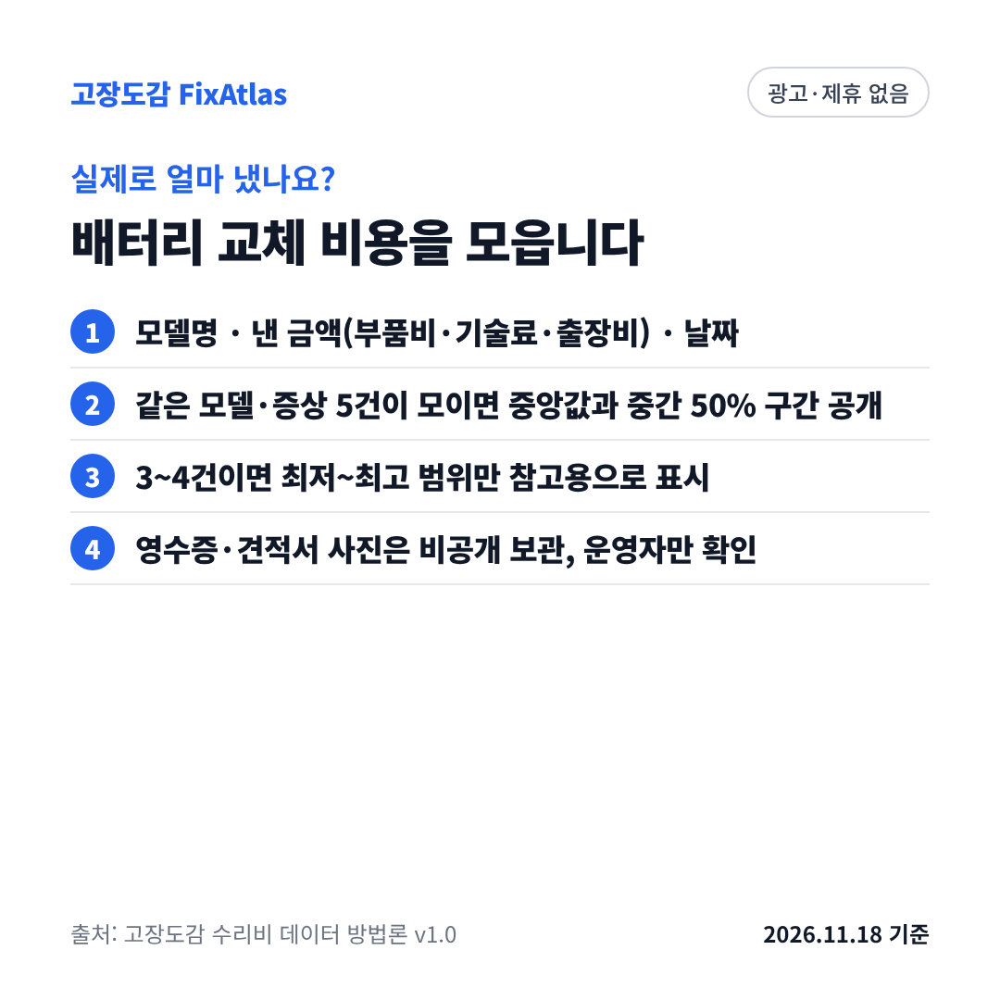

# 청소기 정품 배터리 가격, 삼성·LG 공식몰 4종 (2026년 11월 기준)

> 광고·제휴 없음 · 공식몰 가격 확인일 2026-11-17 · 작성·확인 고장도감 편집자
> 사용자 제보 수리비는 아직 공개 기준(같은 모델 5건)에 못 미쳐 이 글에는 범위를 싣지 않습니다. [공개 기준 보기](site:/methodology#disclosure)

**한 줄 결론**: 2026년 11월 17일 공식몰에서 직접 확인한 정품 배터리 가격은 삼성 BESPOKE 제트 220W용 160,000원, LG 코드제로 A9/A9S용 129,000원(정상가)입니다.

> ⚠ **직접 수리 금지(Do Not DIY)**: 배터리가 부풀었거나 충전 중 뜨거워지면 바로 사용을 멈추고 충전기를 빼세요. 배터리 팩 분해나 셀 교체는 직접 하지 마세요.

## 삼성·LG 정품 배터리 공식가 (2026-11-17 확인)

| 정품 배터리 (부품번호) | 공식가 |
|---|---|
| 삼성 BESPOKE 제트 220W (DJ96-00242D) | 160,000원 |
| 삼성 BESPOKE 제트 봇 (DJ96-00233A) | 77,000원 |
| LG 코드제로 A9/A9S (EAC63382208) | 129,000원 정상가 |
| LG 로봇청소기 R9 (EAC63419404) | 190,000원 할인 전 |

LG 공식몰은 로그인하면 회원가가 따로 보입니다. 확인 당시 A9/A9S 배터리는 104,000원, R9 배터리는 180,500원이었습니다. 적용 모델은 아래 출처의 각 상품 페이지에 나와 있습니다.

## 공식몰 가격이 수리비 전부일까요?

아니요. 공식몰 가격은 **부품값**이에요. LG 공식 안내 기준 서비스 요금은 부품비 + 수리비(기술료)이고, 기사가 방문하면 출장점검료(평일 28,000원)가 더해져요. 배터리를 직접 끼우는 구조인지 설명서에서 먼저 확인해 보세요.

## 교체 전에 확인할 3가지

1. **보증 기간**: LG 공식 안내 기준 청소기 일반 보증은 1년이에요. 배터리 보증 기간은 따로 적혀 있지 않았어요(A9·A9S 인버터모터는 10년).
2. **견적 구성**: 부품비, 기술료, 출장점검료가 나뉘어 적혀 있는지 보세요.
3. **정품 여부**: 이 글은 정품 가격만 다뤄요. 호환 배터리를 고려한다면 KC 안전인증 표시와 판매처 보증 조건을 먼저 확인하세요.

## 배터리를 바꿀까, 새로 살까?

고장도감 계산기는 수리비가 신품가의 25% 이하면 수리, 25~50%면 조건부, 50%를 넘으면 교체를 권하는 일반 경험칙을 써요. 아직 모델별 데이터로 보정하지 않은 기준이라 연식과 다른 고장 부위도 함께 보세요.
→ [수리 vs 교체 계산하기](site:/calculator?product=samsung-bespoke-jet#calc)

## 편집자 확인 기록

상품 페이지 4곳을 2026년 11월 17일에 직접 열어 가격을 옮겼어요. LG 페이지는 로그인 상태에 따라 회원가가 함께 보여서, 표에는 누구나 보는 정상가를 적고 회원가는 따로 적었어요. 다이슨·로보락 정품 배터리는 공식 페이지에서 가격을 확인하지 못해 표에서 뺐어요. 확인되면 추가하고 업데이트 이력에 남길게요.

## 자주 묻는 질문

### 배터리 교체는 보증으로 무료인가요?
제품과 구입 시기에 따라 달라요. LG 청소기 일반 보증은 1년이고 배터리 보증은 따로 표기되지 않았어요. 영수증이나 주문 내역으로 구입일을 확인한 뒤 센터에 먼저 문의하세요.

### 공식몰 가격과 센터 교체 비용이 다른 이유는요?
센터에서 교체하면 부품값에 기술료가, 방문 수리면 출장점검료가 더해질 수 있어요. 견적서에 세 항목이 나뉘어 있는지 확인하세요.

### 다이슨·로보락 배터리 가격은요?
이번에는 공식 페이지에서 가격을 확인하지 못해 싣지 않았어요. 원문으로 확인하지 못한 숫자는 싣지 않는 것이 고장도감 원칙이에요.

## 실제로 얼마 냈는지 알려주세요

공식몰 가격은 부품값일 뿐이고, 실제로 낸 금액은 사람마다 달라요. 같은 모델 제보가 5건 모이면 중앙값과 중간 50% 구간을 공개하고, 3~4건이면 범위만 참고용으로 보여 드려요. 영수증 사진은 비공개로 보관하고 운영자만 확인해요.
→ [배터리 교체 비용 제보하기](site:/submit-repair?product=samsung-bespoke-jet&symptom=sym-3#cta-bottom)

댓글로 모델명과 받은 견적을 남겨 주세요. 다음 글의 질문 목록에 반영할게요.

---

## 출처

- 삼성전자서비스 소모품샵: [BESPOKE 제트 220W 배터리](https://www.samsungsvc.co.kr/shop/product/0000090680), [BESPOKE 제트 봇 배터리](https://www.samsungsvc.co.kr/shop/product/0000090642) (2026-11-17 확인)
- LG전자 케어 액세서리: [A9/A9S 배터리](https://www.lge.co.kr/care-accessories/a9-vacuum-cleaner/eac63382208), [R9 배터리](https://www.lge.co.kr/care-accessories/robotic-vacuum-cleaner/eac63419404) (2026-11-17 확인)
- LG전자: [요금·보증 안내](https://www.lge.co.kr/support/rates-warranty-guide), [서비스센터 방문 예약 안내](https://www.lge.co.kr/support/visit-center-reservation?seq=182) (2026-11-17 확인)
- 고장도감: [수리비 데이터 방법론 v1.0](site:/methodology#sources)

> 고장도감의 정보는 사용자 제보와 공개자료를 바탕으로 한 참고 정보입니다. 실제 수리비, 보증 적용 여부, 부품 수급, 안전성은 제품 상태, 지역, 수리업체, 제조사 정책에 따라 달라질 수 있습니다.
> 고전압, 배터리, 냉매, 가스, 방수 구조와 관련된 작업은 안전사고 위험이 있으므로 전문가 또는 공식 서비스센터를 이용하십시오.

업데이트 이력: 2026-11-17 공식가 확인(삼성 2종·LG 2종) · 2026-11-18 네이버 발행본 정리
