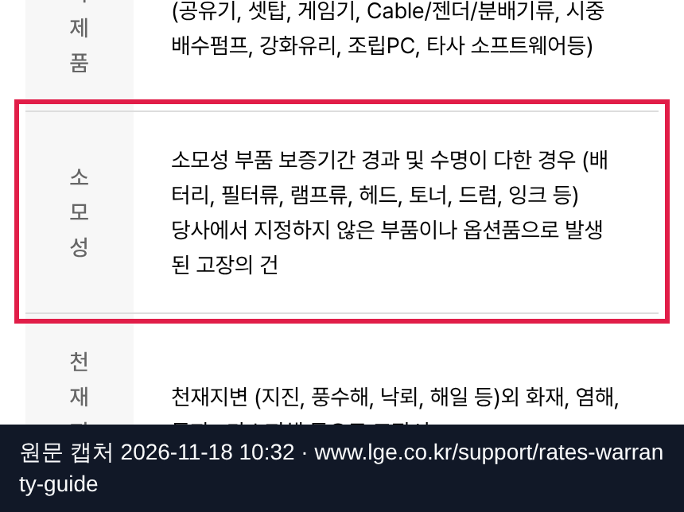
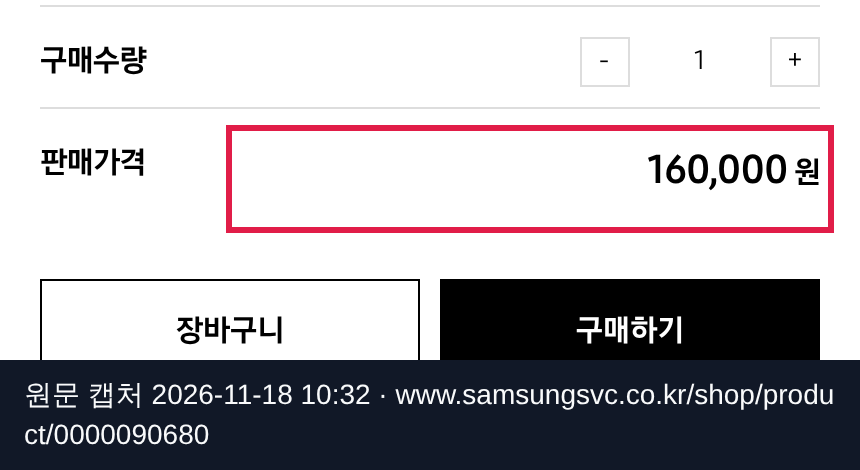

# 청소기 배터리는 보증될까? 삼성·LG 공식몰 정품 가격 4종 (2026년 11월)

광고나 제휴 없이 쓰는 글입니다. 가격과 보증 문구는 2026년 11월 18일에 각 공식 페이지를 다시 열어 대조했고, 그 화면을 캡처해 함께 붙였습니다.

만든 방법: AI 도구로 초안을 쓰고 출처 문구·숫자를 원문과 자동 대조했습니다. 편집자가 [[직접 확인: 원문과 캡처를 직접 다시 확인한 날짜(YYYY-MM-DD)]]에 원문과 캡처를 다시 확인했습니다. AI를 어디까지 쓰는지는 [방법론의 AI 사용 원칙](site:/methodology#ai)에 적어 두었습니다.

LG전자 안내를 기준으로 보면 청소기 배터리는 필터·램프와 같은 **소모성 부품**입니다. 안내 문구대로라면 수명이 다해 바꾸는 배터리는 유상입니다. 정품 값은 삼성 BESPOKE 제트 220W용이 160,000원, LG 코드제로 A9/A9S용이 정상가 129,000원(회원할인가 104,000원)입니다.

## 보증 기간 안이면 무료 아닌가요?

LG 요금/보증 안내는 청소기를 일반제품으로 묶어 무상 보증 기간을 1년으로 적고 있어요. 그런데 같은 페이지의 유상 수리 사유에 "소모성 부품 보증기간 경과 및 수명이 다한 경우"가 있고, 괄호 안 첫 번째 예가 배터리예요. 오래 써서 닳은 배터리를 바꾸는 거라면 유상으로 본다는 뜻이에요.

사실 첫 원고에는 "배터리 보증 기간은 따로 적혀 있지 않다"고 썼어요. 보증 기간 표만 보고 판단했는데, 같은 페이지 아래쪽 유상 수리 사유 표를 끝까지 읽어 보니 배터리가 소모성 부품으로 나와 있었어요. 위 캡처가 그 부분이에요.

반대로 산 지 1년이 안 됐는데 갑자기 충전이 안 되는 식이라면 얘기가 달라질 수 있어요. 수명 문제인지 고장인지 센터 판정을 먼저 받아 보세요.

모터는 기준이 따로 있어요. A9·A9S·A9X의 인버터모터는 보증이 10년인데, 이름이 비슷한 A9 Air는 1년이에요. 문의하기 전에 제품 이름을 정확히 확인해 두면 헷갈릴 일이 줄어요.

## 공식몰 정품 가격 (2026-11-18 확인)

| 정품 배터리 (부품번호) | 공식몰 가격 |
|---|---|
| 삼성 BESPOKE 제트 220W (DJ96-00242D) | 160,000원 |
| 삼성 BESPOKE 제트 봇 (DJ96-00233A) | 77,000원 |
| LG 코드제로 A9/A9S (EAC63382208) | 129,000원, 회원할인가 104,000원 |
| LG 로봇청소기 R9 (EAC63419404) | 190,000원, 회원할인가 180,500원 |

출처: 삼성전자서비스 소모품샵, LG전자 케어 액세서리 각 상품 페이지(2026-11-18 확인, 아래 캡처 2장).

LG 상품 페이지에는 로그인하지 않아도 정상가와 회원할인가가 나란히 보여요. A9/A9S 배터리는 할인율 19%로 25,000원 차이가 나고, R9 배터리는 5%예요. 회원할인가가 적용되는 조건까지는 확인하지 못했으니, 구매 전에 가격 옆 '자세히 보기'를 눌러 보세요.

삼성전자서비스 소모품샵은 판매가격 하나만 표시해요. 220W 배터리 페이지에는 KC 인증번호(XU102502-21001)가 적혀 있어서, 다른 판매처의 '정품' 배터리와 번호를 맞춰 볼 수 있어요.

다이슨과 로보락은 공식 페이지에서 배터리 가격을 찾지 못해 표에 넣지 않았어요.

## 센터에서 바꾸면 얼마가 더 붙나

공식몰 가격은 부품값일 뿐이에요. LG 안내에 따르면 센터 수리 요금은 부품비에 기술료가 붙고, 기사가 집으로 오면 출장점검료(평일 28,000원)까지 더해져요. 손으로 빼고 끼우는 배터리라면 공식몰에서 사서 직접 바꾸는 쪽이 돈이 덜 들어요. 대신 센터에 맡기면 배터리 문제인지 본체 문제인지 진단을 같이 받을 수 있어요. 배터리를 바꿨는데도 증상이 그대로라면 부품값만 날리는 셈이니, 원인이 확실하지 않을 때는 센터가 나은 선택일 수 있어요.

[[직접 확인: 삼성전자서비스나 LG전자 고객센터에 "센터에서 청소기 배터리만 교체하면 부품값 말고 기술료가 따로 붙나요?"라고 물어보고, 문의 날짜와 답변 요지를 2~3문장으로 적기. 답에 금액이 있으면 출처 기록에 "직접:" 줄로 추가]]

> 주의: 배터리가 부풀었거나 충전 중에 뜨거워지면 바로 쓰지 말고 충전기를 빼 두세요. 배터리 팩을 뜯어 셀을 바꾸는 작업은 하지 마세요.

## 실제로 낸 금액을 모으고 있어요

부품값과 실제로 낸 돈은 다르기 마련이에요. 같은 모델 제보가 5건 모이면 중앙값을, 3~4건이면 범위만 참고용으로 공개해요. [배터리 교체 비용 제보하기](site:/submit-repair?product=samsung-bespoke-jet&symptom=sym-3#cta-bottom)

센터에서 배터리를 바꿔 본 분은 기술료가 따로 붙었는지 댓글로 알려 주세요.

## 출처

- LG전자 [요금/보증 안내](https://www.lge.co.kr/support/rates-warranty-guide) (보증 기간, 소모성 부품, 출장점검료 · 2026-11-18 확인)
- LG전자 케어 액세서리 [A9/A9S 배터리](https://www.lge.co.kr/care-accessories/a9-vacuum-cleaner/eac63382208), [R9 배터리](https://www.lge.co.kr/care-accessories/robotic-vacuum-cleaner/eac63419404) (2026-11-18 확인)
- 삼성전자서비스 소모품샵 [BESPOKE 제트 220W 배터리](https://www.samsungsvc.co.kr/shop/product/0000090680), [BESPOKE 제트 봇 배터리](https://www.samsungsvc.co.kr/shop/product/0000090642) (2026-11-18 확인)
- 고장도감 [수리비 데이터 방법론 v1.1](site:/methodology#sources)

공식 안내를 정리한 참고 정보라 실제 비용과 보증 적용은 제품 상태와 센터 판정에 따라 달라질 수 있어요. 틀린 숫자를 찾으면 댓글로 알려 주세요. 원문을 다시 열어 고치고 아래 이력에 남길게요.

쓴 사람: [[직접 확인: 이름 또는 활동명과 한 줄 소개(무슨 일을 하는 사람이고 왜 이 기록을 하는지). 모든 글에 같은 문장을 씀]]

수정 이력: 2026-11-17 첫 원고 · 2026-11-18 원문 재대조 — 배터리 보증 서술을 LG 안내 문구에 맞게 고침(첫 원고는 "배터리 보증 기간 표기 없음"이라고 적었으나 같은 페이지 유상 사유에 배터리가 소모성 부품으로 나옴), 회원할인가가 로그인 없이도 보인다는 것을 확인해 설명을 고침, A9 Air 모터 보증 1년 추가
