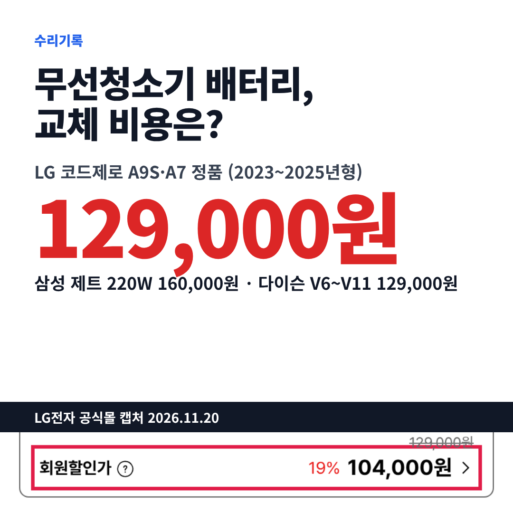

# 무선청소기 배터리 교체 비용은? 정품 제트 16만 원, 코드제로 12만 9천 원

무선청소기 사용 시간이 눈에 띄게 줄었다면 배터리 수명부터 의심해 볼 만합니다.
정품 배터리값은 삼성 BESPOKE 제트 220W용 160,000원, LG 코드제로 A9/A9S용 129,000원(회원할인가 104,000원)입니다.

> 광고·제휴 없이 작성한 글입니다.

이 글은 무선(스틱형)청소기 배터리만 다룹니다.
로봇청소기 배터리는 구조와 가격이 달라 별도 글로 정리합니다.

## 무선청소기 배터리 수명과 교체 주기

LG전자는 코드제로 배터리가 500회 완충·방전 뒤 초기 성능의 약 80% 수준으로 떨어진다고 안내합니다.
교체 권장 주기는 2년입니다.

삼성전자 생활가전 담당자도 삼성 멤버스 안내(2023년 12월)에서 500회 사용 뒤 성능이 20~30% 떨어진다고 설명했습니다.
일주일에 3회 쓰면 약 2년 뒤 그 시점이 온다는 설명입니다.

내 청소기가 정상 범위인지는 완충한 배터리 1개로 사용 시간을 재 보면 알 수 있습니다.

| 모델 | 터보 모드 | 표준 모드 |
|---|---|---|
| LG 코드제로 A9 | 약 6분 | 약 30분 |
| LG 코드제로 A9S | 약 7분 | 약 40분 |

출처: LG전자 고객지원 「배터리 교체 주기와 수명이 짧아지는 원인과 관리방법」(배터리 1개 완충 기준, 2026년 11월 18일 기준)

측정한 시간이 이보다 크게 짧다면 배터리 교체를 검토할 때입니다.

## 충전이 안 될 때 교체 전에 확인할 것

LG전자 고객지원은 코드제로가 충전되지 않을 때 다음을 먼저 확인하도록 안내합니다.

- 충전대에 어댑터와 전원 플러그가 제대로 꽂혀 있는지
- 충전 단자에 먼지나 머리카락 같은 이물질이 있는지(마른 수건이나 부드러운 솔로 제거)
- 청소기가 충전대에 제대로 끼워졌는지
- 추운 곳에서 충전하고 있지 않은지

네 가지를 확인한 뒤에도 사용 시간이 짧다면 배터리 문제일 가능성이 큽니다.

## 무상 교체가 되는 경우

LG전자 요금/보증 안내에서 청소기의 무상 보증 기간은 1년이고 배터리는 소모성 부품으로 분류됩니다.
같은 페이지의 유상 수리 사유에 "소모성 부품 보증기간 경과 및 수명이 다한 경우"가 있어 오래 써서 닳은 배터리는 유상 교체 대상입니다.

"코드제로 배터리 무상 교체"를 찾는 분도 많습니다.
LG전자는 2019년 보도자료에서 코드제로 A9 등 A.R.T 라인업 배터리를 2년간 무상보증하고 이미 구입한 고객에게도 같은 혜택을 준다고 발표했습니다.
요금/보증 안내에는 이 2년 보증이 따로 적혀 있지 않아 지금도 유효한지가 궁금한 대목입니다.

LG전자 고객센터의 2026년 11월 18일 회신에 따르면 코드제로 라인업의 배터리 무상보증 기간은 2년입니다.
보증 기간은 구입일부터 계산합니다.
보증서가 없으면 제조일에 3개월을 더한 날이 기준입니다.

따라서 2019년에 산 제품은 보증 기간이 끝나 유상 교체 대상입니다.
2년 안이라도 정상적으로 쓰다 생긴 성능·기능 하자여야 무상입니다.
수명이 다한 경우, 충격·침수·임의 개조 같은 사용자 과실, 천재지변, 영업용 사용은 무상보증에서 제외됩니다.

모터는 기준이 다릅니다.
A9·A9S·A9X의 인버터모터는 10년을 보증하지만 이름이 비슷한 A9 Air는 해당하지 않으니 모델명을 확인하십시오.

## 정품 배터리 가격

| 모델 | 정품 배터리 (부품번호) | 공식몰 가격 |
|---|---|---|
| 삼성 BESPOKE 제트 220W | DJ96-00242D | 160,000원 |
| LG 코드제로 A9/A9S | EAC63382208 | 129,000원 (회원할인가 104,000원) |

출처: 삼성전자서비스 소모품샵, LG전자 케어 액세서리 상품 페이지(2026년 11월 18일 기준)

LG전자 상품 페이지는 로그인하지 않아도 정상가와 회원할인가를 함께 보여 줍니다.
'자세히 보기'에는 회원할인가가 "로그인하여 주문 시에 적용되는 혜택 가격"이라고 나옵니다.
A9/A9S 배터리에는 회원 전용 할인 6,500원과 추가 할인 18,500원이 붙습니다.

두 할인을 합하면 25,000원입니다.
LG 배터리는 로그인 후 구매하는 편이 유리합니다.

삼성전자서비스 소모품샵은 판매가격 하나만 표시합니다.
220W 배터리 페이지의 KC 인증번호(XU102502-21001)는 다른 판매처에서 '정품'으로 파는 배터리를 가려내는 기준이 됩니다.

비스포크 제트 배터리가 다른 제트 모델과 호환되는지 묻는 분이 많습니다.
배터리는 모델마다 부품번호가 다르므로 상품 페이지의 적용 모델 목록에서 내 청소기 모델명을 확인한 뒤 구매하십시오.
다이슨과 로보락은 공식 판매처의 배터리 가격을 확인할 수 없어 표에서 제외했습니다.

## 리필(셀 교체) 업체를 써도 되나

배터리 껍데기는 그대로 두고 안의 셀만 바꿔 주는 리필 업체가 있습니다.
정품보다 저렴할 수 있지만 리필 배터리는 제조사가 지정한 부품이 아닙니다.

LG전자 요금/보증 안내는 "당사에서 지정하지 않은 부품이나 옵션품으로 발생된 고장의 건"을 유상 수리 사유로 둡니다.
리필 배터리를 쓰다가 본체가 고장 나면 무상 수리를 받기 어려울 수 있다는 점을 감안해야 합니다.

> 주의: 배터리가 부풀었거나 충전 중에 뜨거워지면 즉시 사용을 멈추고 충전기를 분리하십시오. 배터리 팩을 직접 분해해 셀을 교체하는 작업은 하지 마십시오.

## 직접 교체와 센터 교체

배터리 문제가 확실하다면 공식몰에서 사서 직접 끼우는 쪽이 저렴합니다.
LG전자 고객센터 회신에 따르면 보증 기간이 지난 배터리를 센터에서 교체하면 부품비와 수리비(기술료)가 함께 청구됩니다.
보증 기간 안의 무상 교체라면 둘 다 면제됩니다.

출장 수리라면 출장점검료(LG 평일 28,000원)가 더해집니다.
청소기를 서비스센터에 직접 가져가면 출장비는 없습니다.

원인이 배터리인지 분명하지 않을 때는 센터 진단을 먼저 받는 편이 비용을 아낍니다.

## 배터리 교체에 실제로 든 비용

공식몰 가격은 부품값일 뿐이어서 센터에서 교체한 분들의 실제 영수증 금액을 모으고 있습니다.
같은 모델 제보가 5건 모이면 중앙값을, 3~4건이면 최저·최고 금액만 공개합니다.

[배터리 교체 비용 제보하기](site:/submit-repair?product=samsung-bespoke-jet&symptom=sym-3#cta-bottom)

센터에서 배터리를 교체하신 분은 기술료가 얼마였는지 댓글로 남겨 주시면 다음 글에 반영하겠습니다.

## 출처

- LG전자 고객지원 [배터리 교체 주기와 수명이 짧아지는 원인과 관리방법](https://www.lge.co.kr/support/solutions-20150373882418), [충전이 안돼요](https://www.lge.co.kr/support/solutions-20150356416630) (2026년 11월 18일 기준)
- LG전자 [요금/보증 안내](https://www.lge.co.kr/support/rates-warranty-guide) (보증 기간, 소모성 부품, 출장점검료 · 2026년 11월 18일 기준)
- LG전자 [보도자료: 코드제로 A.R.T 배터리 2년 무상보증](https://www.lg.co.kr/media/release/10194) (2019년)
- 삼성 멤버스 [삼성 무선청소기 제트 배터리 수명 관리 방법](https://r1.community.samsung.com/t5/%EC%9C%A0%EC%9A%A9%ED%95%9C-%EA%B0%80%EC%A0%84-%EC%A0%95%EB%B3%B4/%EA%B6%81%EA%B8%88%ED%95%B4%EC%9A%94-%EC%82%BC%EC%84%B1-%EB%AC%B4%EC%84%A0%EC%B2%AD%EC%86%8C%EA%B8%B0-%EC%A0%9C%ED%8A%B8-%EB%B0%B0%ED%84%B0%EB%A6%AC-%EC%88%98%EB%AA%85-%EA%B4%80%EB%A6%AC-%EB%B0%A9%EB%B2%95/ba-p/24839365) (생활가전담당, 2023년 12월)
- LG전자 케어 액세서리 [A9/A9S 배터리](https://www.lge.co.kr/care-accessories/a9-vacuum-cleaner/eac63382208), 삼성전자서비스 소모품샵 [BESPOKE 제트 220W 배터리](https://www.samsungsvc.co.kr/shop/product/0000090680) (2026년 11월 18일 기준)
- 고장도감 [수리비 데이터 방법론 v1.1](site:/methodology#sources)

> 만든 방법: AI 도구로 초안을 쓰고 출처의 숫자·문구를 원문과 자동 대조했습니다. 마지막 대조일은 2026-11-19입니다. AI 사용 범위는 [방법론의 AI 사용 원칙](site:/methodology#ai)에 정리했습니다.

가격은 공식몰 표시 기준이며 실제 센터 청구액과 다를 수 있습니다.

바로잡기: 숫자나 문구가 원문과 다르면 댓글로 알려 주십시오. 원문을 다시 확인해 고치고 수정 이력에 남기겠습니다.

쓴 사람: [[판단: 바이라인 — 실명과 활동명 중 무엇으로, 어떤 소개로 드러낼지 정하기. AI 초안: "고장도감 운영자 ○○. 가전 수리비를 공식 자료와 사용자 제보로 비교해 기록합니다." 정한 문장은 AI가 모든 글에 넣음]]

수정 이력: 2026-11-17 첫 원고 · 2026-11-18 배터리 보증 서술 수정, 회원할인가 표시 조건 수정, 격식체로 문체 정리 · 2026-11-18 무선청소기만 다루도록 범위를 좁히고(로봇청소기 배터리는 별도 글로 이동) 수명·교체 전 점검·무상 교체·리필 항목 추가, 제목 교체
