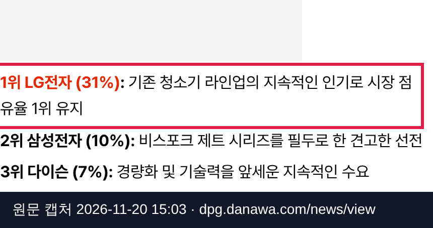
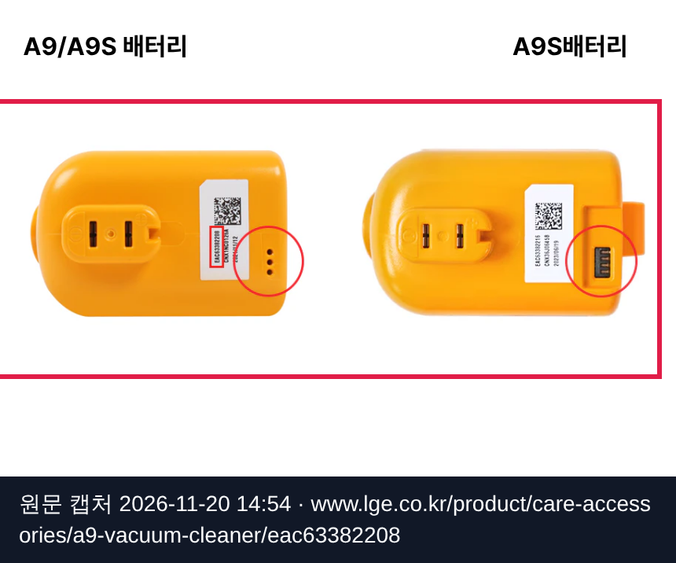
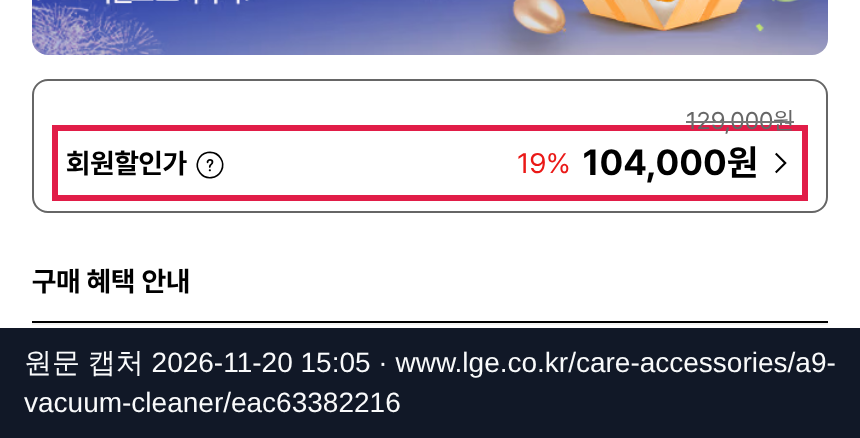

# 무선청소기 배터리 교체 비용은? LG·다이슨 12만 9천 원, 삼성 16만 원

정품 배터리값은 LG 코드제로 A9S·A7용이 12만 9천 원(회원할인가 104,000원), 삼성 비스포크 제트 220W용이 16만 원입니다.
다이슨 V6~V11 배터리는 공식몰 표시가 12만 9천 원이었지만 확인 시점에 모두 품절이었습니다.
같은 브랜드 안에서도 출시 연도마다 배터리 번호가 달라 내 모델부터 확인해야 합니다.

> 협찬·제휴 없이 작성한 글입니다.

이 글은 무선(스틱형)청소기 배터리만 다룹니다.
로봇청소기 배터리는 구조와 가격이 달라 별도 글로 정리합니다.

## 요즘 가장 많이 팔리는 무선청소기는 무엇입니까?

가격비교 사이트 다나와의 2026년 상반기(1~6월 판매량) 집계에서 제조사 판매 비중은 LG전자 31%, 삼성전자 10%, 다이슨 7%, 캐치웰 5%, 샤크닌자 4% 순입니다.
2025년 한 해 집계(거래액·판매량 가중평균)도 LG전자 35.4%, 삼성전자 13.4%, 다이슨 6.0%로 순서가 같습니다.

| 판매 순위 | 모델 | 출시 · 가격 · 성능 |
|---|---|---|
| 1·4위 | LG 코드제로 A9S 올인원타워 (AX920BWE·AX958BWE) | 2024년 출시 · 출시가 1,165,000원(AX920BWE) · 280W · 표준 30분 |
| 2위 | LG 코드제로 A7 Core (A720WA) | 2025년 3월 출시 · 할인 전 900,000원 · 220W |
| 3위 | LG 코드제로 A5 (AS520WA) | 2025년 2월 출시 · 할인 전 650,000원 · 150W · 표준 최대 40분 |
| 5위 | 샤오미 미홀 M22 | 2023년 1월 다나와 등록 · 10만 원대 · 22,000Pa |
| 2025년 7위 | 삼성 비스포크 제트 (VS20B956AXE) | 220W · 최대 1시간 |
| 브랜드 3위 | 다이슨 V8 싸이클론 | 2025년 8월 다나와 등록 · 영국 정가 £349.99 · 최대 1시간 |

출처: 다나와 「2026 상반기 무선청소기 TOP 5」(2026년 7월 27일 발행), 다나와 「2025 BEST 무선청소기 어워즈」, 다나와 상품 정보, LG전자 상품 페이지, TechRadar(2026년 11월 20일 기준)

1위와 4위는 본체가 같은 A9S이고 4위 구성에는 스팀 물걸레가 더 들어 있습니다.
상반기 상위 5개에 삼성 모델이 없어 2025년 연간 7위인 비스포크 제트를 함께 넣었습니다.
다이슨은 상위 5개에 든 모델이 없어 배터리 검색이 가장 많은 V8 계열의 최신형으로 대신했습니다.

해외 시장에서 공개된 순위는 브랜드 단위입니다.
그중 샤크닌자 2025년 연차보고서는 Circana 집계를 인용해 "Shark is the #1 vacuum brand in the United States in dollar sales"라고 적었습니다(미국, 금액 기준, 유선·무선 포함).

흡입력 단위도 제각각이어서 LG·삼성은 W, 미홀은 Pa입니다.
단위가 달라 서로 직접 비교할 수 없으니 같은 브랜드 안에서만 견주십시오.

## 내 청소기 배터리 번호와 정품값은 얼마입니까?

| 모델 | 정품 배터리 번호 · 용량 | 정품값 |
|---|---|---|
| LG 코드제로 A9S 2023~2025년 출시(AX920BWE 등)·A7 | EAC63382216(또는 EAC63382214) · 25.2V · 2,400mAh | 129,000원(회원할인가 104,000원) |
| LG 코드제로 A9·A9S 2019~2022년 출시 | EAC63382208(또는 EAC63382212) · 2,300mAh | 129,000원(회원할인가 104,000원) |
| LG 코드제로 A5 | COV30090401 · 18.5V | 111,000원(회원할인가 105,400원) |
| 삼성 비스포크 제트 220W(VS20B956AXE 등) | DJ96-00242D · 2200 mAh | 160,000원 |
| 삼성 제트 구형 | DJ96-00221A · 21.9V · 2850mAh | 150,000원(재입고 알림) |
| 삼성 비스포크 AI 제트 Lite 280W·400W | 소모품샵 목록에 없음 · 25.2V | 서비스센터 문의 |
| 다이슨 V6·V7·V8 Slim·V10·V11 | V10 969352-02, V11 970145-04 등 | 129,000원(품절 표시) |

출처: LG전자 케어 액세서리·상품 페이지, LG전자 호주·캐나다 공식 페이지(용량), 삼성전자서비스 소모품샵, 삼성전자 제품 사양(2026년 11월 20일 기준). 다이슨 값은 한 블로그가 2026년 8월 6일 다이슨 공식몰에서 보고 기록한 값입니다.

LG는 출시 연도로 배터리를 나눕니다.
상품 페이지 안내는 "2023년 출시 A9S 제품은 2023년 출시 배터리 사용 가능합니다"입니다.
2019~2022년 출시 A9·A9S는 옛 배터리와 2023년 배터리를 모두 쓸 수 있습니다.

판매 1위 AX920BWE는 2024년 모델이라 EAC63382216을 사야 합니다.
LG 안내는 2023년 이후 A9S에 2023년 배터리만 적고 있어 옛 배터리(EAC63382208)는 맞지 않을 수 있습니다.

EAC63382216 상품 페이지의 사용 가능 모델은 164개, 2019~2022년용 EAC63382208은 263개입니다.
배터리를 빼면 본체 안쪽 라벨에 모델명이 적혀 있으니 목록과 맞춰 보십시오.
LG 상품 페이지 사진을 보면 충전 단자 모양도 다릅니다.
2019~2022년용(EAC63382208)은 동그란 단자 3개, 2023년 이후 A9S용(EAC63382216)은 사각 단자 안에 홈 4개입니다.

LG 상품 페이지는 로그인하지 않아도 정상가와 회원할인가를 함께 보여 줍니다.
'자세히 보기'의 설명은 "로그인하여 주문 시에 적용되는 혜택 가격"입니다.
회원 전용 할인 6,500원과 추가 할인 18,500원이 붙으므로 로그인 후 사는 편이 유리합니다.

삼성 220W 배터리 페이지의 '상품적용모델' 목록에는 다나와 2025년 7위 VS20B956AXE가 들어 있습니다.
다른 판매처의 '정품'은 이 페이지의 KC 인증번호(XU102502-21001)와 같은지 비교하면 가려낼 수 있습니다.

삼성 비스포크 AI 제트(280W·400W) 배터리는 소모품샵 배터리 9종의 적용 모델 목록에 없습니다.
이 모델은 서비스센터에 배터리 재고와 값을 먼저 물어보십시오.

## 배터리는 몇 번 충전하면 수명이 다합니까?

LG전자는 코드제로 배터리가 500회 완충·방전 뒤 초기 성능의 약 80%로 떨어진다고 안내합니다.
같은 문서는 교체 권장 주기를 2년으로 적었습니다.
다른 LG 고객지원 문서는 "기간에 따른 권장 교체 주기는 별도로 지정되어 있지 않습니다"라고 해 기간보다 사용 시간으로 판단하는 편이 맞습니다.

삼성 생활가전 담당자는 삼성 멤버스(2023년 12월)에서 500 Cycle 사용 뒤 성능이 20~30% 떨어진다고 설명했습니다.
일주일에 3회 쓰면 약 2년 뒤 그 시점이 온다는 설명입니다.

삼성 220W 배터리 페이지의 "최대 5년"에는 조건이 붙어 있습니다.
조건은 "5년 사용은 100회/년 완전 충방전 기준"이고 그때 성능은 초기 대비 70%입니다.
매일 한 번씩 충전하면 1년에 365회이므로 5년보다 훨씬 일찍 교체 시점이 옵니다.

다이슨은 2018년 V10을 내놓으며 배터리가 800회 충전을 견딘다고 밝혔습니다(TechRadar 보도).
다만 보증 제외 항목에 "배터리 수명 또는 사용으로 인한 배터리 방전 시간의 감소"를 넣었습니다.

내 청소기가 정상인지는 완충한 배터리 1개로 사용 시간을 재 보면 알 수 있습니다.

| 모델 | 표준(일반) 모드 | 가장 센 모드 |
|---|---|---|
| LG A9S 2024년형(AX920BWE) | 30분 | 터보 6분 |
| LG A9 2019~2022년형 | 약 30분 | 터보 약 6분 |
| LG A9S 2019~2022년형 | 약 40분 | 터보 약 7분 |
| LG A5 | 최대 40분 | — |
| 삼성 비스포크 제트 220W | 최대 60분 | 제트 3분 |
| 다이슨 V8(2021년 등록 모델) | 최대 40분 | — |
| 다이슨 V8 싸이클론 | 최대 1시간 | — |

출처: LG전자 상품 페이지·고객지원 「배터리 교체 주기」, 삼성전자서비스 소모품샵, 다나와 상품 정보(배터리 1개 기준, 2026년 11월 20일 기준)

측정한 시간이 표보다 크게 짧다면 배터리 교체를 검토할 때입니다.
2024년형 A9S를 옛 A9S 기준(표준 약 40분)과 견주면 멀쩡한 배터리를 닳았다고 오해할 수 있으니 연식을 먼저 확인하십시오.

## 배터리를 오래 쓰려면 어떻게 해야 합니까?

첫째는 온도입니다.
다이슨 V11 설명서는 18°C~28°C 보관을 권하고 작동·충전은 10°C~30°C에서 하라고 적습니다.
60°C 이상의 온도에 노출하면 폭발할 수 있다고 경고합니다.

삼성은 배터리를 실내(0~40도씨)에서 보관하라고 안내합니다.
겨울철 베란다처럼 춥거나 한여름 직사광선이 드는 곳은 두 기준을 모두 벗어날 수 있습니다.

둘째는 센 모드를 덜 쓰는 것입니다.
삼성 220W 배터리는 일반 모드 60분, 제트 모드 3분이라 제트 모드에서는 배터리를 20배 빨리 씁니다.
다이슨 설명서도 "최적의 배터리 성능과 수명을 유지하려면 일반 모드 또는 중간/자동 모드를 사용하십시오"라고 적습니다.
바닥 청소는 표준 모드로 하고 센 모드는 카펫 같은 곳에만 쓰십시오.

셋째, 충전기를 꽂아 둘지는 제조사 지침이 서로 다릅니다.
LG는 "충전 거치대의 어댑터를 항상 꽂아둔 채로 관리해 주세요"라고 안내합니다.
삼성 담당자는 오래 쓰지 않을 때 "콘센트를 빼고 보관하시는 것이 배터리 수명에 유리해요"라고 했습니다.
다이슨 V11 설명서는 배터리 수명을 늘리려면 "방전 후 바로 충전하지 마십시오"라고 적습니다.
다이슨 해외 안내는 한 달에 한 번 완전히 방전하라고도 권합니다(TechRadar 인용).
회사마다 지침이 다르므로 내 제품 제조사 지침을 따르십시오.

넷째는 필터 청소입니다.
다이슨 프리미엄 센터 엔지니어는 "필터만 주기적으로 청소해도 흡입력과 배터리 수명을 오랫동안 유지할 수 있다"고 설명했습니다.

## 배터리 문제인지 다른 고장인지 어떻게 구분합니까?

배터리를 사기 전에 막힘부터 확인하십시오.
삼성전자서비스는 "먼지통과 필터, 연장관, 브러시에 이물질이 쌓이면 사용 중 전원이 꺼질 수 있습니다"라고 안내합니다.
다이슨 설명서도 "막힘 제거는 보증 사항에서 제외됩니다"라고 적어 막힘을 배터리 불량으로 착각하면 비용만 듭니다.

방이 추워도 멈출 수 있습니다.
다이슨 V16 설명서는 "실내 온도가 5°C(41°F) 이하인 경우, 청소기를 작동하거나 충전할 수 없습니다"라고 적습니다.
다이슨 V10은 표시등으로 배터리 결함을 알리고 이때는 "배터리 결함-다이슨 헬프라인으로 전화 문의"라고 안내합니다.

충전이 안 될 때는 LG전자 고객지원이 다음을 먼저 보라고 안내합니다.

- 충전대에 어댑터와 전원 플러그가 제대로 꽂혀 있는지
- 충전 단자에 먼지나 머리카락 같은 이물질이 있는지(마른 수건이나 부드러운 솔로 제거)
- 청소기가 충전대에 제대로 끼워졌는지
- 추운 곳에서 충전하고 있지 않은지

이것을 확인한 뒤 완충해도 사용 시간이 위 표보다 크게 짧다면 배터리 문제일 가능성이 큽니다.

## 무상 교체는 언제 됩니까?

LG전자 요금/보증 안내에서 청소기 무상 보증 기간은 1년이고 배터리는 소모성 부품입니다.
같은 페이지의 유상 수리 사유에 "소모성 부품 보증기간 경과 및 수명이 다한 경우"가 있습니다.

코드제로 배터리는 이 1년과 별개로 2년 보증이 있습니다.
LG전자는 2019년 보도자료에서 코드제로 A9 등 A.R.T 라인업 배터리를 2년간 무상보증하고 기존 구매 고객에게도 같은 혜택을 준다고 발표했습니다.
LG전자 고객센터의 2026년 11월 18일 회신에서도 코드제로 라인업 배터리 무상보증 기간은 2년입니다.

보증 기간은 구입일부터 계산하고 보증서가 없으면 제조일에 3개월을 더한 날이 기준입니다.
2019년에 산 제품은 보증이 끝나 유상 교체 대상입니다.
2년 안이라도 수명이 다한 경우, 충격·침수·임의 개조 같은 사용자 과실, 천재지변, 영업용 사용은 제외됩니다.

A9·A9S·A9X의 인버터모터는 10년을 보증합니다.
이름이 비슷한 A9 Air는 해당하지 않으니 모델명을 확인하십시오.

2023년 소비자가만드는신문 조사에서도 배터리 보증기간은 삼성전자와 LG전자가 2년이었습니다.
다만 삼성은 보증 기간 안이라도 닳은 배터리를 무상으로 바꿔 주기 어렵다는 입장이고 아래 사례에서 관계자가 그렇게 답했습니다.

다이슨 보증은 2년이지만 위에서 본 것처럼 배터리 수명에 따른 사용 시간 감소는 빠집니다.
설명서에는 "이 보증은 제품을 구입한 국가에서 사용할 때만 유효합니다"라는 문구도 있어 해외 직구품은 국내 보증을 기대하기 어렵습니다.
2019년 보도에서 다이슨은 직구품 AS 접수는 받지 않지만 "청소기 배터리 구매는 가능하다"고 했습니다.
샤크닌자 공식몰도 무선청소기 무상 수리에서 "배터리, 필터, 칼날 등 소모품 및 액세서리는 제외됩니다"라고 적습니다.

## 브랜드별 AS는 어디로 가고 비용은 얼마입니까?

| 브랜드 | 접수처 | 출장비·기간 |
|---|---|---|
| 삼성 | 서비스센터 169개 | 출장비 28,000원(평절기 기본), 성수기 33,000원 |
| LG | 서비스센터 120개 | 출장점검료 28,000원, 센터에 가져가면 출장비 없음 |
| 다이슨 | 서비스센터 52개 | 평균 처리 1.6일, 72시간 안에 못 고치면 대체품 대여(회사 발표) |
| 샤오미 | AS 센터 16개(직영·외주) | "부품 공급 차질" 보도(2026년 1월) |
| 드리미 | 롯데하이마트 310여 개 접점, 공식 센터 57개 | 스틱청소기 포함 접수 |
| 샤크닌자 | 고객센터 1644-9245·카카오톡 | 무상 수리 기본 1년, 공식몰 구매·등록 시 최대 3년 |

출처: SR타임스(삼성·LG 센터 수), 삼성전자서비스 서비스요금, LG전자 요금/보증 안내, 세계일보 2026년 6월 27일(다이슨), 아시아경제 2026년 1월 29일(샤오미), ZDNet Korea 2025년 12월 15일(드리미), 샤크닌자 공식몰(2026년 11월 20일 기준)

다이슨 프리미엄 센터 방문기(ZDNet Korea)에 따르면 접수 뒤 약 10분 동안 바로 점검하고 부품이 있으면 당일 수리합니다.
고장이 아닌 소모품 교체는 고객이 비용을 냅니다.

스틱청소기는 들고 갈 수 있으므로 센터에 직접 가져가면 출장비를 아낍니다.
LG전자 고객센터 회신도 "청소기를 서비스센터로 직접 가져가면 출장비는 없음"이었습니다.

보증 기간이 지난 배터리를 센터에서 바꾸면 부품비와 수리비(기술료)가 함께 청구됩니다.
배터리가 원인인지 분명하지 않을 때만 센터 진단을 받고 확실하면 정품을 사서 직접 끼우는 편이 쌉니다.

## 서비스센터를 써 본 사람들은 어땠습니까?

삼성 제트를 산 지 2년 2개월 된 사용자가 김포 삼성서비스센터에서 새 배터리를 사라는 안내를 받은 일이 2023년 보도됐습니다.
삼성전자서비스 관계자는 "보증기간이 2년 이내라 하더라도 배터리 자체의 불량이 아닌 이상 사용 기간으로 인한 무상교체는 어렵다"고 답했습니다.

다이슨은 2023년 1~10월 1372소비자상담센터 불만이 864건으로 1년 전보다 66.8% 늘었습니다.
그중 청소기가 181건이었고 "급격한 배터리 소모에 따른 짧은 작동 시간" 불만이 주를 이뤘습니다(한국소비자연맹 집계).

다이슨은 2026년 현재 서비스센터 52개를 운영하고 평균 AS 처리 시간이 1.6일이라고 발표했습니다.

배터리 재고도 문제입니다.
2023년 소비자고발센터에 들어온 무선청소기 불만 30여 건에는 "배터리 재고 부족으로 교체 지연"이 있었습니다.
2026년 1월에는 샤크닌자 무선청소기 사용자가 부품 재고가 없어 "언제 수급될 지 알 수 없어 기다려봐야 한다"는 답을 들은 사례가 보도됐습니다.

한국소비자원 피해구제 접수에서도 청소기는 불만이 많은 품목입니다.
2026년 6월 보도 기준 전기진공청소기가 138건이었습니다.

## 직접 교체·호환 배터리·리필 중 무엇이 낫습니까?

LG 코드제로 배터리는 A5 상품 페이지 표현대로 "슬라이드 방식으로 탈착"해 공구 없이 바꿉니다.
삼성 제트 배터리도 소모품샵에서 소비자에게 단품으로 팝니다.
기존 다이슨 V8은 배터리가 나사로 고정돼 있습니다.
수리 안내 사이트 iFixit은 V8 배터리 교체를 난이도 Easy, 2~5분, 십자드라이버 Phillips #0으로 안내합니다.
2025년에 나온 V8 싸이클론부터는 V8 계열도 배터리를 빼서 바꾸는 교체형이 됐습니다.

다나와에서 호환 배터리 최저가는 다이슨 V8용 36,900원, LG 코드제로 A9용 60,610원이었습니다(2026년 11월 20일).
다만 다나와는 호환 배터리의 KC 번호를 "판매 사이트 문의"로만 보여 줍니다.
호환 배터리는 보증에서도 불리합니다.
LG전자는 "당사에서 지정하지 않은 부품이나 옵션품으로 발생된 고장의 건"을 유상 수리 사유로 둡니다.
다이슨 V11 설명서는 정품 배터리(부품 번호 355983)만 쓰라고 하고 "다이슨이나 다이슨 공식 대리점 이외의 당사자가 실시한 수리나 개조"를 보증에서 뺍니다.
다이슨 V16은 비정품 배터리를 끼우면 "다이슨 정품이 아닌 배터리가 감지되었습니다"라는 경고를 띄웁니다.

리필은 배터리 껍데기는 두고 안의 셀만 바꾸는 방식입니다.
삼성 배터리 페이지는 "분해하지 마시고 가까운 서비스센터에 문의하세요"라고 적어 팩 분해를 권하지 않습니다.

호환·리필품을 고른다면 KC 안전확인 번호(XU로 시작)가 있는지부터 보십시오.
번호는 제품안전정보센터(safetykorea.kr)의 인증정보 검색에서 조회할 수 있습니다.

> 주의: 배터리가 부풀었거나 충전 중에 뜨거워지면 즉시 사용을 멈추고 충전기를 분리하십시오. 배터리 팩을 직접 분해해 셀을 교체하는 작업은 하지 마십시오.

## 다 쓴 배터리는 어디에 버립니까?

LG전자는 2026년 10월 1일부터 11월 30일까지 '배터리턴' 캠페인을 엽니다.
제조사와 관계없이 쓰던 무선청소기 폐배터리를 LG전자 서비스센터에 반납할 수 있습니다.
반납한 뒤 A9·A9S·A7 정품 배터리를 사면 30,000원을 깎아 최종 혜택가는 99,000원입니다.
제품별로 1인당 최대 3개까지이고 수량이 한정돼 있습니다.

캠페인이 끝난 뒤에는 동주민센터나 아파트의 전용 수거함에 넣으십시오.
서울시 안내는 "다시 충전하지 않고 가능한 방전이 된 상태로 배출"하고 단자가 드러나 있으면 절연테이프로 감싸라고 합니다.

## 배터리 교체에 실제로 든 비용

공식몰 가격은 부품값이어서 센터에서 교체한 분들의 실제 영수증 금액을 모으고 있습니다.
같은 모델 제보가 5건 모이면 중앙값을, 3~4건이면 최저·최고 금액만 공개합니다.

[배터리 교체 비용 제보하기](site:/submit-repair?product=samsung-bespoke-jet&symptom=sym-3#cta-bottom)

센터에서 배터리를 바꾸신 분은 기술료가 얼마였는지 댓글로 남겨 주시면 다음 글에 반영하겠습니다.

## 출처

- 다나와 [2026 상반기 무선청소기 TOP 5](https://dpg.danawa.com/news/view?boardSeq=63&listSeq=6039621)(2026년 7월 27일), [기획전](https://plan.danawa.com/info/?nPlanSeq=12744), [2025 BEST 무선청소기 어워즈](https://plan.danawa.com/info/?nPlanSeq=11980), 상품 정보 [AX920BWE](https://prod.danawa.com/info/?pcode=49742069)·[미홀 M22](https://prod.danawa.com/info/?pcode=18868094)
- LG전자 상품 페이지 [AX920BWE](https://www.lge.co.kr/product/vacuum-cleaners/ax920bwe)·[A720WA](https://www.lge.co.kr/product/vacuum-cleaners/a720wa)·[AS520WA](https://www.lge.co.kr/product/vacuum-cleaners/as520wa), 케어 액세서리 [EAC63382216](https://www.lge.co.kr/care-accessories/a9-vacuum-cleaner/eac63382216)·[EAC63382208](https://www.lge.co.kr/care-accessories/a9-vacuum-cleaner/eac63382208)
- LG전자 고객지원 [배터리 교체 주기와 수명이 짧아지는 원인과 관리방법](https://www.lge.co.kr/support/solutions-20150373882418), [충전이 안돼요](https://www.lge.co.kr/support/solutions-20150356416630), [요금/보증 안내](https://www.lge.co.kr/support/rates-warranty-guide)
- LG전자 보도자료 [코드제로 A.R.T 배터리 2년 무상보증](https://www.lg.co.kr/media/release/10194)(2019년), [배터리턴 캠페인](https://www.lg.co.kr/media/release/30631)(2026년 10월 2일)
- 삼성전자서비스 소모품샵 [BESPOKE 제트 220W 배터리](https://www.samsungsvc.co.kr/shop/product/0000090680)·[제트 배터리](https://www.samsungsvc.co.kr/shop/product/0000013334), [무선청소기 전원 꺼짐](https://www.samsungsvc.co.kr/solution/40903), [서비스요금 산정기준](https://www.samsungsvc.co.kr/info/fee)
- 삼성 멤버스 [삼성 무선청소기 제트 배터리 수명 관리 방법](https://community.samsung.com/kr/conversations/%EC%9C%A0%EC%9A%A9%ED%95%9C-%EA%B0%80%EC%A0%84-%EC%A0%95%EB%B3%B4/%EA%B6%81%EA%B8%88%ED%95%B4%EC%9A%94-%EC%82%BC%EC%84%B1-%EB%AC%B4%EC%84%A0%EC%B2%AD%EC%86%8C%EA%B8%B0-%EC%A0%9C%ED%8A%B8-%EB%B0%B0%ED%84%B0%EB%A6%AC-%EC%88%98%EB%AA%85-%EA%B4%80%EB%A6%AC-%EB%B0%A9%EB%B2%95/r1_24839365)(생활가전담당, 2023년 12월)
- 다이슨 한국어 사용자 설명서 [V11](https://www.dyson.co.uk/content/dam/dyson/maintenance/user-guides/ko-kr/%EB%8B%A4%EC%9D%B4%EC%8A%A8%20V11%EC%82%AC%EC%9A%A9%EC%9E%90%20%EC%84%A4%EB%AA%85%EC%84%9C.pdf)·[N692B](https://www.dyson.co.uk/content/dam/dyson/maintenance/user-guides/kr_kr/cordless-vacuums/sticks/N692B_OUG.pdf)
- 다이슨 한국어 사용자 설명서 [V10](https://www.dyson.co.uk/content/dam/dyson/maintenance/user-guides/kr_kr/cordless-vacuums/sticks/SV12_ABSOLUTE_UG_FEAST.pdf)·[V12s](https://www.dyson.co.uk/content/dam/dyson/maintenance/user-guides/kr_kr/cordless-vacuums/sticks/DYS_P231478_J0004_T01_VX-165653_N620H-CN_2022_OUG_Master_ko-KR_Digital_1_0_0%20(1).pdf), V8 싸이클론 [영문 설명서](https://www.dyson.co.uk/content/dam/dyson/maintenance/user-guides/hk_hk/vacuums/Dyson_V8-Cyclone_SV55_User%20Manual_EN.pdf), 다나와 [V8 싸이클론](https://prod.danawa.com/info/?pcode=96774743)·[V8](https://prod.danawa.com/info/?pcode=21760133)
- 다이슨 배터리 가격 기록 [블로그](https://earn-on-everything.com/entry/%EB%8B%A4%EC%9D%B4%EC%8A%A8-%EC%B2%AD%EC%86%8C%EA%B8%B0-v6-v7-v8-v10-%EB%B0%B0%ED%84%B0%EB%A6%AC-%EC%85%80%ED%94%84-%EA%B5%90%EC%B2%B4-%EB%B0%A9%EB%B2%95-%EA%B5%AC%EB%A7%A4-%EB%B0%A9%EB%B2%95/)(2026년 8월 6일 확인), TechRadar [V8 Cyclone](https://www.techradar.com/home/vacuums/dyson-just-released-the-vacuum-we-actually-wanted-an-upgraded-v8-that-costs-basically-the-same-as-the-original)·[배터리 관리](https://www.techradar.com/home/vacuums/how-to-preserve-your-dyson-vacuum-battery)·[V10 배터리](https://www.techradar.com/news/james-dyson-promises-15-year-battery-life-for-the-cyclone-v10-cordless-vacuum), ZDNet Korea [다이슨 프리미엄 센터](https://zdnet.co.kr/view/?no=20250609135532)(2025년 6월 9일)·[직구품 AS](https://zdnet.co.kr/view/?no=20191113154413)(2019년 11월 13일)
- LG전자 [배터리턴 기획전](https://www.lge.co.kr/benefits/exhibitions/detail-PE01017005), [교체 주기 안내](https://www.lge.co.kr/support/solutions-20150332172261), LG 해외 공식 [EAC63382216](https://www.lg.com/au/vacuum-cleaners/vacuum-cleaner-accessories/eac63382216/)·[EAC63382208](https://www.lg.com/ca_en/care-accessories/vacuum-cleaners/battery-adapter-charger/eac63382208/), 삼성전자 [AI 제트 Lite 사양](https://www.samsung.com/sec/support/model/VS28D950AIW/)·[AI 제트 400W 사양](https://www.samsung.com/sec/support/model/VS90F40CSK/), 삼성전자서비스 [배터리 목록](https://www.samsungsvc.co.kr/shop/product?category=10424&directory=10770)
- 다나와 호환 배터리 [다이슨 V8용](https://prod.danawa.com/info/?pcode=14014652)·[LG A9용](https://prod.danawa.com/info/?pcode=116353126), 소비자가만드는신문 [2023년 9월 26일](https://www.consumernews.co.kr/news/articleView.html?idxno=689058)·[2026년 1월 18일](https://www.consumernews.co.kr/news/articleView.html?idxno=747459)
- 샤크닌자 [2025년 연차보고서](https://s202.q4cdn.com/977000893/files/doc_financials/2025/ar/SN-2025-Annual-Report.pdf), [공식몰](https://www.sharkninja.co.kr/), iFixit [Dyson V8 Animal Battery Replacement](https://www.ifixit.com/Guide/Dyson+V8+Animal+Battery+Replacement/130540)
- 보도 [SR타임스](https://www.srtimes.kr/news/articleView.html?idxno=180168), [세계일보](https://www.segye.com/newsView/20260626513467)(2026년 6월 27일), [아시아경제](https://view.asiae.co.kr/article/2026012914485055863)(2026년 1월 29일), [ZDNet Korea](https://zdnet.co.kr/view/?no=20251215083853)(2025년 12월 15일), [세이프타임즈](https://www.safetimes.co.kr/news/articleView.html?idxno=201324)(2023년 2월 15일), [연합뉴스](https://v.daum.net/v/20231115144117456)(2023년 11월 15일)
- 서울시 [2차 전지 배출 안내](https://news.seoul.go.kr/env/archives/565185)
- 수리기록 [수리비 데이터 방법론 v1.1](site:/methodology#sources)

> 만든 방법: AI 도구로 초안을 쓰고 출처의 숫자·문구를 원문과 자동 대조했습니다. 마지막 대조일은 2026-11-20입니다. AI 사용 범위는 [방법론의 AI 사용 원칙](site:/methodology#ai)에 정리했습니다.

가격은 공식몰 표시 기준이며 실제 센터 청구액과 다를 수 있습니다.

바로잡기: 숫자나 문구가 원문과 다르면 댓글로 알려 주십시오. 원문을 다시 확인해 고치고 수정 이력에 남기겠습니다.

쓴 사람: 경기도 핸디맨의 수리기록. 집수리를 하면서 가전, 가구 수리·교체·시공 비용·방법을 공식 자료, 사용자 제보 등을 비교해 기록해두고 있습니다.

수정 이력: 2026-11-17 첫 원고 · 2026-11-18 배터리 보증 서술 수정, 회원할인가 표시 조건 수정, 격식체로 문체 정리 · 2026-11-18 무선청소기만 다루도록 범위를 좁히고 수명·교체 전 점검·무상 교체·리필 항목 추가 · 2026-11-20 판매 상위 브랜드·모델 전체로 범위를 넓히고(다나와 판매 순위, 모델별 배터리 번호·정품값, 오래 쓰는 법, 브랜드별 AS, 교체·리필 경험) LG 배터리 번호를 출시 연도별로 바로잡음
