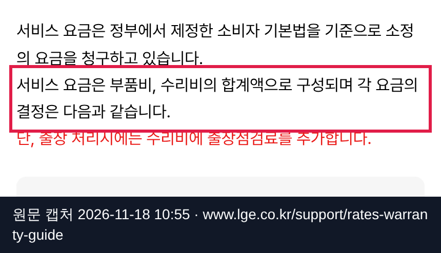

# LG전자 출장비 28,000원, 저녁·주말엔 33,000원 (2026.11)

LG전자 출장점검료는 평일 낮이면 28,000원이에요. 평일 18시 이후나 주말·공휴일엔 33,000원, 여름 성수기(6~8월)엔 기본 33,000원에 저녁·주말·공휴일 38,000원이에요. 같은 수리라도 예약 시간에 따라 최대 10,000원이 달라져요.

LG전자 요금/보증 안내 페이지를 2026년 11월 18일에 열어 금액과 문구를 한 줄씩 맞춰 봤어요. 광고나 제휴는 없어요.

| 예약 시간 | 출장점검료 |
|---|---|
| 평일 18시 전 | 28,000원 |
| 평일 18시 이후, 주말·공휴일 | 33,000원 |
| 6~8월 평일 18시 전 | 33,000원 |
| 6~8월 평일 18시 이후, 주말·공휴일 | 38,000원 |

출처: LG전자 요금/보증 안내 "4) 출장비(출장점검료)" 항목(2026-11-18 확인, 아래 캡처).

퇴근 후(18시 이후)로 잡으면 5,000원이 더 붙어요. 거리는 상관없어요. "거리에 상관없이 동일하게" 청구한다고 적혀 있어서, 집이 센터에서 멀어도 금액은 같아요.

## 고치지 않아도 출장비를 내나요?

[[직접 확인: LG전자 고객센터에 "무상 보증 기간 안에 출장 점검만 받으면 출장점검료가 나오나요?"를 물어 답을 이 자리 첫 문장으로 쓰기 — 예: "무상 보증 기간에는 ○○예요(○월 ○일 고객센터 답변)." 날짜 포함]]

LG 안내 문구는 출장점검료가 "제품 수리 여부와 상관없이 출장을 요구하는 유상 수리의 경우에 적용됩니다"예요. 기사가 와서 점검만 하고 고치지 않아도, 유상 건이면 출장비는 나와요.

## 견적서는 세 칸으로 나눠 받으세요

LG는 서비스 요금을 부품비와 수리비의 합으로 계산하고, 출장으로 처리하면 출장점검료를 얹어요. 수리비는 "수리 난이도 (시간) 에 따른 순수 기술료"로 정의돼 있어요. 총액 한 줄로만 적힌 견적이라면 세 칸으로 나눠 달라고 하세요.

| 견적서 항목 | 확인할 것 |
|---|---|
| 부품비 | 부품 단가가 LG 공식몰 가격과 같은지 |
| 수리비(기술료) | 작업이 얼마나 걸렸는지 |
| 출장점검료 | 예약한 시간대 요금이 맞게 붙었는지 |

[[직접 확인: 같은 통화에서 "청소기처럼 들고 갈 수 있는 제품을 서비스센터에 직접 가져가면 출장점검료가 없나요?"도 물어 답을 한두 문장으로 적기]]

## 삼성전자서비스는 왜 빠졌나

삼성전자서비스 출장비도 나란히 놓고 싶었어요. 그런데 공식 페이지에 적용 시점이 없는 요금표가 두 개 함께 있어서, 어느 쪽이 지금 요금인지 확인하지 못했어요. 확인되면 이 글에 덧붙이고 이력에 남길게요.

## 받은 견적이 있다면

출장비는 정해져 있어도 부품비와 기술료는 고장마다 달라요. 받은 견적이나 영수증 금액을 보내 주시면, 같은 모델·증상으로 5건이 쌓였을 때 중앙값으로 정리해 공개해요. [LG 가전 수리비 제보하기](site:/submit-repair#cta-bottom)

출장 수리를 받아 본 분은 견적서에 출장비가 따로 적혀 있었는지 댓글로 남겨 주세요.

## 출처

- LG전자 [요금/보증 안내](https://www.lge.co.kr/support/rates-warranty-guide) (출장비, 서비스 요금 산정 기준 · 2026-11-18 확인)
- 고장도감 [수리비 데이터 방법론 v1.1](site:/methodology#sources)

만든 방법: AI 도구로 초안을 쓰고 출처 문구·숫자를 원문과 자동 대조했습니다. 편집자가 [[직접 확인: 원문과 캡처를 직접 다시 확인한 날짜(YYYY-MM-DD)]]에 원문과 캡처를 다시 확인했습니다. AI를 어디까지 쓰는지는 [방법론의 AI 사용 원칙](site:/methodology#ai)에 적어 두었습니다.

요금은 LG 공식 안내 기준이고, 실제 청구액은 센터 판단과 제품 상태에 따라 달라요. 원문과 다른 숫자나 문구가 보이면 짚어 주세요. 다시 대조해서 고치고 기록할게요.

쓴 사람: [[직접 확인: 이름 또는 활동명과 한 줄 소개(무슨 일을 하는 사람이고 왜 이 기록을 하는지). 모든 글에 같은 문장을 씀]]

수정 이력: 2026-11-17 첫 원고 · 2026-11-18 원문 재대조 — 출처를 LG 요금/보증 안내 한 곳으로 정리(서비스센터 방문 예약 안내 페이지는 화면에 금액이 보이지 않아 뺌), 출장점검료 적용 범위를 원문 문구 그대로 인용 · 2026-11-18 독립 검토 반영 — 문체를 해요체로 통일, 견적서 확인 항목 수정, 썸네일 교체
