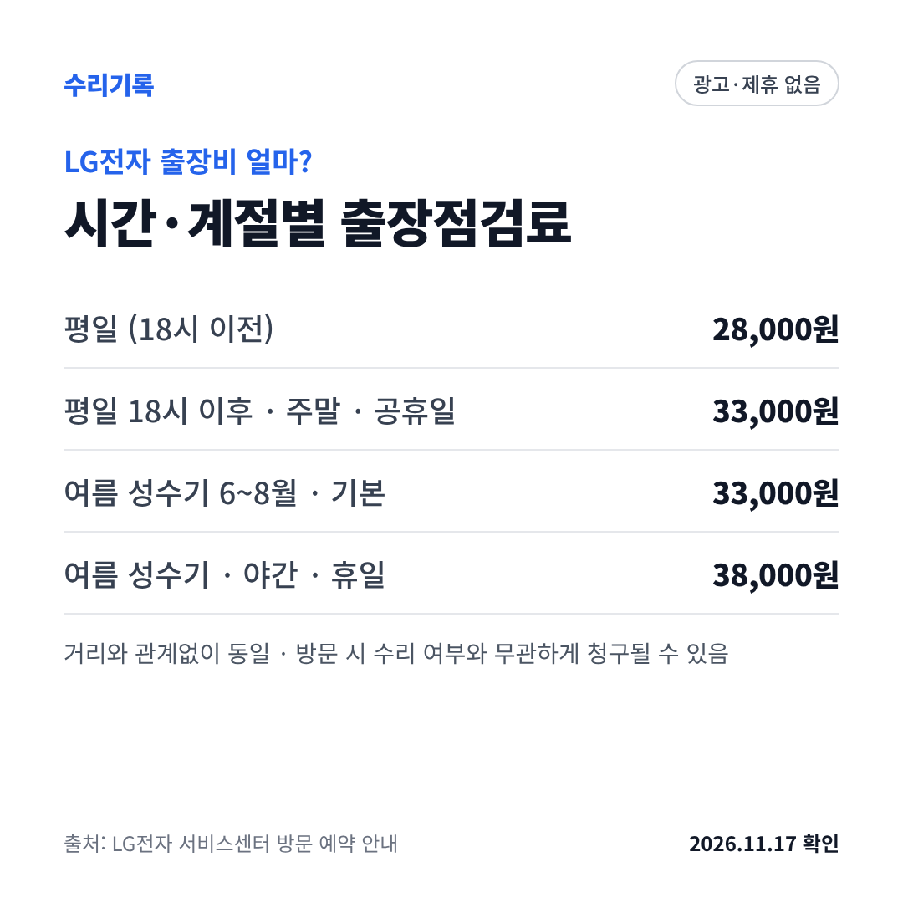
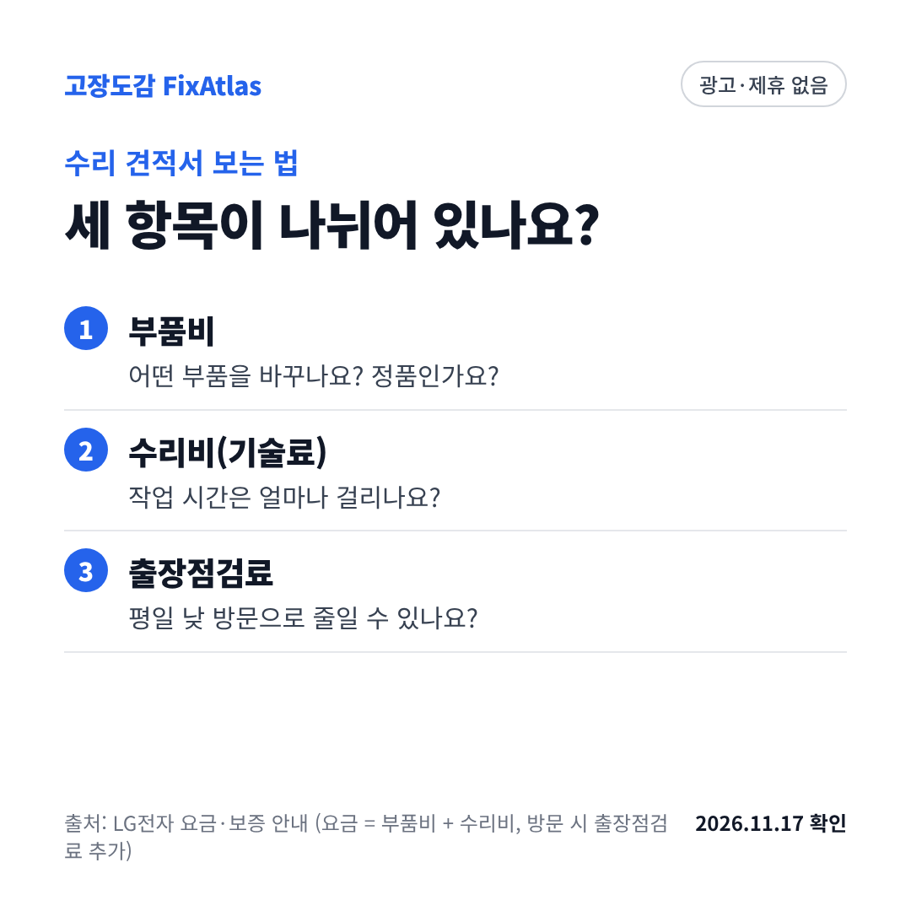
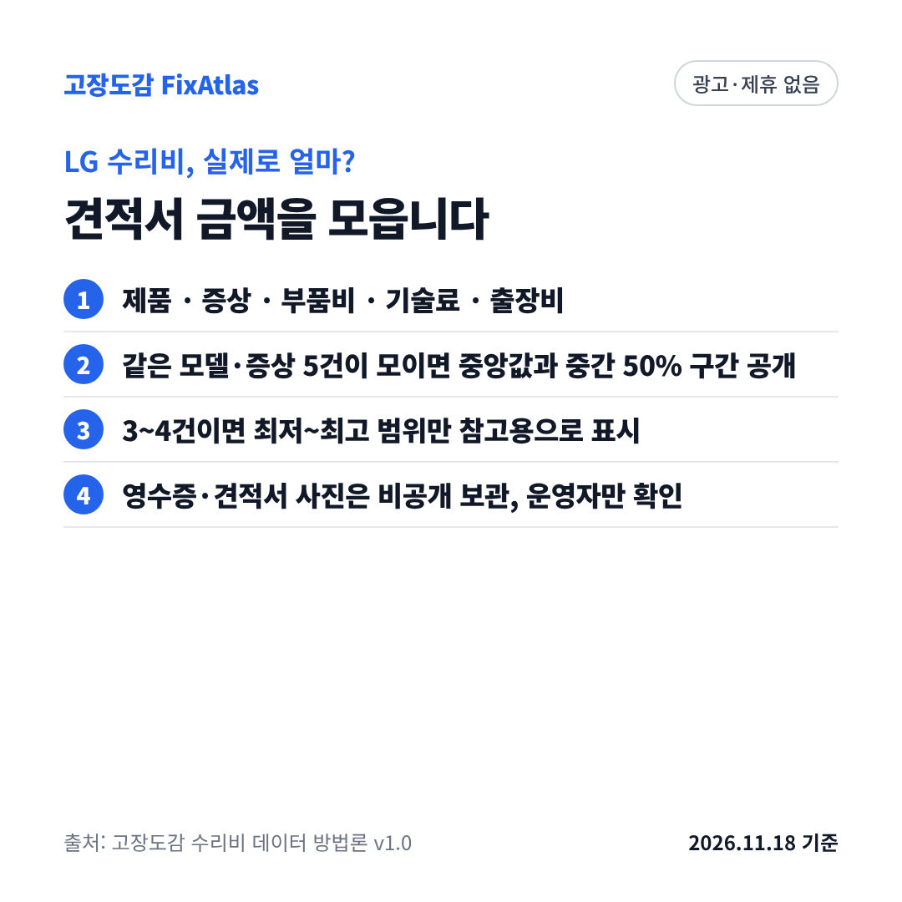

# LG전자 출장비 얼마? 평일 28,000원, 시간·계절별 정리 (2026.11)

> 광고·제휴 없음 · LG전자 공식 안내 확인일 2026-11-17 · 작성·확인 고장도감 편집자
> LG 가전 공통 출장점검료입니다. 사용자 제보 수리비는 아직 공개 기준(같은 모델 5건)에 못 미쳐 싣지 않습니다. [공개 기준 보기](site:/methodology#disclosure)

**한 줄 결론**: LG전자 출장점검료는 평일 28,000원, 평일 18시 이후·주말·공휴일 33,000원입니다. 여름 성수기(6~8월)에는 기본 33,000원, 야간·주말·공휴일 38,000원이고, 거리와 관계없이 같습니다.

## LG 출장점검료 (2026-11-17 확인)

| 언제 | 출장점검료 |
|---|---|
| 평일 18시 이전 | 28,000원 |
| 평일 18시 이후 · 주말 · 공휴일 | 33,000원 |
| 여름 성수기(6~8월) 기본 | 33,000원 |
| 여름 성수기 18시 이후 · 주말 · 공휴일 | 38,000원 |

청소기 전용 요금이 아니라 LG 가전 공통 요금이에요. 금액은 아래 출처의 LG전자 공식 안내 두 곳에서 서로 대조했어요.

## 출장비는 수리를 안 해도 내나요?

LG 공식 안내 기준, 방문을 요청한 유상 수리라면 수리 여부와 관계없이 출장점검료가 청구될 수 있어요. 예약할 때 보증 기간 안의 무상 수리 대상인지 먼저 물어보세요.

## 견적서는 세 항목으로 나뉘어요

LG 공식 안내 기준 서비스 요금은 **부품비 + 수리비(기술료)**이고, 방문 처리 시 **출장점검료**가 더해져요.

| 항목 | 견적 받을 때 물어볼 것 |
|---|---|
| 부품비 | 어떤 부품을 바꾸나요? 정품인가요? |
| 수리비(기술료) | 작업 시간이 얼마나 걸리나요? |
| 출장점검료 | 평일 18시 이전으로 바꾸면 줄어드나요? |

## 출장비를 줄이는 방법 3가지

1. 급하지 않다면 **평일 18시 이전**으로 예약하세요. 28,000원과 33,000원의 차이가 나요.
2. 에어컨처럼 여름에 몰리는 수리는 성수기(6~8월)를 피할 수 있는지 보세요.
3. 청소기처럼 들고 갈 수 있는 제품은 센터 방문 접수가 되는지, 그때 출장비가 붙지 않는지 센터에 확인하세요.

## 편집자 확인 기록

LG 안내 페이지 두 곳(서비스센터 방문 예약 안내, 요금·보증 안내)을 2026년 11월 17일에 열어 금액을 서로 대조했어요. 삼성전자서비스 출장비도 함께 싣고 싶었지만, 공식 페이지에 적용 시점이 적히지 않은 요금표가 두 개 있어 어느 쪽이 현재 요금인지 확정하지 못해 뺐어요.

## 자주 묻는 질문

### 거리가 멀면 출장비가 더 나오나요?
LG 공식 안내는 거리와 관계없이 같은 금액이에요.

### 삼성전자서비스 출장비는 얼마인가요?
공식 페이지에서 현재 요금을 확정하지 못해 이 글에는 싣지 않았어요. 확인되면 추가하고 업데이트 이력에 남길게요.

### 성수기는 언제인가요?
LG 안내 기준 6월부터 8월까지예요.

## 실제로 얼마 냈는지 알려주세요

출장비는 정해져 있지만 부품비와 기술료는 고장마다 달라요. 같은 모델·증상 제보가 5건 모이면 중앙값과 중간 50% 구간을 공개하고, 3~4건이면 범위만 참고용으로 보여 드려요.
→ [LG 가전 수리비 제보하기](site:/submit-repair#cta-bottom)
→ [LG 로봇청소기 R9 수리비·자가점검 보기](site:/products/robot-vacuum/lg-cordzero-r9#body)

댓글로 제품, 지역, 받은 견적(부품비·기술료·출장비)을 남겨 주세요. 다음 글의 질문 목록에 반영할게요.

---

## 출처

- LG전자: [서비스센터 방문 예약 안내](https://www.lge.co.kr/support/visit-center-reservation?seq=182) (2026-11-17 확인)
- LG전자: [요금·보증 안내](https://www.lge.co.kr/support/rates-warranty-guide) (2026-11-17 확인)
- 고장도감: [수리비 데이터 방법론 v1.0](site:/methodology#sources)

> 고장도감의 정보는 사용자 제보와 공개자료를 바탕으로 한 참고 정보입니다. 실제 수리비, 보증 적용 여부, 부품 수급, 안전성은 제품 상태, 지역, 수리업체, 제조사 정책에 따라 달라질 수 있습니다.

업데이트 이력: 2026-11-17 LG 공식 요금 확인 · 2026-11-18 네이버 발행본 정리
