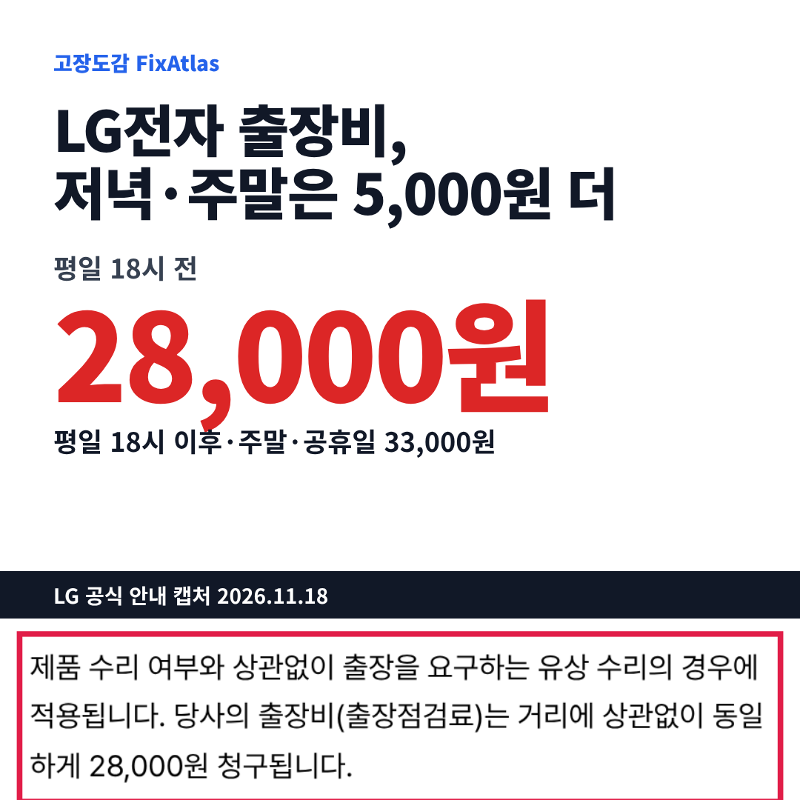
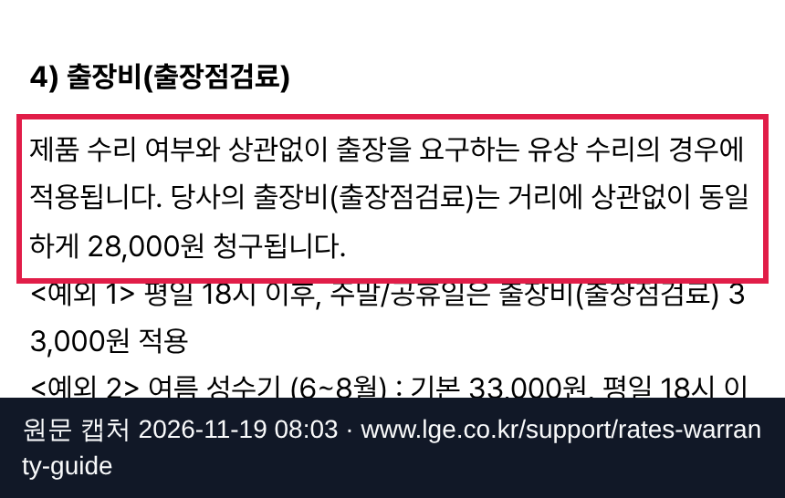

# LG전자 출장비 28,000원, 저녁·주말은 33,000원 (2026.11)

LG전자 출장점검료는 평일 18시 전이면 28,000원입니다. 평일 18시 이후와 주말·공휴일에는 33,000원이고 여름 성수기(6~8월)에는 기본 33,000원, 저녁·주말·공휴일 38,000원으로 오릅니다. 같은 수리라도 예약 시간에 따라 최대 10,000원이 차이 납니다.

> 광고·제휴 없이 작성한 글입니다.

| 예약 시간 | 출장점검료 |
|---|---|
| 평일 18시 전 | 28,000원 |
| 평일 18시 이후, 주말·공휴일 | 33,000원 |
| 6~8월 평일 18시 전 | 33,000원 |
| 6~8월 평일 18시 이후, 주말·공휴일 | 38,000원 |

출처: LG전자 요금/보증 안내 "4) 출장비(출장점검료)" 항목(2026년 11월 18일 기준)

평소에는 18시 이후로 예약하는 것만으로 5,000원이 더 붙습니다. 거리는 금액에 영향을 주지 않습니다. 안내문에 "거리에 상관없이 동일하게" 청구한다고 명시되어 있어 센터에서 먼 지역도 같은 금액입니다.

## 수리하지 않아도 출장비를 내는가

[[직접 확인: LG전자 고객센터에 "무상 보증 기간 안에 출장 점검만 받으면 출장점검료가 청구됩니까?"를 문의하고 답을 이 자리 첫 문장으로 격식체로 쓰기. 예: "무상 보증 기간에는 ○○입니다(○월 ○일 LG전자 고객센터 답변)."]]

LG전자 안내문은 출장점검료가 "제품 수리 여부와 상관없이 출장을 요구하는 유상 수리의 경우에 적용됩니다"라고 밝히고 있습니다. 기사가 방문해 점검만 하고 수리하지 않더라도 유상 건이라면 출장비가 청구됩니다.

## 견적서의 세 항목

LG전자는 서비스 요금을 부품비와 수리비의 합으로 계산하고 출장으로 처리하면 출장점검료를 더합니다. 수리비는 "수리 난이도 (시간) 에 따른 순수 기술료"로 정의되어 있습니다. 견적이 총액 한 줄로만 적혀 있다면 항목별로 나눠 적어 달라고 요청할 수 있습니다.

| 견적서 항목 | 확인할 내용 |
|---|---|
| 부품비 | 부품 단가가 LG전자 공식몰 가격과 같은지 |
| 수리비(기술료) | 작업에 걸린 시간 |
| 출장점검료 | 예약 시간대 요금이 맞게 붙었는지 |

[[직접 확인: 같은 통화에서 "청소기처럼 들고 갈 수 있는 제품을 서비스센터에 직접 가져가면 출장점검료가 없습니까?"도 문의해 답을 격식체 한두 문장으로 적기]]

## 삼성전자서비스가 빠진 이유

삼성전자서비스 출장비는 공식 페이지에 적용 시점이 표시되지 않은 요금표가 두 개 함께 있어 현재 요금을 특정하지 못했습니다. 현재 요금이 확인되면 이 글에 추가하고 수정 이력에 남기겠습니다.

## 받은 견적 공유

출장비는 정해져 있지만 부품비와 기술료는 고장마다 다릅니다. 받은 견적이나 영수증 금액을 보내 주시면 같은 모델·증상 제보가 5건 모였을 때 중앙값으로 정리해 공개합니다. [LG 가전 수리비 제보하기](site:/submit-repair#cta-bottom)

출장 수리를 받아 보신 분은 견적서에 출장비가 별도 항목으로 적혀 있었는지 댓글로 알려 주십시오.

## 출처

- LG전자 [요금/보증 안내](https://www.lge.co.kr/support/rates-warranty-guide) (출장비, 서비스 요금 산정 기준 · 2026년 11월 18일 기준)
- 고장도감 [수리비 데이터 방법론 v1.1](site:/methodology#sources)

> 만든 방법: AI 도구로 초안을 쓰고 출처의 숫자·문구를 원문과 자동 대조했습니다. 편집자 확인일은 [[직접 확인: 편집자가 원문과 캡처를 직접 다시 확인한 날짜(YYYY-MM-DD)]]입니다. AI 사용 범위는 [방법론의 AI 사용 원칙](site:/methodology#ai)에 정리했습니다.

요금은 LG전자 공식 안내 기준이며 실제 청구액은 센터 판단과 제품 상태에 따라 달라집니다.

바로잡기: 숫자나 문구가 원문과 다르면 댓글로 알려 주십시오. 원문을 다시 확인해 고치고 수정 이력에 남기겠습니다.

쓴 사람: [[직접 확인: 이름 또는 활동명과 한 줄 소개(무슨 일을 하는 사람이고 왜 이 기록을 하는지). 모든 글에 같은 문장을 씀]]

수정 이력: 2026-11-17 첫 원고 · 2026-11-18 출처를 LG전자 요금/보증 안내 한 곳으로 정리(서비스센터 방문 예약 안내 페이지는 화면에 금액이 보이지 않아 제외), 출장점검료 적용 범위를 원문 문구로 인용, 견적서 확인 항목 수정, 대표 이미지 교체, 격식체로 문체 정리
