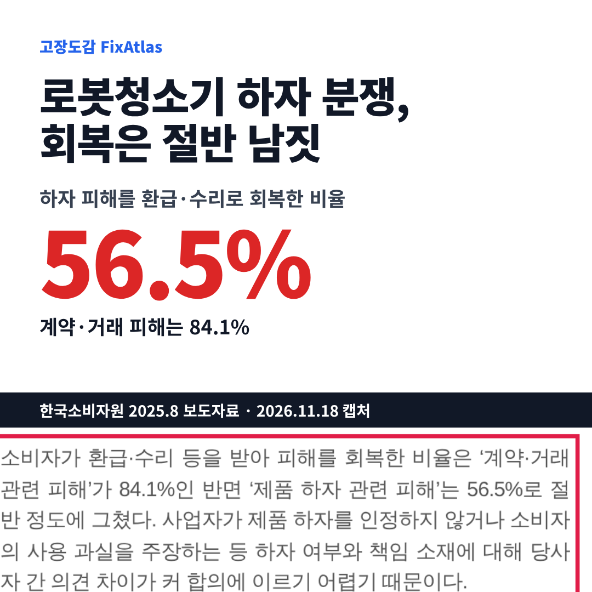
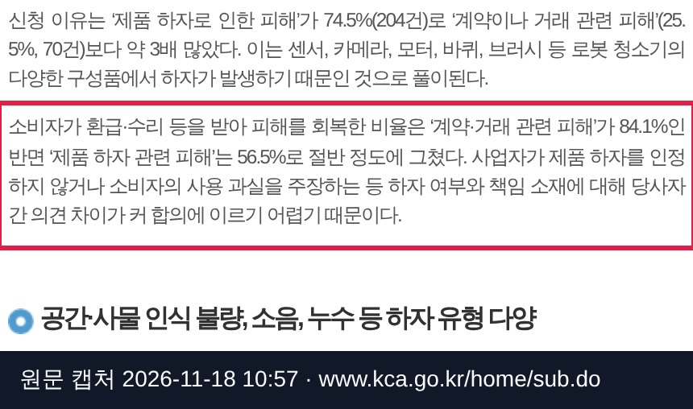
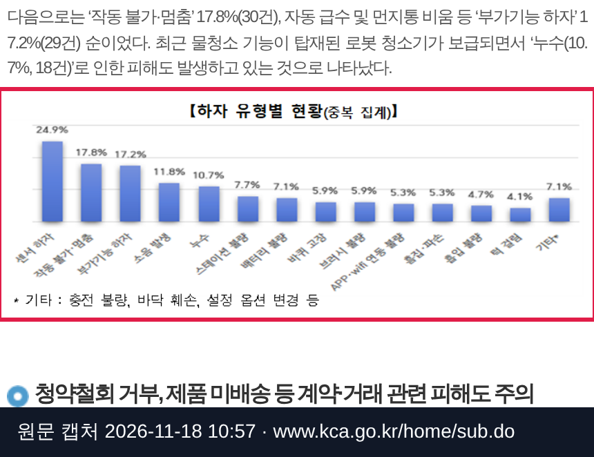
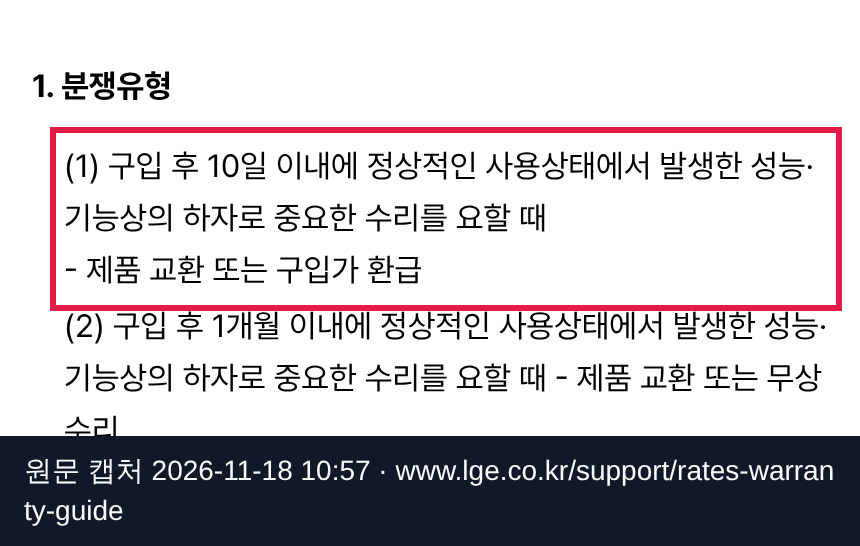

# 로봇청소기 고장 피해 10건 중 7건이 제품 하자 (2025 소비자원 분석)

한국소비자원이 2022년부터 2025년 6월까지 접수된 로봇청소기 피해구제 신청을 분석한 결과, 74.5%가 제품 하자 때문이었습니다. 그런데 하자 피해를 환급·수리 등으로 회복한 비율은 56.5%로, 계약·거래 피해(84.1%)보다 크게 낮았습니다. 소비자원은 사업자가 하자를 인정하지 않거나 소비자의 사용 과실을 주장해 합의가 어렵다고 설명했습니다.

숫자는 2025년 8월 소비자원 보도자료에서 가져왔고, 2026년 11월 18일에 원문의 본문·표·그래프와 다시 대조했습니다. 새 자료가 나오면 바꿔 싣겠습니다. 광고·제휴는 없습니다.

신청 건수도 늘고 있어요. 2022년 37건이던 것이 2024년 105건이 됐고, 2025년에는 상반기에만 77건이 접수됐어요.

## 어떤 하자가 많았나

제품 하자가 확인된 169건을 유형별로 나눈 결과예요. 보도자료 본문에는 네 가지만 나오지만, 함께 실린 그래프를 보면 소음이 누수보다 많아요.

| 하자 유형 | 비율 |
|---|---|
| 센서 기능: 맵핑 불량, 장애물 미인식, 스테이션 복귀 실패 | 24.9% (42건) |
| 작동 불가·멈춤 | 17.8% (30건) |
| 부가기능: 자동 급수, 먼지통 비움 | 17.2% (29건) |
| 소음 발생 | 11.8% (그래프에 비율만 표시) |
| 누수 | 10.7% (18건) |

출처: 한국소비자원 보도자료 본문과 "하자 유형별 현황" 그래프(2026-11-18 확인, 아래 캡처).

그래프 제목에 "중복 집계"라고 적혀 있어요. 한 건에 여러 하자가 겹칠 수 있어서 항목을 다 더하면 100%를 넘어요. 배터리 불량(7.1%)이나 바퀴·브러시 고장도 뒤를 이었어요.

## 교환·환급을 요구할 수 있는 기준

공정거래위원회 고시 「소비자분쟁해결기준」의 가전제품 기준이에요. LG전자 요금/보증 안내 페이지에 실린 전문으로 확인했어요.

| 언제, 어떤 하자 | 요구할 수 있는 것 |
|---|---|
| 산 지 10일 안에 정상 사용 중 중요한 수리가 필요한 하자 | 제품 교환 또는 구입가 환급 |
| 산 지 1개월 안에 정상 사용 중 중요한 수리가 필요한 하자 | 제품 교환 또는 무상수리 |
| 품질보증기간 안에 같은 하자로 3회째 수리 | 교환 또는 구입가 환급 |
| 품질보증기간 안에 여러 부위 고장으로 5회째 수리 | 교환 또는 구입가 환급 |

비고에는 같은 하자를 2회까지 고쳤는데 또 생기면(여러 부위라면 4회까지 고친 뒤 재발하면) "수리 불가능한 것으로 봄"이라고 적혀 있어요. 몇 번 고쳤는지가 교환·환급의 근거가 되니, 수리할 때마다 수리 내역서를 받아 두세요.

## 사용 과실이라는 말을 들었을 때 필요한 기록

업체가 사용 과실을 주장하면 "정상적인 사용상태"였다는 걸 보여 줄 기록이 필요해요.

- 증상이 처음 나타난 날짜와 앱의 오류 메시지 화면
- 증상이 나는 순간의 짧은 영상(어느 방, 어떤 바닥인지 같이 보이게)
- 설명서대로 썼다는 근거: 문턱 높이, 바닥 물기, 정품 소모품 사용 여부
- 센터 판정 내용과 수리 내역서(되도록 문자나 서면으로)

[[직접 확인: 집에 있는 로봇청소기로 위 기록을 실제로 남겨 보거나(오류 화면·센서 위치 사진), 직접 겪은 고장·판정 사례가 있다면 날짜·증상·센터 판정·결과를 3~5문장으로 적기. 본인 사례가 없으면 지인 사례를 동의받아 익명으로. 이 칸이 비면 발행을 미룸]]

합의가 안 되면 순서는 이렇습니다.

1. 제조사나 판매처에 수리 내역과 기록을 보여 주고 교환·환급을 요구하기
2. 국번 없이 1372(소비자상담센터)에 상담하기
3. 그래도 안 되면 한국소비자원에 피해구제 신청하기(고시 제2조)

## 맡기기 전에 해 볼 수 있는 점검

소비자원은 센서가 오작동하지 않도록 먼지를 제거하고, 청소 전에는 음식물처럼 방해되는 물건을 치우라고 당부했어요. 범퍼가 눌린 채 끼어 있지 않은지, 바퀴와 브러시에 머리카락이 감기지 않았는지도 보세요.

물이 샜다면 여기서 멈추세요. 전원을 끄고 충전을 멈춘 뒤 서비스센터에 맡기고, 본체를 열어 말리지는 마세요.

## 살 때 미리 볼 것

계약·거래 피해도 적지 않았어요. 포장박스를 열었다는 이유로 반품을 거부하거나 해외 구매대행 제품에 높은 반환 비용을 청구하는 등 청약철회·계약해제를 거부한 사례가 41.4%(29건), 배송을 미룬 미배송 사례가 37.1%(26건)였어요. 소비자원은 집 구조(문턱 높이 등)에 맞는 사양을 고르라고 권했어요.

## 센터 판정을 받아 보셨다면

센터에서 하자 판정을 받았는지, 사용 과실 판정을 받았는지, 그 결과 얼마를 냈는지 알려 주세요. 제보 양식의 후기 칸에 판정 내용을 적어 주시면 같은 모델·증상끼리 묶어 볼 수 있어요. 수리비는 같은 모델·증상 5건이 모이면 중앙값으로 공개해요. [로봇청소기 고장·수리 경험 제보하기](site:/submit-repair?symptom=sym-5#cta-bottom)

'사용 과실' 판정을 받아 본 분은 어떤 증상이었는지 댓글로도 남겨 주세요.

## 출처

- 한국소비자원 [로봇 청소기 피해구제 신청 10건 중 7건이 제품 하자 불만](https://www.kca.go.kr/home/sub.do?menukey=4005&mode=view&no=1003906171&page=2) (2025년 8월 보도자료 · 2026-11-18 원문 확인)
- 공정거래위원회 고시 「소비자분쟁해결기준」 가전제품 기준 — [LG전자 요금/보증 안내](https://www.lge.co.kr/support/rates-warranty-guide)에 실린 전문으로 확인(2026-11-18)
- 고장도감 [수리비 데이터 방법론 v1.1](site:/methodology#sources)

만든 방법: AI 도구로 초안을 쓰고 출처 문구·숫자를 원문과 자동 대조했습니다. 편집자가 [[직접 확인: 원문과 캡처를 직접 다시 확인한 날짜(YYYY-MM-DD)]]에 원문과 캡처를 다시 확인했습니다. AI를 어디까지 쓰는지는 [방법론의 AI 사용 원칙](site:/methodology#ai)에 적어 두었습니다.

보도자료와 고시를 정리한 참고 정보라, 개별 분쟁의 결과는 제품 상태와 판정에 따라 갈려요. 잘못 옮긴 숫자가 보이면 알려 주세요. 원문과 다시 맞춰 보고 고친 내용을 이력에 적을게요.

쓴 사람: [[직접 확인: 이름 또는 활동명과 한 줄 소개(무슨 일을 하는 사람이고 왜 이 기록을 하는지). 모든 글에 같은 문장을 씀]]

수정 이력: 2026-11-17 첫 원고 · 2026-11-18 원문 재대조 — 첫 원고의 "고장 4대 유형"(센서·작동 불가·부가기능·누수)을 고침. 본문만 읽고 정했는데, 보도자료 그래프에서는 소음 발생(11.8%)이 누수(10.7%)보다 많았음. 연도별 건수 출처를 언론 보도에서 보도자료 표로 바꿈 · 2026-11-18 독립 검토 반영 — 제목 교체, 소비자분쟁해결기준(교환·환급 기준)과 피해구제 순서 추가, 제보 안내를 판정 중심으로 변경
