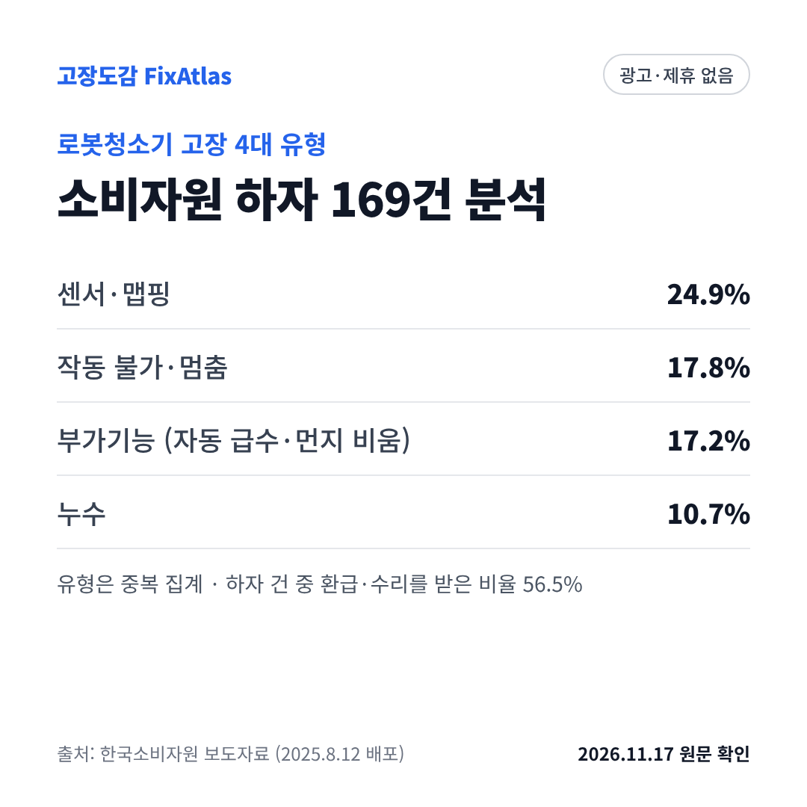
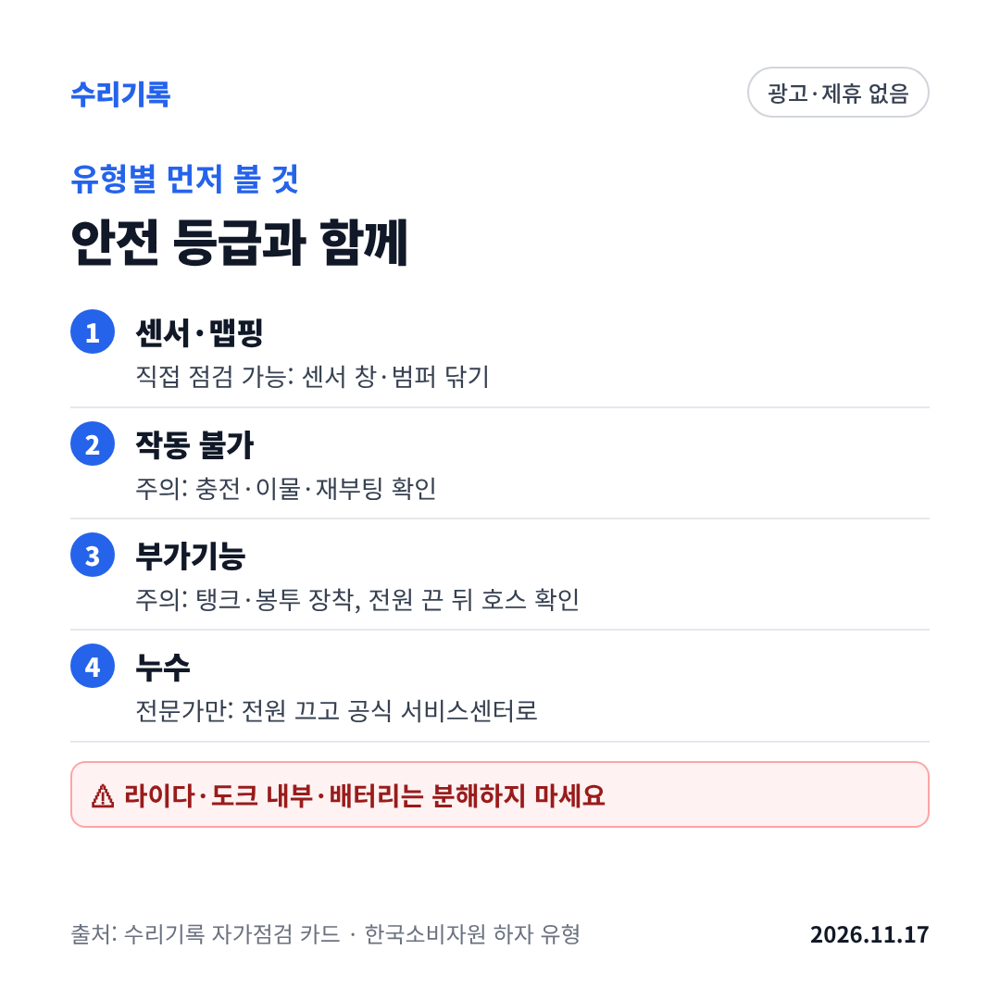
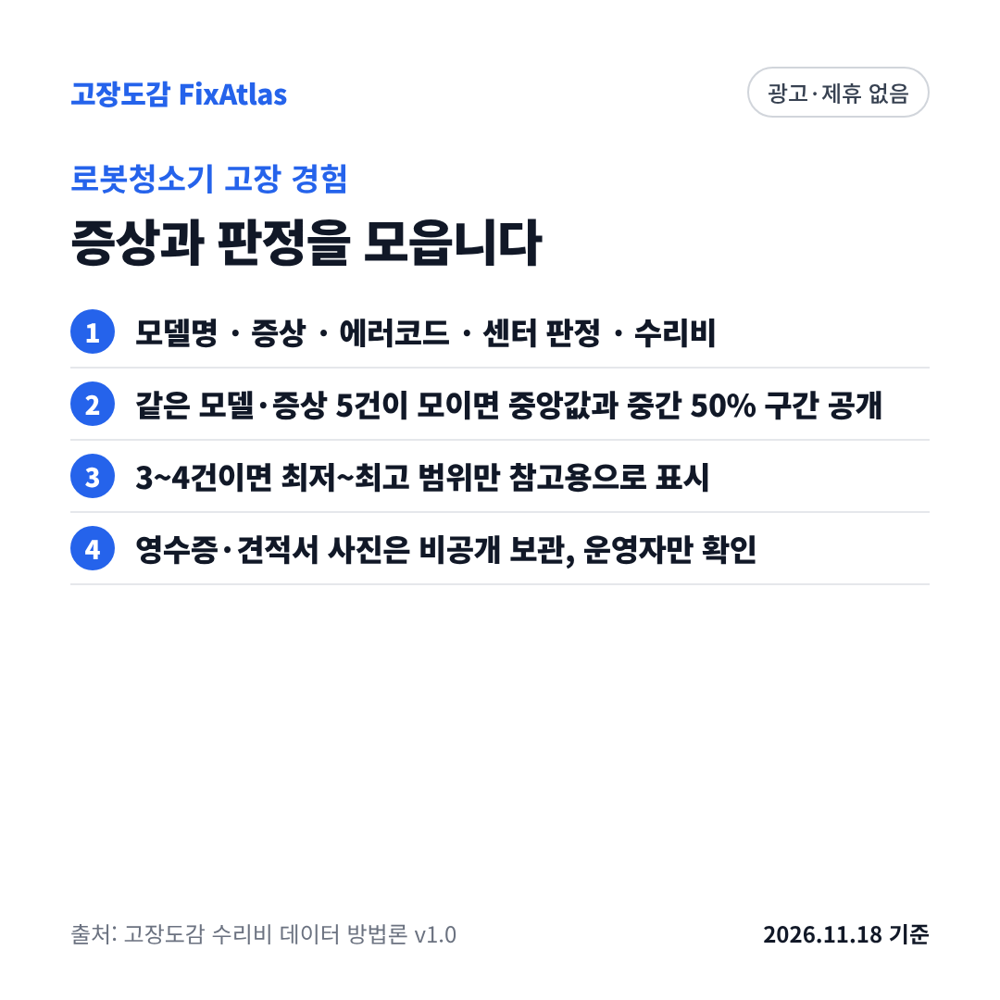

# 로봇청소기 고장 유형 TOP4, 소비자원 하자 169건으로 본 먼저 확인할 것

> 광고·제휴 없음 · 한국소비자원 보도자료(2025-08-12 배포) 원문 확인일 2026-11-17 · 작성·확인 고장도감 편집자
> 아래 비율은 소비자원에 피해구제를 신청한 사례 안에서의 비율입니다. 전체 제품의 고장률이 아닙니다.

**한 줄 결론**: 한국소비자원이 하자를 확인한 로봇청소기 피해 169건을 보면 센서·맵핑 문제가 24.9%로 가장 많고, 작동 불가·멈춤 17.8%, 자동 급수·먼지 비움 같은 부가기능 17.2%, 누수 10.7% 순입니다. 하자 건 중 환급·수리 등으로 처리된 비율은 56.5%였습니다.

> ⚠ **누수는 전문가만(Expert Only)**: 본체나 충전 접점에 물이 들어갔다면 전원을 켜지 말고 충전을 멈추세요. 라이다 센서, 도크 내부, 배터리는 분해하지 마세요.

## 소비자원 데이터 요약

| 항목 | 수치 |
|---|---|
| 피해구제 신청 사유 | 제품 하자 74.5%(204건), 계약·거래 25.5%(70건) |
| 하자 유형 (하자 확인 169건, 중복 집계) | 센서·맵핑 24.9%(42건), 작동 불가·멈춤 17.8%(30건), 부가기능 17.2%(29건), 누수 10.7%(18건) |
| 환급·수리 등 처리 비율 | 하자 건 56.5%, 계약·거래 건 84.1% |

연도별 접수 건수는 2022년 37건에서 2024년 105건으로 늘었고, 2025년 상반기에만 77건이었어요. 이 수치는 보도자료 그래프를 옮긴 언론 보도 기준이에요. 2025년 8월 발표 자료라 최근 경향과는 다를 수 있어요.

## 유형별로 먼저 확인할 것

### 1. 센서·맵핑: 직접 점검 가능(Safe Check)
본체 아래 낭떠러지 센서, 앞 범퍼, 위쪽 센서 창을 마른 천으로 닦고 범퍼가 끼지 않았는지 보세요. 검은색이나 반사가 심한 바닥에서만 증상이 나는지도 확인해 보세요. 그래도 그대로면 센서 모듈은 분해하지 말고 센터에 문의하세요.

### 2. 작동 불가·멈춤: 주의(Caution)
도크에 올렸을 때 충전되는지, 바퀴·브러시·범퍼에 이물이 끼었는지 보고 설명서대로 재부팅하세요. 충전 중 열이나 냄새가 나면 바로 멈추세요.

### 3. 부가기능(자동 급수·먼지 비움): 주의(Caution)
전원을 끈 상태에서 물탱크, 오수통, 먼지 봉투가 제대로 끼워졌는지, 호스와 필터가 막히지 않았는지 보세요. 도크 안쪽 펌프와 전기부는 분해하지 마세요.

### 4. 누수: 전문가만(Expert Only)
바로 전원을 끄고 충전을 멈추세요. 탱크 패킹 위치와 균열은 눈으로만 확인하고, 직접 분해하거나 말리지 말고 공식 서비스센터에 문의하세요.

## 하자 분쟁에서 기록이 중요한 이유

하자 건의 처리 비율이 56.5%라는 건, 나머지는 환급·수리 같은 결과로 이어지지 않았다는 뜻이에요. 증상이 처음 나타난 날짜, 에러코드, 센터 판정 내용을 사진과 함께 남겨 두세요.

## 편집자 확인 기록

소비자원 보도자료 원문을 열어 표의 비율과 건수를 하나씩 대조했어요. 연도별 접수 건수는 보도자료 그래프에만 있어서, 그 수치를 옮긴 언론 보도를 출처로 따로 적었어요.

## 자주 묻는 질문

### 이 비율이 로봇청소기 고장률인가요?
아니요. 소비자원에 피해구제를 신청한 사례 안에서의 비율이에요. 전체 제품이 이 비율로 고장 난다는 뜻은 아니에요.

### 하자 분쟁은 어디에 접수하나요?
먼저 제조사나 판매처에 문의하고, 해결되지 않으면 1372 소비자상담센터에 상담을 신청할 수 있어요.

### 물이 샌 로봇청소기는 말리면 다시 써도 되나요?
배터리와 전기부 근처에 물이 들어갔을 수 있어 직접 말려 쓰는 것은 권하지 않아요. 전원을 끈 채로 서비스센터 점검을 받으세요.

## 고장·수리 경험을 모읍니다

같은 모델·증상 사례가 모이면 다음 사람이 판정과 견적을 비교할 근거가 돼요. 같은 모델·증상 제보가 5건 모이면 수리비 중앙값과 중간 50% 구간을 공개하고, 3~4건이면 범위만 참고용으로 보여 드려요.
→ [로봇청소기 고장·수리 경험 제보하기](site:/submit-repair?symptom=sym-5#cta-bottom)
→ [로봇청소기 증상별 수리비 찾아보기](site:/search?q=%EB%A1%9C%EB%B4%87%EC%B2%AD%EC%86%8C%EA%B8%B0#body)

댓글로 모델명, 증상, 센터 판정을 남겨 주세요. 다음 글의 질문 목록에 반영할게요.

---

## 출처

- 한국소비자원: [로봇청소기 피해구제 보도자료(2025-08-12 배포)](https://www.kca.go.kr/home/sub.do?menukey=4005&mode=view&no=1003906171&page=2) (2026-11-17 원문 확인)
- SBS Biz: [연도별 접수 건수 보도](https://biz.sbs.co.kr/amp/article/20000252700) (2026-11-17 확인)
- 고장도감: [수리비 데이터 방법론 v1.0](site:/methodology#sources)

> 고장도감의 정보는 사용자 제보와 공개자료를 바탕으로 한 참고 정보입니다. 실제 수리비, 보증 적용 여부, 부품 수급, 안전성은 제품 상태, 지역, 수리업체, 제조사 정책에 따라 달라질 수 있습니다.
> 고전압, 배터리, 냉매, 가스, 방수 구조와 관련된 작업은 안전사고 위험이 있으므로 전문가 또는 공식 서비스센터를 이용하십시오.

업데이트 이력: 2026-11-17 소비자원 원문 확인 · 2026-11-18 네이버 발행본 정리
