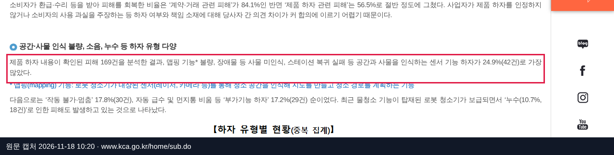

# 로봇청소기 고장 분쟁, 하자 피해 회복은 56.5%뿐: 소비자원 자료로 본 대비법

한국소비자원이 2022년부터 2025년 6월까지 접수된 로봇청소기 피해구제 신청을 분석했습니다. 제품 하자로 생긴 피해를 환급·수리 등으로 회복한 비율은 56.5%로, 계약·거래 피해(84.1%)보다 크게 낮았습니다. 소비자원은 사업자가 하자를 인정하지 않거나 소비자의 사용 과실을 주장해 합의가 어렵다고 설명했습니다. 신청 건수도 2022년 37건에서 2024년 105건으로 늘었고, 2025년에는 상반기에만 77건이 접수됐습니다.

이 글의 숫자는 2025년 8월 소비자원 보도자료에서 가져왔고, 2026년 11월 18일에 원문을 다시 열어 대조했습니다. 발표된 지 시간이 지난 자료라 지금 상황과는 다를 수 있습니다. 광고·제휴는 없습니다.

만든 방법: AI 도구로 초안을 쓰고 출처 문구·숫자를 원문과 자동 대조했습니다. 편집자가 [[직접 확인: 원문과 캡처를 직접 다시 확인한 날짜(YYYY-MM-DD)]]에 원문과 캡처를 다시 확인했습니다. AI를 어디까지 쓰는지는 [방법론의 AI 사용 원칙](site:/methodology#ai)에 적어 두었습니다.

## 어떤 하자가 많았나

제품 하자가 확인된 169건을 유형별로 나누면 다음과 같습니다. 보도자료 본문에는 네 가지만 나오지만, 함께 실린 그래프를 보면 소음이 누수보다 많습니다.

| 하자 유형 | 비율 |
|---|---|
| 센서 기능: 맵핑 불량, 장애물 미인식, 스테이션 복귀 실패 | 24.9% (42건) |
| 작동 불가·멈춤 | 17.8% (30건) |
| 부가기능: 자동 급수, 먼지통 비움 | 17.2% (29건) |
| 소음 발생 | 11.8% |
| 누수 | 10.7% (18건) |

출처: 한국소비자원 보도자료 본문과 "하자 유형별 현황" 그래프(2026-11-18 확인, 아래 캡처).

그래프 제목에 "중복 집계"라고 적혀 있어요. 한 건에 여러 하자가 겹칠 수 있어서 항목을 다 더하면 100%를 넘어요. 그 밖에 스테이션 불량, 배터리 불량(7.1%), 바퀴·브러시 고장 같은 항목이 뒤를 이었어요. 누수는 물청소 기능이 달린 제품이 늘면서 생기기 시작한 피해라는 설명이에요.

이 표는 한 번 틀렸던 표예요. 첫 원고는 보도자료 본문만 읽고 "4대 유형"을 센서·작동 불가·부가기능·누수로 적었어요. 본문이 누수만 따로 언급해서 그렇게 읽었는데, 함께 실린 그래프에는 소음이 누수보다 위에 있었어요. 숫자는 글보다 표와 그래프에서 다시 확인해야 한다는 걸 이번에 배웠어요.

## 고장이 나면 남겨 둘 것

분쟁에서 갈리는 지점은 결국 "제품 하자냐, 사용 과실이냐"예요. 그래서 증상이 처음 보일 때부터 기록을 남겨 두는 편이 유리해요.

- 증상이 처음 나타난 날짜와 그때 상황(어느 방, 어떤 바닥)
- 앱에 뜬 오류 메시지 화면
- 증상이 보이는 짧은 영상
- 서비스센터 판정 내용(되도록 문자나 서면으로)

[[직접 확인: 집에 있는 로봇청소기로 위 기록을 실제로 남겨 보고(오류 화면·센서 위치 사진), 직접 겪은 고장 사례가 있다면 날짜·증상·센터 판정을 3~5문장으로 적기. 본인 사례가 없으면 지인 사례를 동의받아 익명으로]]

## 맡기기 전에 해 볼 수 있는 점검

소비자원은 센서가 오작동하지 않도록 먼지를 제거하고, 청소 전에는 음식물처럼 방해되는 물건을 손으로 치우라고 당부했어요. 여기까지가 집에서 해 볼 만한 범위예요.

- 센서 창과 앞 범퍼를 마른 천으로 닦고, 범퍼가 눌린 채 끼어 있지 않은지 보기
- 바퀴와 브러시에 머리카락이나 실이 감겼는지 보기
- 전원을 끈 상태에서 물탱크와 먼지 봉투가 제대로 끼워졌는지 보기

물이 샜다면 여기서 멈추세요. 전원을 끄고 충전을 멈춘 뒤 서비스센터에 맡기고, 본체를 열어 말리지는 마세요.

## 살 때 미리 볼 것

계약·거래 피해도 적지 않았어요. 포장박스를 열었다는 이유로 반품을 거부하거나 해외 구매대행 제품에 높은 반환 비용을 청구하는 등 청약철회·계약해제를 거부한 사례가 41.4%(29건), 배송을 미룬 미배송 사례가 37.1%(26건)였어요.

소비자원은 집 구조(문턱 높이 등)에 맞는 사양을 고르라고 권했어요. 해외 구매대행이라면 반품 조건과 반환 비용을 결제 전에 확인해 두세요. 구매대행은 값이 싼 대신, 문제가 생겼을 때 국내 공식 서비스를 받기 어렵거나 반품 비용이 커질 수 있다는 점까지 같이 따져 보는 게 좋아요.

## 비슷한 일을 겪었다면

하자 판정을 두고 다툰 경험은 다음 사람에게 가장 쓸모 있는 정보예요. 같은 모델·증상 제보가 5건 모이면 수리비 중앙값을 공개해요. [로봇청소기 고장·수리 경험 제보하기](site:/submit-repair?symptom=sym-5#cta-bottom)

센터에서 '사용 과실' 판정을 받아 본 분은 어떤 증상이었는지 댓글로 알려 주세요. 해결이 안 되면 국번 없이 1372(소비자상담센터)에 상담을 신청할 수 있어요.

## 출처

- 한국소비자원 [로봇 청소기 피해구제 신청 10건 중 7건이 제품 하자 불만](https://www.kca.go.kr/home/sub.do?menukey=4005&mode=view&no=1003906171&page=2) (2025년 8월 보도자료 · 2026-11-18 원문 확인)
- 고장도감 [수리비 데이터 방법론 v1.1](site:/methodology#sources)

보도자료를 바탕으로 정리한 참고 정보예요. 개별 분쟁의 결과는 제품 상태와 판정에 따라 달라질 수 있어요. 잘못 옮긴 숫자가 보이면 댓글로 알려 주세요. 원문과 다시 맞춰 보고 고친 내용을 이력에 적을게요.

쓴 사람: [[직접 확인: 이름 또는 활동명과 한 줄 소개(무슨 일을 하는 사람이고 왜 이 기록을 하는지). 모든 글에 같은 문장을 씀]]

수정 이력: 2026-11-17 첫 원고 · 2026-11-18 원문 재대조 — 첫 원고의 "고장 4대 유형"(센서·작동 불가·부가기능·누수)을 고침. 보도자료 그래프에서는 소음 발생(11.8%)이 누수(10.7%)보다 많았음. 연도별 건수 출처를 언론 보도에서 보도자료 표로 바꿈. 하자 유형의 세부 증상과 계약·거래 피해 내용 추가
