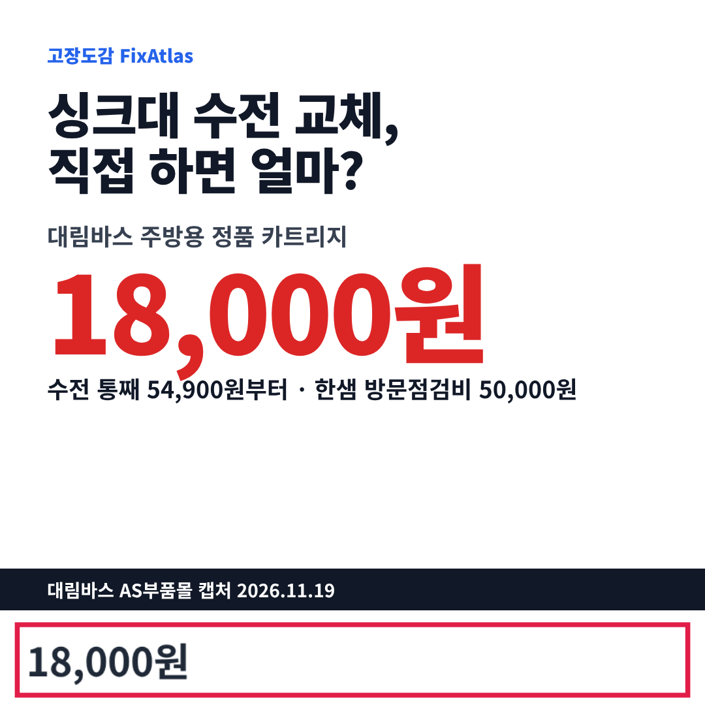
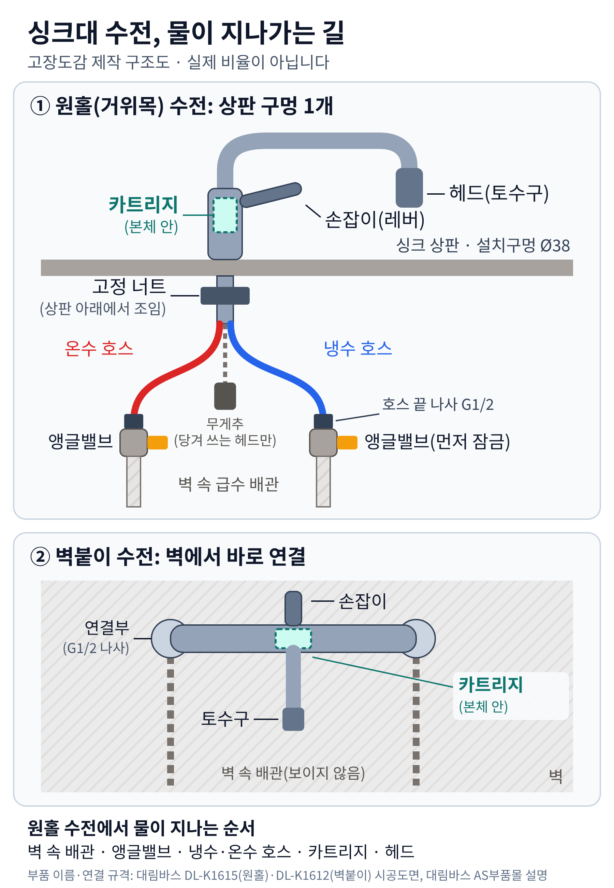
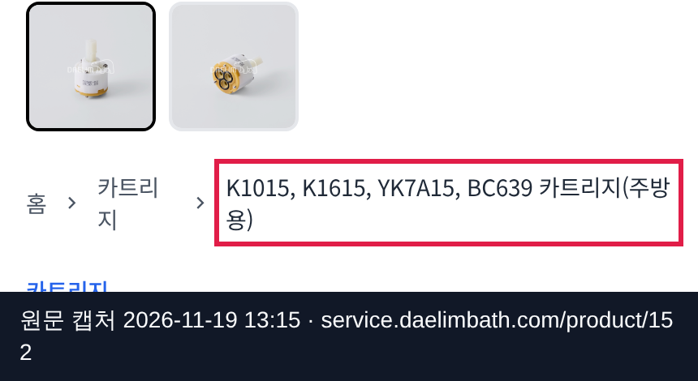
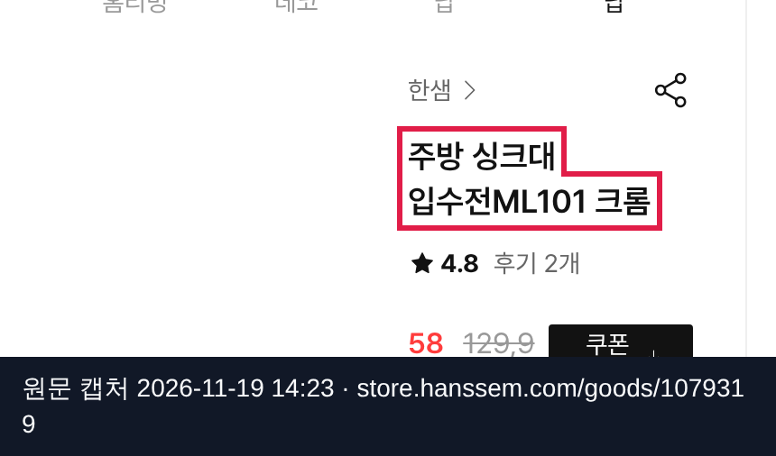
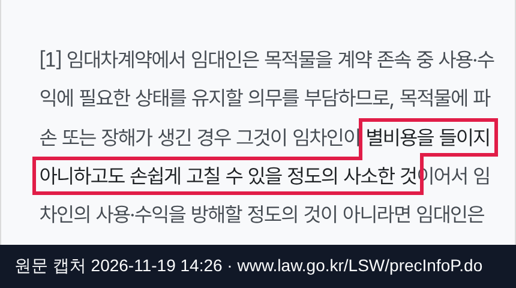

# 싱크대 수전 교체 비용은? 카트리지 18,000원, 수전 54,900원부터

싱크대 수전 교체는 카트리지만 바꾸면 부품 18,000원, 수전을 통째로 바꾸면 54,900원부터 듭니다.
기사를 부르면 방문비만 50,000원(한샘 평일 주간)이고 기술료가 따로 붙습니다.
세입자라면 누가 내는지도 따져야 합니다. 별 비용 없이 손쉽게 고칠 사소한 고장이 아니면 집주인이 고칠 의무를 진다는 것이 대법원 기준입니다.

> 광고·제휴 없이 작성한 글입니다.

| 한눈에 보기 | 내용 |
|---|---|
| 난이도 | 보통(대림바스 부품몰의 카트리지 설치 난이도 표기) |
| 시간 | 제조사가 공개한 작업 시간은 없습니다 |
| 직접 하면 | 카트리지 18,000원, 수전 통째 54,900원부터(공구가 집에 있을 때) |
| 기사에게 맡기면 | 방문비 50,000원(휴일·야간 60,000원) + 기술료 + 부품 |
| 등급 | 노랑: 세입자는 집주인 동의와 원상회복이 조건, 소유자는 초록 |

출처: 카트리지는 대림바스 AS부품몰, 수전은 한샘몰 판매가, 방문비는 한샘 서비스센터 안내(2026년 11월 19일 기준)

## 싱크대 수전 물샘, 카트리지만 바꾸면 됩니까?

먼저 우리 집 수전이 어느 쪽인지 보십시오.
원홀 수전은 싱크 상판 구멍 하나에 세우고 상판 아래에서 고정 너트로 조입니다. 냉수·온수 호스 두 가닥이 내려가 앵글밸브에 물립니다.
벽붙이 수전(흔히 벽수전)은 벽에서 나온 배관 두 개에 본체가 바로 연결됩니다.

대림바스 원홀 주방수전(DL-K1615) 시공도면에는 설치구멍이 Ø38, 호스 끝 나사가 G1/2로 적혀 있습니다.
같은 회사 벽붙이 제품(DL-K1612) 도면은 본체 양쪽 연결부가 벽 속 배관에 직접 들어가는 모양입니다.

어디서 새는지에 따라 바꿀 부품이 달라집니다.

| 증상 | 의심할 부품 | 이 글로 해결 |
|---|---|---|
| 잠가도 토수구에서 똑똑 떨어짐 | 카트리지 | 카트리지 교체 |
| 손잡이가 뻑뻑하거나 냉수·온수 조절이 안 됨 | 카트리지 | 카트리지 교체 |
| 하부장 안 냉수·온수 호스 이음부가 젖음 | 냉수·온수 호스(흔히 고압 호스로 판매), 고무 패킹 | 호스·패킹 교체 |
| 당겨 쓰는 헤드 이음부에서 샘 | 헤드, 헤드 호스 | 같은 모델 부품으로 교체 |
| 본체에 금이 감, 맞는 카트리지를 구할 수 없음 | 수전 본체 | 수전 통째 교체 |
| 하부장 바닥·벽이 계속 젖음 | 배관이나 벽 속 누수 | 아님(아래 멈춤 조건) |

출처: 이누스 고객센터 간단 조치, 대림바스 AS부품몰 카트리지·호스 설명(2026년 11월 19일 기준)

토수구에서 물방울이 그치지 않는 증상에 대해 이누스 고객센터 간단 조치 게시판은 "수전 내부 카트리지의 불량일 가능성이 높습니다"라고 답합니다.
대림바스 부품몰도 카트리지가 필요한 경우로 "내부 누수 및 물샘 증상이 발생한 경우"와 "수전 작동 시 뻑뻑함 및 작동 불량이 발생한 경우"를 듭니다.

카트리지는 모델마다 다릅니다.
대림바스는 "모델별 카트리지 규격 및 체결 방식이 다를 수 있습니다"라며 수전 모델명부터 확인하라고 적었습니다.

호스나 헤드만 새면 수전을 통째로 바꿀 필요가 없습니다.
대림바스 부품몰의 주방 싱크 메탈호스(P4209)는 19,000원입니다. 교체가 필요한 경우로 "연결부 부식 및 노후로 교체가 필요한 경우"와 "헤드 사용 시 호스 움직임이 원활하지 않을 경우"를 듭니다.

## 하부장이 젖어 있거나 밸브가 안 잠기면 멈추십시오

- 앵글밸브를 끝까지 돌려도 물이 멈추지 않거나 녹슬어 돌아가지 않으면 그 자리에서 손을 떼십시오. 집주인이나 관리사무소, 기사에게 연락할 일입니다.
- 앵글밸브 없이 집 전체 물을 끊어야 하는 아파트라면 관리사무소에 단수 방법을 물으십시오.
- 호스 너트를 돌릴 때 배관이 같이 돌거나 밸브 둘레에 초록·갈색 부식이 보이면 멈추십시오. 배관이 상할 수 있습니다.
- 수전을 잠가도 하부장 바닥이 계속 젖거나 벽지에 물 얼룩이 번지면 수전이 아니라 배관 문제일 수 있습니다. 바로 집주인에게 알리십시오.
- 설치한 지 1년이 안 된 대림바스 수전처럼 무상 AS 기간이 남아 있으면 제조사 AS부터 받으십시오.

대림바스 수전은 설치한 날부터 1년 안에 생긴 시공·제품 하자를 무상으로 고쳐 줍니다(대림바스 AS 안내).
한샘은 "한샘 서비스센터 외의 사람이 수리하여 고장이 발생한 경우"를 유상 수리로 분류합니다.
직접 손댄 뒤 생긴 고장은 보증 안이라도 돈을 낼 수 있다는 뜻입니다.

## 싱크대 수전 교체 준비물: 공구는 사야 합니까, 빌려도 됩니까?

| 준비물 | 쓰는 곳 | 구하는 방법 |
|---|---|---|
| 멍키 스패너 | 앵글밸브 쪽 호스 너트 풀고 조이기 | 다이소로 충분(멍키스패너 200, 3,000원) |
| 수전 렌치(자루가 긴 렌치) | 상판 아래 좁은 곳의 고정 너트 | 빌릴 것(주민센터 공구 대여) 또는 살 것 |
| 테프론 테이프 | 벽붙이 연결부처럼 나사끼리 물리는 곳 | 다이소로 충분(1,000원) |
| 드라이버나 육각 렌치 | 손잡이 고정 나사(제품마다 다름) | 집에 있음 |
| 새 카트리지나 새 수전 | 모델명에 맞는 정품 | 살 것(제조사 부품몰) |
| 수건·대야·휴대폰 손전등 | 남은 물 받기, 하부장 안 비추기 | 집에 있음 |

출처: 다이소몰 판매가, 서울시 미디어허브(2026년 11월 19일 기준)

주민센터 공구 대여는 동마다 갖춘 공구가 다릅니다.
서울시 미디어허브 기사(2023년 4월)도 "각 주민센터마다 구비해 놓은 공구가 다르기 때문에" 미리 확인하라고 적었습니다.

새 수전을 살 때는 제품이나 포장에 수도용 위생안전 인증 표시가 있는지 보십시오.
수도법 제14조는 인증받은 자재·제품에 "인증을 받은 사실을 수도용 자재나 제품 및 그 포장에 표시하여야 한다"고 정합니다.

## 싱크대 수전 교체 방법: 셀프로 하면 어떤 순서입니까?

### 카트리지만 바꿀 때

1. 수전 아래 앵글밸브 두 개를 잠그고 손잡이를 열어 남은 물을 뺍니다.
2. 손잡이 고정 나사를 풀어 손잡이를 떼고 카트리지를 꺼냅니다.
3. 안쪽 이물질을 닦고 새 카트리지를 헌 것과 같은 방향으로 넣습니다.
4. 손잡이를 다시 조립하고 앵글밸브를 천천히 엽니다.
5. 냉수와 온수를 끝까지 틀었다 잠그기를 여러 번 합니다. 잠근 뒤 토수구에서 물이 떨어지는지, 손잡이 둘레가 젖는지 보면 끝입니다.

대림바스 부품몰의 설치 방법도 "기존 수전 손잡이 및 카트리지 분리" 뒤 "신규 카트리지 동일 위치 장착" 순서입니다.

### 수전을 통째로 바꿀 때(원홀)

1. 앵글밸브 두 개를 잠그고 손잡이를 열어 남은 물을 뺍니다.
2. 대야를 받치고 멍키 스패너로 냉수·온수 호스를 앵글밸브에서 풉니다.
3. 상판 아래 고정 너트를 수전 렌치로 풉니다. 싱크대 수전 고정 너트 풀기가 가장 힘든 단계입니다.
4. 헌 수전을 위로 빼내고 설치구멍 둘레의 물때를 닦습니다.
5. 새 수전을 구멍에 세우고 아래에서 고정 너트를 조여 흔들리지 않게 합니다.
6. 냉수 호스와 온수 호스를 각자의 앵글밸브에 손으로 먼저 돌려 끼운 뒤 스패너로 마저 조입니다.
7. 앵글밸브를 천천히 열고 마른 휴지로 호스 양 끝과 고정 너트 아래를 훑습니다. 휴지에 물기가 묻어나지 않을 때까지 지켜본 뒤 하부장 문을 닫습니다.

헌 수전과 떼어 낸 부속은 버리지 말고 상자에 넣어 두십시오.
세입자라면 이사 나갈 때 원래대로 되돌리는 데 필요합니다.

## 싱크대 수전 교체 비용, 직접 하면 얼마이고 맡기면 얼마입니까?

| 항목 | 직접 | 기사(한샘 AS 기준) |
|---|---|---|
| 부품 | 카트리지 18,000원 또는 수전 54,900원부터 | 제조사 정찰제 부품값(목록 비공개) |
| 공구 | 집에 있으면 없음, 다이소에서 새로 사면 4,000원 | 기사가 가져옴 |
| 방문비 | 없음 | 50,000원(휴일·야간 60,000원) |
| 기술료 | 없음 | 별도(금액 비공개) |
| 합계 | 카트리지 18,000~22,000원, 수전 54,900~58,900원 | 50,000원 + 기술료 + 부품 |

출처: 대림바스 AS부품몰, 한샘몰(주방 싱크대 입수전 ML101), 다이소몰, 한샘 서비스센터 「AS유/무상 기준」(2026년 11월 19일 기준)

기사 칸의 방문비는 금액을 공개한 한샘 AS 기준입니다.
한샘은 "점검 후 수리를 취소하시더라도" 방문 점검이 끝나면 방문비를 청구합니다.
이누스는 "출장비는 출장수리를 요구하는 경우 적용되며 지역별로 차등 청구됩니다"라고만 밝힙니다.
대림바스도 고객 과실이면 "출장비, 서비스 실비가 청구됩니다"라고만 적어 금액 표기는 없는 상태입니다.

한샘·이누스·대림바스의 서비스 안내에는 싱크대 수전 교체 기술료 금액이 없습니다.
동네 설비업체 공임도 공개된 공식 자료가 없습니다.

직접 하는 쪽이 오히려 비싼 경우도 따져 봐야 합니다.

| 이런 경우 | 직접 | 기사 |
|---|---|---|
| 공구 세트를 새로 삼 | 공구값이 방문비 50,000원과 기술료를 합친 금액을 넘으면 직접이 더 비쌈 | 공구값이 들지 않음 |
| 직접 하다 실패함 | 이미 쓴 부품·공구값 + 기사 비용 | 처음부터 맡긴 비용 |
| 집주인이 고쳐야 할 고장 | 세입자 돈이 나감(나중에 청구는 가능) | 집주인이 기사를 부르면 세입자 부담 없음 |

출처: 같은 표의 공식 가격으로 계산, 민법 제626조

한 번 쓰고 말 공구라면 주민센터에서 빌리는 편이 낫습니다.
원룸 세입자라면 싱크대 수전 교체 비용은 직접 하느냐 맡기느냐보다 "누가 내는가"에서 더 크게 갈립니다.

## 원룸 월세라면 싱크대 수전 교체 비용은 집주인 몫입니까?

민법 제623조는 집주인에게 집을 "사용, 수익에 필요한 상태를 유지하게 할 의무"를 지웁니다.
대법원은 고장이 세입자가 "별비용을 들이지 아니하고도 손쉽게 고칠 수 있을 정도의 사소한 것"이라면 집주인의 수선의무가 없다고 봅니다.

카트리지 하나로 끝나는 물샘이 사소한 고장인지, 부엌을 못 쓰게 하는 고장인지 가르는 금액 기준은 법에 없습니다.
그래서 고치기 전에 집주인에게 알리는 것이 먼저입니다.
민법 제634조도 수리가 필요하면 세입자가 "지체없이 임대인에게 이를 통지하여야" 한다고 정합니다.

집주인이 고쳐 주지 않아 세입자가 먼저 돈을 냈다면 그 비용을 돌려 달라고 할 수 있습니다.
민법 제626조①은 임차인이 보존에 필요한 비용을 쓴 경우 "필요비를 지출한 때에는 임대인에 대하여 그 상환을 청구할 수 있다"고 적습니다.
알린 문자, 새는 사진, 영수증을 함께 남겨 두십시오.

수전을 통째로 바꾸는 일은 집주인 물건을 바꾸는 일입니다.
민법 제654조는 빌린 물건을 "원상에 회복하여야" 한다는 제615조를 임대차에 준용합니다.
그래서 세입자는 교체 전에 집주인 동의를 문자로 받고 헌 수전을 보관해 두어야 합니다.

## 비슷한 다툼은 어떻게 판단됐습니까?

대법원은 2012년 6월 14일 가구전시장 바닥 결로 사건(2010다89876)에서 임대인의 수선의무를 인정했습니다.
계약서에 임차인이 모든 책임을 진다는 약정이 있었는데도 건물 구조의 하자는 임대인 몫이라는 판단입니다.
다만 임차인이 "별 비용을 들이지 않고도 할 수 있는 배기형 환기조치나 제습기를 설치하는 등의 조치를 취하지 않은 것은" 배상액을 줄이는 사유가 됩니다.
상가 사건이지만 주택 임대차와 같은 민법 제623조가 적용된 판결입니다.

머니투데이는 2026년 6월 27일 전셋집 원상회복 다툼을 보도했습니다.
6년 거주한 세입자 A씨는 방문 시트지가 들뜬 것을 두고 "16년 된 자재의 자연스러운 노후화라고 주장했지만" 보증금 때문에 비용 일부를 부담한 사례입니다.
같은 보도가 전한 국토교통부 집계로는 2026년 1~4월 임대차분쟁조정위원회에 들어온 주택 분쟁 618건 가운데 유지·수선 의무 분쟁이 147건입니다.
수전처럼 작은 설비도 동의와 기록이 없으면 이사 나갈 때 같은 다툼으로 번질 수 있습니다.

## 수전 교체 견적을 받으셨다면

방문비, 기술료, 부품값을 나눠 적은 견적이나 영수증을 보내 주십시오.
같은 품목 제보가 5건 모이면 중앙값으로 이 글의 비용표에 넣겠습니다.

[싱크대 수전 수리비 제보하기](site:/submit-repair#cta-bottom)

수전을 바꿔 보신 세입자라면 비용을 집주인과 어떻게 나눴는지 댓글로 알려 주십시오.

## 출처

- 대림바스 AS부품몰 [주방용 카트리지](https://service.daelimbath.com/product/152) · [주방 싱크 메탈호스](https://service.daelimbath.com/product/206) (2026년 11월 19일 기준)
- 대림바스 [AS 서비스 안내](https://www.daelimbath.com/download/as_guide) · 시공도면 [DL-K1615 원홀](https://www.daelimbath.com/upload/product/DL-K1615_do.pdf) · [DL-K1612 벽붙이](https://www.daelimbath.com/upload/product/DL-K1612_do.pdf)
- 한샘 서비스센터 [AS유/무상 기준](https://as.hanssem.com/reserve/ServiceChargeInfomation/view.as) · 한샘몰 [주방 싱크대 입수전 ML101](https://store.hanssem.com/goods/1079319)
- 이누스 고객센터 [서비스요금 안내](https://cs.inusbath.com/ISDS/view/view.do?pageCd=resGuid) · [간단 조치: 잠가도 물이 떨어질 때](https://cs.inusbath.com/ISDS/bbt/bbt00004V.do?pageCd=BBM00007&boardSeq=7416&boardMstCd=BBM00007)
- 다이소몰 [멍키스패너 200](https://www.daisomall.co.kr/pd/pdr/SCR_PDR_0001?pdNo=57411) · [테프론 나사 테이프 2P](https://www.daisomall.co.kr/pd/pdr/SCR_PDR_0001?pdNo=57491)
- 국가법령정보센터 [민법](https://www.law.go.kr/LSW/lsInfoP.do?lsiSeq=284415) 제615조·제623조·제626조·제634조·제654조 · [수도법](https://www.law.go.kr/LSW/lsInfoP.do?lsiSeq=284311) 제14조 · [대법원 2010다89876 판결](https://www.law.go.kr/LSW/precInfoP.do?precSeq=164196)
- 머니투데이 [6년 산 전셋집서 "시트지 들떠, 150만원 청구"...전셋값 오르자 분쟁 급증](https://www.mt.co.kr/estate/2026/06/27/2026062414343360002) (2026-06-27)
- 서울시 미디어허브 [가끔 쓰는 공구류, '이곳'에서 무료로 빌려 쓰세요~](https://mediahub.seoul.go.kr/archives/2007658) (2023-04-20)
- 고장도감 [수리비 데이터 방법론](site:/methodology#sources)

> 만든 방법: AI 도구로 초안을 쓰고 출처의 숫자·문구를 원문과 자동 대조했습니다. 구조도는 대림바스 시공도면의 부품 배치를 보고 고장도감이 직접 그렸습니다. 마지막 대조일은 2026-11-19입니다. AI 사용 범위는 [방법론의 AI 사용 원칙](site:/methodology#ai)에 정리했습니다.

가격은 2026년 11월 19일 공식몰·부품몰 기준입니다. 배관 상태는 집마다 달라 같은 순서로도 결과가 다를 수 있습니다.

바로잡기: 숫자나 문구가 원문과 다르면 댓글로 알려 주십시오. 원문을 다시 확인해 고치고 수정 이력에 남기겠습니다.

쓴 사람: [[판단: 바이라인 — 실명과 활동명 중 무엇으로, 어떤 소개로 드러낼지 정하기. AI 초안: "고장도감 운영자 ○○. 가전 수리비를 공식 자료와 사용자 제보로 비교해 기록합니다." 정한 문장은 AI가 모든 글에 넣음]]

수정 이력: 2026-11-19 싱크대 수전 가이드 첫 원고 작성 · 같은 날 구조도 추가
