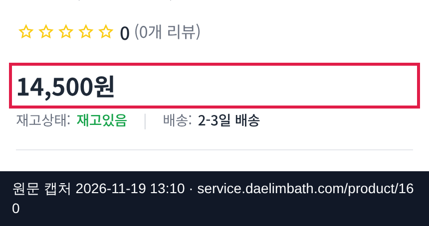
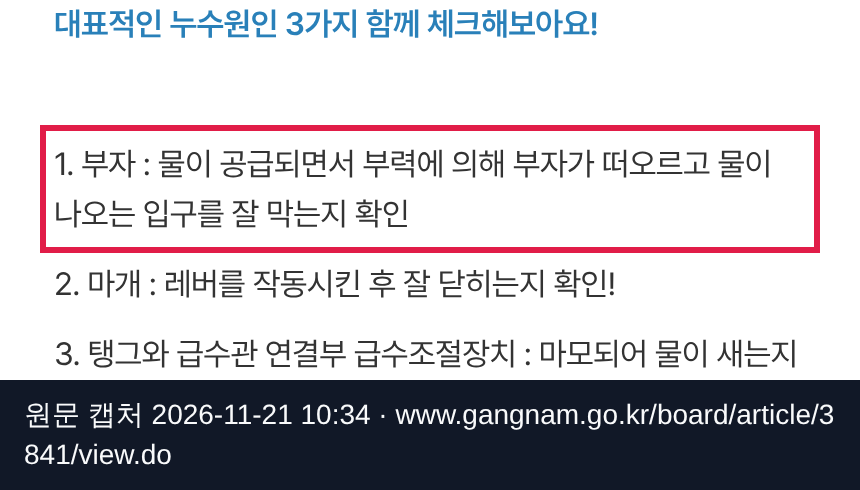
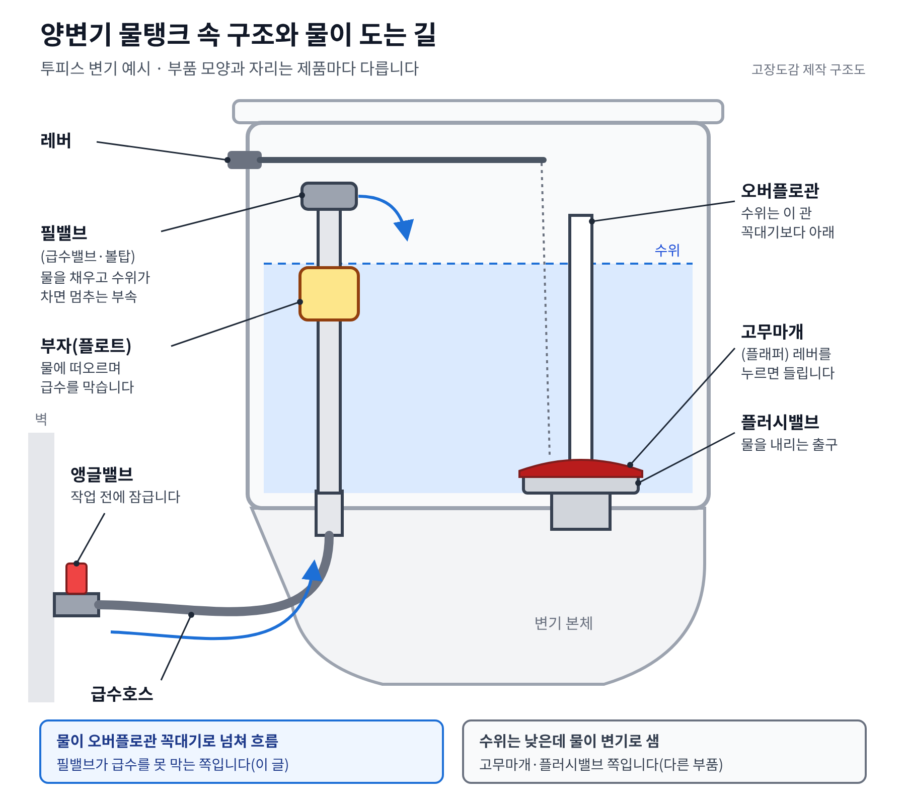

# 변기 필밸브(볼탑) 교체 비용은? 직접 하면 정품 14,500원

변기 물탱크의 필밸브(볼탑)를 직접 바꾸면 대림바스 정품 투피스용 기준으로 부품값 14,500원이 듭니다.
원피스 변기용은 25,700원이고 두 가격 모두 2026년 11월 19일 대림바스 AS부품몰 판매가입니다.

> 광고·제휴 없이 작성한 글입니다.

| 한눈에 보기 | 내용 |
|---|---|
| 난이도 | 쉬움(대림바스 부품몰 표기) |
| 시간 | 제조사가 밝힌 기준 없음 |
| 직접 하면 | 투피스용 14,500원, 원피스용 25,700원(배송비 무료) |
| 기사에게 맡기면 | 부품값에 출장비·서비스 실비가 붙지만 공개된 금액은 없음 |
| 등급 | 초록(세입자는 노랑): 세입자는 집주인에게 먼저 알리고 떼어 낸 부품을 보관 |

출처: 대림바스 AS부품몰 필밸브 상품·배송안내, 대림바스 A/S 안내(2026년 11월 19일 기준)

이 글은 탱크에 물을 채우는 필밸브 한 가지만 다룹니다.
변기 쪽으로 물을 내보내는 고무마개·플러시밸브는 다른 부품이어서 증상을 가르는 데까지만 적었습니다.

## '변기 물이 계속 차요', 필밸브 고장입니까?

대림바스는 필밸브를 "양변기 물탱크 내부에 물을 공급하고 수위를 조절하는 부속"이라고 설명합니다.
같은 상품 안내는 물이 계속 공급되어 멈추지 않을 때, 평소보다 늦게 채워질 때, 급수 중 이상 소음이 날 때를 교체가 필요한 증상으로 꼽습니다.

탱크 뚜껑을 열고 물이 멈춘 뒤의 수위부터 보십시오.
수위와 물길만 봐도 필밸브 고장 증상인지 다른 부품 문제인지 대부분 갈립니다.

| 탱크 안 모습 | 의심할 부품 |
|---|---|
| 물이 오버플로관 꼭대기를 넘어 관 속으로 계속 흘러듦 | 필밸브(이 글) |
| 물탱크 물이 안 차거나 평소보다 늦게 참, 물 차는 소리가 유난함 | 필밸브(이 글) |
| 수위는 오버플로관보다 낮은데 변기 안으로 물이 졸졸 샘 | 고무마개·플러시밸브 |
| 아무도 쓰지 않았는데 필밸브가 저절로 켜졌다 꺼짐 | 고무마개·플러시밸브 |

출처: 대림바스 AS부품몰 필밸브 상품 안내, Fluidmaster 400A 필밸브 설치 설명서 문제 해결 항목(2026년 11월 19일 기준)

필밸브 제조사인 Fluidmaster의 설치 설명서는 필밸브가 저절로 켜졌다 꺼지는 현상을 "This indicates the tank is losing water."라고 풀이합니다.
탱크에서 빠져나간 만큼 필밸브가 다시 채우고 있다는 뜻입니다.

이때 설명서는 고무마개(flapper)와 배수 시트를 먼저 닦아 보라고 합니다.
그래도 새면 고무마개나 플러시밸브를 바꾸라는 안내여서 필밸브를 살 필요가 없습니다.

변기에서 물 내려가는 소리가 계속 들릴 때도 같은 방법으로 가릅니다.
소리가 날 때 물이 오버플로관 꼭대기로 넘어가고 있으면 필밸브 쪽입니다.

강남구 수도 안내도 양변기 누수의 대표 원인으로 부자와 마개를 꼽습니다.
부자는 "부력에 의해 부자가 떠오르고 물이 나오는 입구를 잘 막는지 확인"하고 마개는 "레버를 작동시킨 후 잘 닫히는지 확인"하라는 안내입니다.

구조도의 부품 이름과 자리는 대림바스 필밸브 상품 안내, 강남구 누수 안내, Fluidmaster 400A 설치 설명서의 그림을 따랐습니다.
실제 모양과 위치는 제품마다 다릅니다.

## 앵글밸브가 안 잠기면 멈추고 기사를 부르십시오

- 변기 옆 앵글밸브가 끝까지 잠기지 않거나 녹슬어 돌아가지 않으면 손을 떼십시오. 억지로 돌리다 밸브나 벽 속 배관이 상하면 필밸브보다 큰 공사가 됩니다.
- 아파트·빌라에서 세대 전체 수도를 잠가야 한다면 관리사무소 안내를 따르십시오.
- 물탱크 도기에 금이 보이면 필밸브가 아니라 탱크나 변기를 바꿔야 하는 문제입니다.
- 변기 아래 바닥으로 물이 번지면 탱크 속 부속보다 바닥 배관이나 변기 고정부를 의심해야 합니다. 아랫집 누수로 번질 수 있으니 바로 맡기십시오.
- 설치한 지 1년이 안 된 대림바스 변기라면 시공사나 제조사 AS가 먼저입니다. 대림바스는 "설치 후 1년 이내에 시공 하자, 제품 하자인 경우 무상 AS 가능합니다"라고 안내합니다.
- 변기 모델명을 찾을 수 없다면 부품을 사기 전에 제조사에 문의하십시오. 대림바스는 모델별로 "필밸브의 규격, 높이, 급수 연결 방식이 다를 수 있습니다"라고 밝힙니다.

## 필밸브 교체 공구와 준비물은 무엇입니까?

| 준비물 | 쓰는 곳 | 구하는 방법 |
|---|---|---|
| 정품 필밸브 | 양변기 모델명에 맞는 것. 대림바스 투피스용(CT-761S 등) 14,500원, 원피스용(CC-213 등) 25,700원 | 살 것(제조사 부품몰) |
| 몽키스패너 | 손으로 풀리지 않는 급수호스 너트와 고정 너트 | 집에 있음, 다이소로 충분(멍키스패너 200, 3,000원), 없으면 이웃에게 빌릴 것 |
| 스펀지·양동이·수건 | 탱크 바닥에 남은 물 떠내기, 바닥 보호 | 집에 있음 |
| 고무장갑 | 탱크 물에 손을 넣을 때 | 집에 있음 |
| 급수호스 | 낡거나 갈라진 호스만 함께 교체 | 필요할 때만 살 것 |

출처: 대림바스 AS부품몰 필밸브 상품, 다이소몰 멍키스패너 200(2026년 11월 19일 기준)

필밸브는 다이소몰 판매 품목에 보이지 않아 제조사 부품몰에서 사는 편이 확실합니다.
다이소에서 구하기 쉬운 것은 몽키스패너 같은 공구 쪽입니다.

물에 닿는 부품은 위생 기준도 봐야 합니다.
수도법 제14조는 물에 접촉하는 수도용 자재·제품이 대통령령이 정한 "위생안전기준에 맞는지에 대하여 인증을 받아야 한다"고 정하고 인증받지 않은 제품의 판매도 막습니다.

인증받은 업체는 "인증을 받은 사실을 수도용 자재나 제품 및 그 포장에 표시하여야 한다"는 의무도 집니다.
필밸브를 고를 때는 포장에 수도용 위생안전기준 인증 표시가 있는지 확인하는 편이 안전합니다.

고정 너트와 패킹은 대림바스 기준으로 "해당 상품 및 옵션에 따라 포함 여부 상이"합니다.
주문 전에 상품 구성을 보십시오.

## 필밸브는 어떻게 교체합니까?

순서는 대림바스 필밸브 상품의 설치 방법을 따르고 세부 주의는 Fluidmaster 400A 설치 설명서에서 가져왔습니다.
대림바스도 "부속 종류 및 양변기 모델에 따라 설치 방법은 다를 수 있습니다"라고 밝히므로 새 부품에 설명서가 들어 있으면 그쪽을 우선하십시오.

1. 앵글밸브를 시계 방향으로 돌려 잠급니다.
2. 물을 한 번 내려 탱크를 비우고 바닥에 남은 물은 스펀지로 떠냅니다.
3. 탱크 아래 급수호스 너트를 풀고 필밸브를 탱크에 고정한 너트도 풀어 기존 필밸브를 빼냅니다.
4. 새 필밸브의 높이를 오버플로관보다 높게 맞춥니다. Fluidmaster 400A는 밸브의 C.L. 표시가 "MUST be positioned 1” above top of overflow pipe", 곧 오버플로관 꼭대기보다 1인치 위에 와야 한다고 정합니다.
5. 새 필밸브를 끼우고 고정 너트는 손으로만 조입니다. Fluidmaster 설명서는 "Hand-tighten only. DO NOT OVER TIGHTEN."이라고 적고 세게 조이면 필밸브나 탱크가 깨질 수 있다고 경고합니다.
6. 부자가 탱크 벽이나 레버, 플러시밸브에 닿지 않는지 봅니다.
7. 급수호스를 다시 연결하고 앵글밸브를 엽니다.
8. 시험: 물이 다 차서 멈춘 수위가 오버플로관 꼭대기보다 아래인지 보고 두세 번 물을 내려 같은 자리에서 멈추는지 확인합니다. 탱크 아래 연결부를 마른 휴지로 훑어 젖는 곳이 없으면 끝입니다.

연결부가 젖어 있다면 Fluidmaster 설명서대로 "turn nut just enough to stop leaking", 곧 새지 않을 만큼만 너트를 더 조이십시오.
물이 오버플로관으로 넘친다면 제품의 수위 조절 장치로 부자를 낮춥니다.

Fluidmaster 400A는 조절 나사를 시계 반대 방향으로 돌리면 수위가 내려갑니다.
다른 제품은 조절 방식이 다를 수 있으니 부품 설명서를 보십시오.

## 교체한 다음 날 다시 새는지 어떻게 봅니까?

교체한 날 저녁과 다음 날 아침에 탱크 수위가 같은지 비교하십시오.
아무도 물을 쓰지 않았는데 필밸브가 혼자 켜진다면 이번에는 고무마개 쪽을 의심할 차례입니다.

필밸브를 교체해도 물 차는 소리가 수시로 난다면 같은 경우입니다.
탱크 물이 고무마개 틈으로 빠지는 만큼 새 필밸브가 다시 채우고 있을 수 있습니다.

## 필밸브 교체 비용, 직접 하면 얼마이고 기사는 얼마입니까?

| 항목 | 직접 | 기사 |
|---|---|---|
| 필밸브(투피스용 정품) | 14,500원 | 기사가 가져오는 부품값은 공개 기준 없음 |
| 필밸브(원피스용 정품) | 25,700원 | 위와 같음 |
| 배송비 | 무료(도서산간·제주 제외) | 해당 없음 |
| 공구 | 집에 있으면 추가 비용 없음, 다이소 멍키스패너를 새로 사면 3,000원 | 해당 없음 |
| 출장비·공임 | 없음 | 공개된 공식 금액 없음 |
| 합계 | 투피스 14,500~17,500원, 원피스 25,700~28,700원 | 부품값 + 출장비 + 서비스 실비 |

출처: 대림바스 AS부품몰 필밸브 상품·배송안내, 대림바스 A/S 안내, 다이소몰 멍키스패너 200(2026년 11월 19일 기준). 합계는 부품값에 공구값을 더한 고장도감 계산입니다.

기사에게 맡길 때의 금액은 공개된 기준이 없습니다.
대림바스는 고객 과실이면 "출장비, 서비스 실비가 청구됩니다"라고만 밝히고 금액은 싣지 않았습니다.

공구를 새로 사도 직접 비용은 3,000원 늘 뿐이지만 기사 쪽 금액이 없어 두 길을 금액으로 맞대지는 못합니다.

대림바스 정품 부품 자체는 "제품 구매 후 6개월 이내 정상 사용 중 발생한 제품 이상에 대해서는 무상 A/S가 가능합니다".
영수증을 보관해 두면 새 필밸브가 곧 고장 났을 때 쓸 수 있습니다.

## 세입자라면 변기 수리는 집주인 몫입니까?

민법 제623조는 임대인이 목적물을 "계약존속중 그 사용, 수익에 필요한 상태를 유지하게 할 의무"를 진다고 정합니다.
대법원은 2012년 6월 14일 선고한 2010다89876 판결에서 이 의무의 경계를 그었습니다.

"임차인이 별비용을 들이지 아니하고도 손쉽게 고칠 수 있을 정도의 사소한 것"이어서 사용을 방해하지 않는다면 임대인에게 수선의무가 없습니다.
반대로 고치지 않으면 "사용·수익할 수 없는 상태로 될 정도의 것이라면 임대인은 수선의무를 부담한다"고 판결은 밝힙니다.

필밸브 교체만 따로 다룬 판결은 확인되지 않아 고장 정도와 계약서 특약을 기준으로 따집니다.
판결이 보는 것은 부품값보다 고치지 않았을 때 변기를 제대로 쓸 수 있느냐입니다.

계약서에 수선 부담을 정한 특약이 있는지도 함께 보십시오.
세입자가 할 일은 세 가지입니다.

- 고장을 알면 바로 집주인에게 알리십시오. 민법 제634조는 "임차물의 수리를 요하거나" 권리를 주장하는 사람이 있을 때 임차인이 지체 없이 임대인에게 통지하도록 정합니다. 문자로 보내면 날짜가 남습니다.
- 집주인 몫의 수리를 먼저 했다면 필요비로 돌려받을 수 있습니다. 민법 제626조는 "임차인이 임차물의 보존에 관한 필요비를 지출한 때에는 임대인에 대하여 그 상환을 청구할 수 있다"고 정합니다. 영수증과 교체 전후 사진을 남기십시오.
- 떼어 낸 필밸브는 버리지 마십시오. 임대차가 끝날 때는 원상회복 의무(민법 제654조가 준용하는 제615조)가 있으니 원래 부품을 두면 같은 규격으로 바꿨다는 것을 보여 줄 수 있습니다.

누가 내든 빨리 고치는 편이 낫습니다.
서울시는 2020년 1월 1일부터 양변기 누수에 따른 수도요금을, 2023년 1월 1일부터 하수도 요금을 감면 대상에서 뺐습니다.

강남구 안내는 그 이유로 양변기 누수가 "전체 누수 건수 중 40%에 해당되어" 수자원 낭비의 주요 원인이라는 점을 들었습니다.
다른 시·군은 기준이 다를 수 있으니 관할 수도사업소 안내를 보십시오.

## 변기 누수로 수도요금 100만 원이 나오면 세입자도 냅니까?

로톡뉴스는 2019년 7월 19일 로톡 상담 사례를 재구성해 원룸 월세 세입자의 일을 보도했습니다.
세입자는 화장실에서 '우웅' 하는 소리만 들었을 뿐 물이 새는 줄은 몰랐습니다.

발단은 변기 누수를 의심한 집주인이 수도요금 100만 원을 "반반씩 부담하자"고 한 제안입니다.
상담한 변호사의 답은 "집(변기)의 하자로 인한 것인 만큼" 수선의무가 있는 임대인이 내는 것이 옳다는 쪽이었습니다.

법원 판결이 아니라 변호사 한 명의 상담 의견입니다.
변호사가 근거로 든 임대인의 수선의무는 민법 제623조에 있고 그 조문은 2026년 11월 19일 현행 법령에서도 그대로입니다.

화장실에서 물 차는 소리가 이어진다면 이 글 앞부분의 수위 확인부터 하고 집주인에게 알리십시오.
누수를 늦게 알수록 나눠 낼 요금도 커집니다.

## 기사에게 맡긴 금액을 알려 주십시오

필밸브 교체를 기사에게 맡겼을 때의 출장비와 공임은 공개 자료에 없습니다.
받은 견적서나 영수증 금액을 보내 주시면 제보가 모이는 대로 위 비용표에 지역별로 더하겠습니다.

[변기 필밸브 교체비 제보하기](site:/submit-repair#cta-bottom)

직접 바꾸셨다면 변기 모델명을 어디서 찾았는지 댓글로 남겨 주십시오.
모델명 스티커 위치는 제품마다 달라 다음 독자에게 바로 도움이 됩니다.

## 출처

- 대림바스 AS부품몰 [필밸브(투피스용)](https://service.daelimbath.com/product/160), [필밸브(원피스용)](https://service.daelimbath.com/product/141), [배송안내](https://service.daelimbath.com/shipping) (2026년 11월 19일 기준)
- 대림바스 [A/S 서비스 안내](https://www.daelimbath.com/download/as_guide) (2026년 11월 19일 기준)
- 다이소몰 [멍키스패너 200](https://www.daisomall.co.kr/pd/pdr/SCR_PDR_0001?pdNo=57411) (2026년 11월 19일 기준)
- Fluidmaster [400A Fill Valve Installation Instructions](https://res.cloudinary.com/dzhpkjoqj/Fluidmaster/FLUIDMINST00101.pdf) (설치·문제 해결 항목, 2026년 11월 19일 기준)
- 국가법령정보센터 [민법](https://www.law.go.kr/법령/민법) 제615조·제623조·제626조·제634조·제654조, [수도법](https://www.law.go.kr/법령/수도법) 제14조, [대법원 2010다89876 판결](https://www.law.go.kr/LSW/precInfoP.do?precSeq=164196) (2026년 11월 19일 기준)
- 서울특별시 [하수도 요금 양변기 누수 감면 제외 안내](https://news.seoul.go.kr/env/archives/520951), 강남구 [양변기 누수 수도요금 감면 변경 안내](https://www.gangnam.go.kr/board/article/3841/view.do?mid=id01_0501) (강남구 글 2019-12-05 게시, 2026년 11월 19일 확인)
- 로톡뉴스 [변기 누수로 수도요금 100만 원, 누구 책임인가요?](https://lawtalknews.co.kr/article/UM6TZCCZ1GHI) (2019-07-19 보도, 2026년 11월 19일 확인)

> 만든 방법: AI 도구로 초안을 쓰고 출처의 숫자·문구를 원문과 자동 대조했습니다. 마지막 대조일은 2026-11-19입니다. 구조도는 위 제조사 자료의 부품 이름과 자리를 바탕으로 고장도감이 직접 그렸습니다. AI 사용 범위는 [방법론의 AI 사용 원칙](site:/methodology#ai)에 정리했습니다.

이 글은 일반 정보입니다.
변기 모델과 배관 상태에 따라 순서와 결과가 달라질 수 있습니다.

바로잡기: 숫자나 문구가 원문과 다르면 댓글로 알려 주십시오. 원문을 다시 확인해 고치고 수정 이력에 남기겠습니다.

쓴 사람: [[판단: 바이라인 — 실명과 활동명 중 무엇으로, 어떤 소개로 드러낼지 정하기. AI 초안: "고장도감 운영자 ○○. 가전 수리비를 공식 자료와 사용자 제보로 비교해 기록합니다." 정한 문장은 AI가 모든 글에 넣음]]

수정 이력: 2026-11-19 첫 원고
