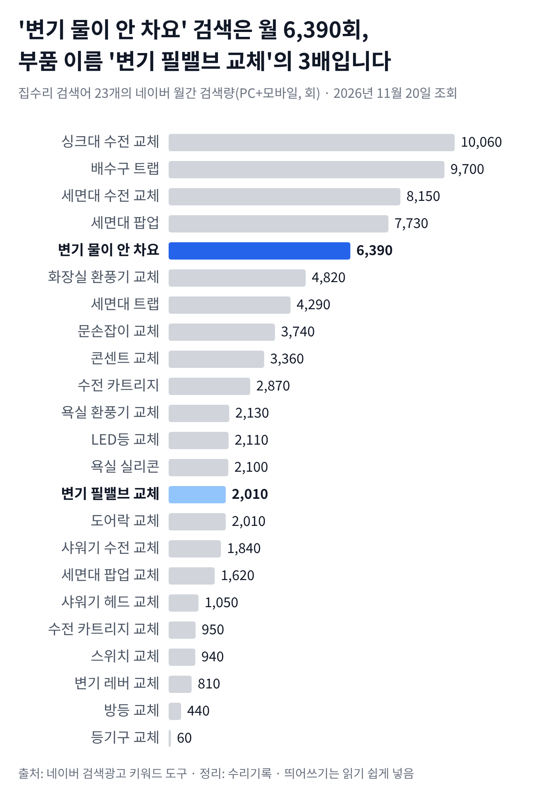
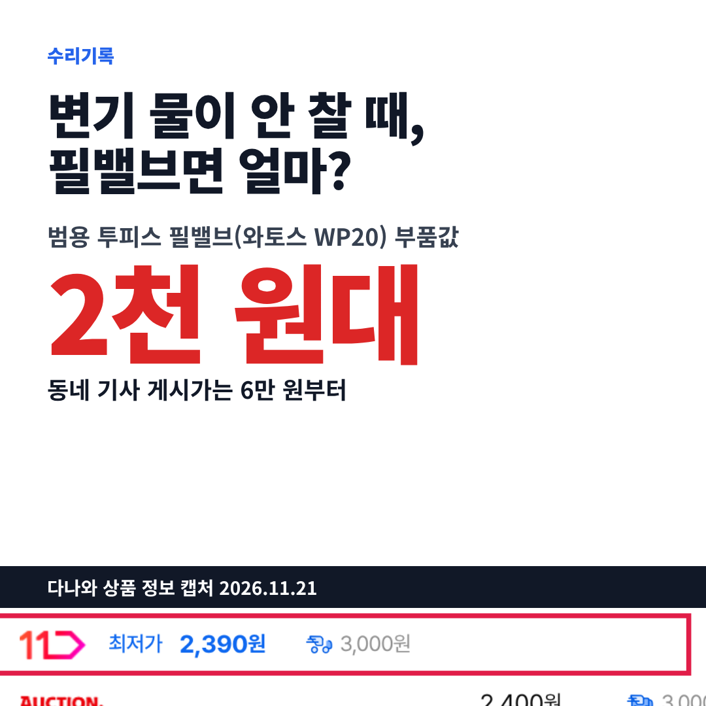
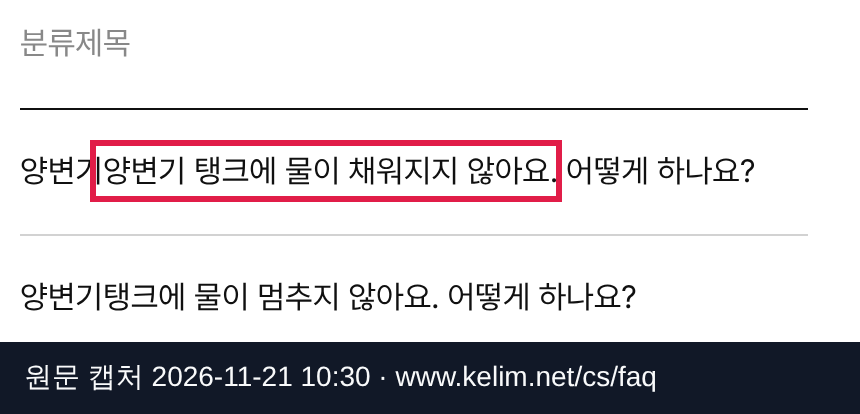
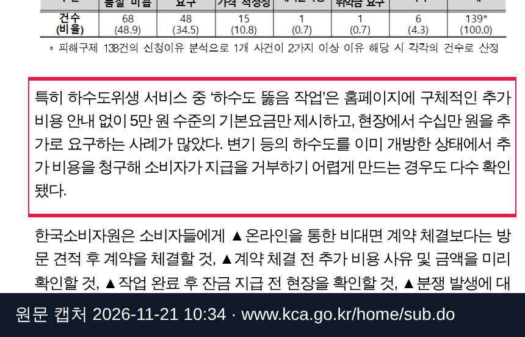
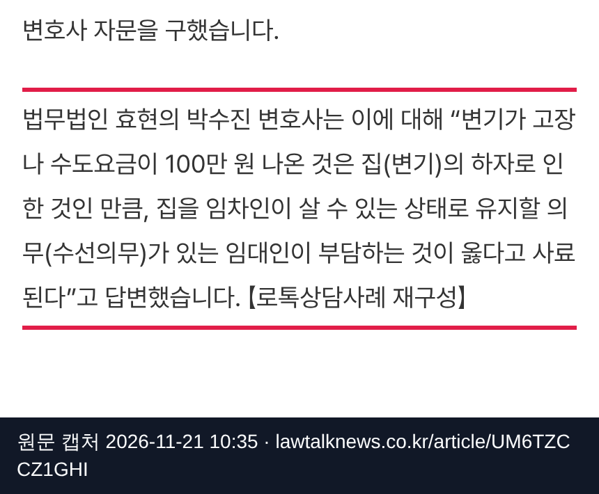

# 변기 물이 안 차요? 필밸브면 직접 2천 원대부터, 기사는 6만 원부터

네이버 검색어를 살펴보니 '변기 물이 안 차요'를 정말 많이 궁금해하셨습니다.
원인이 물탱크 속 필밸브(볼탑)라면 직접 바꿀 때 부품값은 2천 원대(다나와 최저가 2,390원, 배송비 별도)부터이고 동네 기사에게 맡기면 게시가 기준 6만 원부터입니다.

'변기 물이 안 차요'는 집수리 검색어 23개 가운데 다섯 번째로 많은 월 6,390회입니다.
같은 고장을 부품 이름으로 찾는 '변기 필밸브 교체'(월 2,010회)의 3배입니다.

부품 이름보다 증상으로 먼저 찾으신다는 뜻이어서 이 글도 증상에서 출발합니다.
물이 안 차는 원인이 모두 필밸브는 아니므로 세면대 물, 앵글밸브, 겨울철 동파부터 가르고 부품과 값으로 넘어갑니다.

> 협찬·제휴 없이 작성한 글입니다.

| 한눈에 보기 | 내용 |
|---|---|
| 먼저 볼 것 | 세면대 물이 나오는지, 앵글밸브가 끝까지 열렸는지, 겨울이면 계량기 동파 |
| 난이도 | 쉬움: 앵글밸브를 잠그고 탱크 안 부품 하나를 바꾸는 일 |
| 시간 | 제조사가 밝힌 기준 없음 |
| 직접 하면 | 필밸브 투피스 2,390~7,460원, 원피스 17,400~33,750원(다나와 최저가, 배송비 별도) |
| 기사에게 맡기면 | 동네업체 게시가 투피스 6만 원부터, 출장비를 따로 받으면 100,000원부터. 한샘 AS는 방문점검비 50,000원 + 기술료 + 자재비 |
| 등급 | 초록(세입자는 노랑): 세입자는 집주인에게 먼저 알리고 떼어 낸 부품을 보관 |

출처: 다나와 상품 정보, 당근 동네업체 게시가, 한샘 서비스센터 요금 안내(2026년 11월 20일 기준)

## 변기 물이 안 차요, 어디부터 봐야 합니까?

제조사 설명서와 수도사업자 안내에 나온 원인은 단수, 동파, 앵글밸브, 급수호스, 필밸브 이물질, 필밸브 고장입니다.
아래 순서로 보면 필밸브를 살 일인지 갈립니다.

1. 세면대 수도를 틀어 보십시오. 거기서도 물이 안 나오면 변기가 아니라 집 전체의 단수나 동파 쪽입니다.
2. 변기 옆 앵글밸브가 끝까지 열렸는지, 탱크로 가는 급수호스가 꺾이지 않았는지 보십시오.
3. 앵글밸브를 잠그고 탱크 아래 호스 너트를 풀어 양동이에 댄 뒤 밸브를 천천히 여십시오.
4. 양동이로 물이 세게 나오는데 탱크만 늦게 차면 필밸브 쪽입니다.

Kohler의 문제 해결 안내는 탱크가 늦게 찰 때 첫 조치로 "A. Fully open the water supply shut-off valve."를 듭니다.
Korky도 "A partially closed valve or restricted supply line can limit water flow into the tank."라며 꺾인 호스는 "Straighten the line if it is kinked."라고 안내합니다.

이누스도 물탱크에 물이 채워지지 않을 때 "먼저 앵글밸브가 잠겨있는지 확인해주시기 바랍니다"라고 안내합니다.
그다음으로 "잔수호스가 플러시 밸브 몸체에서 탈거되어 있는지" 보라고 합니다.

계림 고객센터 FAQ의 '양변기 탱크에 물이 채워지지 않아요' 항목은 세 번째 점검으로 "필밸브 부구가 다른곳에 닿았는지 확인하십시요"를 듭니다.
부구(부자)가 탱크 벽이나 레버에 걸리면 필밸브가 열리지 않습니다.

양동이 시험은 미국 변기 부속 제조사 Korky(Lavelle Industries)의 안내에 나옵니다.
급수호스를 필밸브에서 풀어 "redirect the line into a bucket" 하라는 방법입니다.

Korky는 이때 양동이로 물이 거의 안 나오면 "There may be a blockage in the line or your incoming water supply"라고 판정합니다.
앵글밸브나 배관 쪽 문제라는 뜻이어서 필밸브를 바꿔도 낫지 않습니다.

| 이렇게 보이면 | 원인 | 고치는 길 |
|---|---|---|
| 세면대도 물이 안 나옴 | 단수·동파 | 관리사무소 공지 확인, 동파면 수도사업소 신고 |
| 앵글밸브가 덜 열림, 호스가 꺾임 | 급수 쪽 | 밸브를 끝까지 열고 호스를 폄 |
| 양동이 시험에서 물이 약함 | 앵글밸브·배관 막힘 | 관리사무소나 기사 |
| 양동이로는 세게 나오는데 탱크만 늦게 참 | 필밸브 이물질·씰 마모 | 이물질 청소, 씰이나 필밸브 교체 |
| 부자가 탱크 벽·레버에 닿음, 수위가 너무 낮음 | 부자 위치·수위 설정 | 부자 위치를 고치고 수위를 올림 |

출처: 이누스·계림 고객센터 FAQ, Kohler·Korky 문제 해결 안내, Fluidmaster 400A 설치 설명서, 서울시 동파 안내(2026년 11월 20일 기준)

## 겨울에 갑자기 안 차면 동파부터 의심하십시오

이 글이 올라가는 12월부터는 계량기 동파가 늘어납니다.
서울시는 2026년 11월 15일 보도자료에서 지난겨울 수도계량기 동파가 "전년 2,046건보다 708건(34.6%) 증가한 2,754건으로 집계됐다"고 밝혔습니다.
그 가운데 "1,352건(49.1%)이 복도식 아파트에서 발생해" 복도에 계량기함이 있는 집이 특히 위험합니다.

서울시 안내는 "수돗물이 갑자기 나오지 않을 때에는 수도계량기 유리가 깨지거나 부풀어 올랐는지 확인하여" 신고하라고 합니다(2019년 12월 안내).
변기만이 아니라 세면대까지 물이 안 나오면 이 확인부터 하십시오.

- 녹일 때: 서울시 2025년 11월 14일 안내는 "언 계량기는 50℃ 이하의 열로 천천히 녹이는" 방법을 권합니다.
- 불은 쓰지 마십시오: 2020년 2월 서울시 안내는 "화기(토치, 헤어드라이기 등)를 사용하면 화재가 발생할 수 있고" "50도 이상 뜨거운 물을 사용할 경우 계량기 파손의 위험이 있으므로" 피하라고 적었습니다.
- 계량기 지시부가 깨졌거나 부풀었으면 직접 손대지 말고 신고하십시오. 서울시는 지시부가 깨지거나 부풀면 계량기 파손이나 누수로 이어질 수 있다고 설명합니다.
- 교체 비용: 서울시는 "한파 등 자연재해로 수도계량기가 동파된 경우에는 무상으로 교체를 지원한다"고 밝혔습니다. 다만 "관리 소홀로 동파된 경우에는 사용자에게 계량기 대금과 교체비용이 부과될 수 있다"고 덧붙였습니다.
- 신고처: 서울은 동파가 의심되면 "120다산콜재단, 관할 수도사업소 또는 아리수 요금고객센터로 즉시 신고"해 달라고 합니다. K-water가 맡은 지방상수도는 "물이 잘 안나오는 등 불편사항을 신고하시면 즉시(도서지역 제외) 현장에 출동하여" 조치한다고 서비스 기준에 적었습니다.

## 필밸브 쪽이라면 바꾸기 전에 무엇을 해 봅니까?

필밸브가 의심돼도 새로 사기 전에 이물질부터 빼 보십시오.
단수나 수도 공사 뒤에 물이 늦게 찬다면 더 그렇습니다.

아메리칸스탠다드 미국 FAQ는 "Sometimes debris can get stuck inside the fill valve causing it to refill your tank slowly."라고 설명합니다.
TOTO 미국 설명서도 "An indication that the strainer requires service can be seen in a delayed fill cycle"라며 물이 늦게 차는 것을 거름망 청소 신호로 봅니다.

Fluidmaster 400A 설명서의 순서는 이렇습니다.
"Remove top cap and check for debris."로 뚜껑을 열어 이물질을 보고 그래도 느리면 "replace seal with a genuine Fluidmaster 242"로 씰을 바꾸라고 합니다.

물이 오버플로관보다 한참 아래에서 멈춘다면 고장이 아니라 수위 설정일 수 있습니다.
같은 설명서는 "Water level in tank may be too low."라고 짚고 400A는 "turn adjustment screw clockwise to raise"로 올리라고 안내합니다.

국내 제조사 누리집에는 필밸브 이물질 청소 순서가 공개돼 있지 않습니다.
뚜껑 여는 법과 수위 조절 방식은 제품마다 다르니 내 필밸브의 설명서나 제조사 고객센터 안내를 따르십시오.

## 물이 계속 차거나 물소리가 안 멈추면 무엇이 고장입니까?

반대로 변기 물이 계속 차요, 물소리가 안 멈춰요라는 증상도 탱크 뚜껑을 열고 물길을 보면 갈립니다.

| 탱크 안 모습 | 의심할 부품 |
|---|---|
| 물이 오버플로관 꼭대기를 넘어 관 속으로 계속 흘러듦 | 필밸브 |
| 수위는 오버플로관보다 낮은데 변기 안으로 물이 졸졸 샘 | 고무마개·플러시밸브 |
| 아무도 쓰지 않았는데 필밸브가 저절로 켜졌다 꺼짐 | 고무마개·플러시밸브 |

출처: Fluidmaster 400A 설치 설명서 문제 해결 항목, 강남구 양변기 누수 안내(2026년 11월 20일 기준)

Fluidmaster 설명서는 필밸브가 저절로 켜졌다 꺼지면 "This indicates the tank is losing water."라고 풀이합니다.
이때는 "Clean flapper and drain seat. If leak continues, change flapper or flush valve."라고 해 필밸브를 살 필요가 없습니다.

강남구 수도 안내도 양변기 누수의 대표 원인으로 부자와 마개를 꼽습니다.
부자는 "부력에 의해 부자가 떠오르고 물이 나오는 입구를 잘 막는지 확인"하고 마개는 "레버를 작동시킨 후 잘 닫히는지 확인"하라는 안내입니다.

구조도의 부품 이름과 자리는 강남구 누수 안내와 Fluidmaster 400A 설치 설명서의 그림을 따랐습니다.
실제 모양과 위치는 제품마다 다릅니다.

## 앵글밸브가 안 잠기면 멈추고 기사를 부르십시오

- 변기 옆 앵글밸브가 끝까지 잠기지 않거나 녹슬어 돌아가지 않으면 손을 떼십시오. 억지로 돌리다 밸브나 벽 속 배관이 상하면 필밸브보다 큰 공사가 됩니다.
- 아파트·빌라에서 세대 전체 수도를 잠가야 한다면 관리사무소 안내를 따르십시오.
- 물탱크 도기에 금이 보이면 필밸브가 아니라 탱크나 변기를 바꿔야 하는 문제입니다.
- 변기 아래 바닥으로 물이 번지면 탱크 속 부속보다 바닥 배관이나 변기 고정부를 의심해야 합니다. 아랫집 누수로 번질 수 있으니 바로 맡기십시오.
- 설치한 지 1년이 안 된 변기라면 시공사나 제조사 AS가 먼저입니다. 대림바스는 "설치 후 1년 이내에 시공 하자, 제품 하자인 경우 무상 AS 가능합니다"라고 안내합니다.
- 계량기 지시부가 깨졌다면 집 안 부품 문제가 아니므로 수도사업소에 신고하십시오.

## 우리 집 변기는 어느 브랜드이고 모델명은 어디에 있습니까?

국내에서 만든 위생도기는 대림바스와 계림이 대부분입니다.
대한도자기·타일공업협동조합의 '국내 위생도기 제조업체 연간 출하현황'을 인용한 이코노미스트 보도(2026년 5월 11일)에 따르면 2025년 점유율은 대림바스 61.8%, 계림요업 25.3%입니다.

이 숫자는 국내 제조사 출하 기준이어서 아메리칸스탠다드·TOTO 같은 수입 브랜드는 빠진 값입니다.
최근 1년 판매 순위를 수입 브랜드까지 넣어 공개한 자료는 없습니다.

온라인 판매 쪽은 다나와 양변기 인기순이 참고가 됩니다.
2026년 11월 20일 상위 30개 가운데 대림바스가 15개, 아메리칸스탠다드가 4개, 이누스가 2개, 한샘이 1개였습니다.

다나와 인기순은 "조회수, 판매량, 판매금액, 연관 콘텐츠 수 등을 점수화하여" 매기는 순위라 판매량 순위와 같지는 않습니다.
한국소비자원도 2024년 1월 25일 보도자료에서 "소비자 선호도가 높은 절수형 변기"로 대림바스·계림·이누스·아메리칸스탠다드·한샘·로얄앤코·토토 등 "10개 업체의 14개 제품에 대해" 시험했습니다.

부품을 사기 전에 모델명부터 찾으십시오.
제조사 가운데 모델명 위치를 직접 밝힌 곳은 이누스입니다.

- "레버 반대편의 물탱크와 양변기 하부 확인"
- "탱크뚜껑을 열어 뚜껑내부 확인"
- "하부 겉면 부착 스티커로 확인"

오래된 변기는 스티커가 떨어져 없을 수도 있습니다.

같은 소비자원 시험에서 변기시트는 모델명·재질·제조자명을 표시해야 하는데도 "모든 제품이 표시사항의 일부 또는 전체를 누락해 개선이 필요했다"는 결과가 나왔습니다.
표시가 빠진 제품이 흔하므로 스티커가 안 보이면 탱크 속 부품 사진을 찍어 고객센터에 보내는 편이 빠릅니다.

## 브랜드별 필밸브는 어디서 사고 AS 전화는 몇 번입니까?

| 브랜드 | 필밸브 구하는 곳·값 | AS 전화·무상 기간 |
|---|---|---|
| 대림바스 | 직영 부품몰, 다나와 투피스 볼탑 7,460원·원피스 CC-213·214용 17,400원 | 1588-1952, 설치 후 1년. 유상이면 출장비·서비스 실비(금액 비공개) |
| 계림 | 공식몰에는 없고 대리점·판매점. 다나와 원피스 33,750원 | 1566-8625, 무상 기간·출장비 비공개 |
| 이누스 | 부품 판매업체 푸른물(1566-3787). 다나와 원피스 32,620원(가격 2026년 4월 갱신) | 1588-8613, 인도(설치)일부터 1년. 출장비 지역별 차등 |
| 아메리칸스탠다드 | 다나와 검색 상품 32,500원(C603700Z) | 제품 설명서·보증서의 고객센터 번호로 문의 |
| 한샘 | 한샘 양변기 부속품 WTG300 15,300원(구성 미표기) | 1588-0900, 1년. 방문점검비 50,000원(휴일·야간 60,000원) + 기술료 + 자재비 |
| 콜러 | 모델명으로 A/S에 문의 | A/S 070-4067-5455 |
| 와토스(범용) | WP20 2,390원, 높이조절 WP250 7,040원, 원피스 WP21 19,920원 | 변기 제조사 AS 대상이 아님 |

출처: 다나와 상품 정보, 대림바스·계림·이누스·한샘·콜러 고객센터 안내(2026년 11월 20일 기준). 다나와 값은 최저가이고 배송비는 별도입니다.

대림바스는 직영 부품몰을 따로 두면서 "부품 구매와 제품 점검·수리 서비스는 별도로 운영됩니다"라고 밝힙니다.
부품만 사서 직접 바꿀 수도 있고 고객센터로 수리를 따로 신청할 수도 있다는 뜻입니다.

계림은 부품을 전국 대리점·판매점에서 사게 하며 "부속은 재고가 없는 경우도 있사오니" 미리 확인하라고 합니다.
수리를 신청할 때 모델명을 잘못 적으면 "이중 출장비 발생"이 될 수 있다고 경고합니다.

원피스(일체형) 변기는 필밸브가 다른 부속과 묶이는 경우가 많습니다.
계림 FAQ는 로우탱크 원피스에서 "제트펌프 전환 부구 패킹의 노후로 인한 변형 발생 및 작동불량"도 물 문제의 원인으로 듭니다.

원피스는 모델명을 고객센터에 알려 맞는 부속을 받는 편이 안전합니다.
다나와에서도 이누스·계림 원피스 필밸브는 분사펌프와 묶인 상품으로 팔립니다.

## 범용 필밸브(와토스)를 써도 됩니까?

투피스 변기라면 범용 필밸브를 쓰는 집이 많습니다.
한국경제(2025년 8월 29일)는 와토스코리아를 "국내 위생도기 부품 시장의 50% 정도를 차지하고 있는 와토스코리아"로 소개했습니다.

다나와 리뷰 수도 범용 쪽이 많습니다.
와토스 WP20은 평점 4.6점에 리뷰 2,557건, 대림바스 투피스 볼탑은 4.6점에 리뷰 289건입니다(2026년 11월 21일).

동네 수리업체도 범용 부품을 쓰는 곳이 있습니다.
서울 강남의 한 당근 업체는 투피스 부속 교체 항목에 "와토스/자재비 포함"이라고 적어 두었습니다.

범용을 고를 때 볼 것은 세 가지입니다.

- 높이: 탱크가 높으면 키높이 조절형(와토스 WP250 7,040원)이 맞습니다. 새 필밸브의 높이는 오버플로관보다 높아야 합니다.
- 원피스: 범용 원피스용(와토스 WP21 19,920원)이 있지만 분사펌프와 짝이 맞는지 모델명으로 확인하십시오.
- 인증 표시: 같은 한국경제 기사는 중국산 부품을 두고 업계 추산으로 "품질 수준은 떨어지지만 가격은 30% 이상 저렴한 편"이라고 전했습니다. 포장에 수도용 위생안전기준 인증 표시가 있는지 보십시오(아래 준비물 절).

## 필밸브 교체 공구와 준비물은 무엇입니까?

| 준비물 | 쓰는 곳 | 구하는 방법 |
|---|---|---|
| 필밸브 | 변기 모델에 맞는 브랜드 정품 또는 범용(투피스 2,390~7,460원, 원피스 17,400~33,750원) | 살 것(제조사 부품몰·대리점·다나와 등) |
| 몽키스패너 | 손으로 풀리지 않는 급수호스 너트와 고정 너트 | 집에 있음, 다이소로 충분(멍키스패너 200, 3,000원), 없으면 이웃에게 빌릴 것 |
| 스펀지·양동이·수건 | 탱크 바닥에 남은 물 떠내기, 양동이 시험, 바닥 보호 | 집에 있음 |
| 고무장갑 | 탱크 물에 손을 넣을 때 | 집에 있음 |
| 급수호스 | 낡거나 갈라진 호스만 함께 교체 | 필요할 때만 살 것 |

출처: 다나와 상품 정보, 다이소몰 멍키스패너 200(2026년 11월 20일 기준)

필밸브는 다이소몰 판매 품목에 없어 제조사 부품몰이나 가격비교 쇼핑몰에서 사는 편이 확실합니다.
다이소에서 구하기 쉬운 것은 몽키스패너 같은 공구 쪽입니다.

리뷰를 보면 공구 사정은 집마다 다릅니다.
"몽키스패너 하나면 해결"했다는 사람이 있는 반면 변기 아래가 좁아 "큰 너트에 맞는 공구가 필요하네요"라고 쓴 사람도 있습니다.

물에 닿는 부품은 위생 기준도 봐야 합니다.
수도법 제14조는 물에 접촉하는 수도용 자재·제품이 대통령령이 정한 "위생안전기준에 맞는지에 대하여 인증을 받아야 한다"고 정하고 인증받지 않은 제품의 판매도 막습니다.

인증받은 업체는 "인증을 받은 사실을 수도용 자재나 제품 및 그 포장에 표시하여야 한다"는 의무도 집니다.
필밸브를 고를 때는 포장에 수도용 위생안전기준 인증 표시가 있는지 확인하십시오.

## 필밸브는 어떻게 교체합니까?

순서는 Fluidmaster 400A 설치 설명서를 바탕으로 했습니다.
새 부품에 설명서가 들어 있으면 그쪽을 우선하십시오.

1. 앵글밸브를 끝까지 돌려 잠급니다. 손잡이 모양에 따라 돌리는 방향이 다를 수 있습니다.
2. 물을 한 번 내려 탱크를 비우고 바닥에 남은 물은 스펀지로 떠냅니다. Fluidmaster 설명서의 "Flush toilet and remove excess water from tank with sponge" 단계입니다.
3. 탱크 아래 급수호스 너트를 풀고 필밸브를 탱크에 고정한 너트도 풀어 기존 필밸브를 빼냅니다.
4. 새 필밸브의 높이를 오버플로관보다 높게 맞춥니다. 400A 설명서는 밸브의 C.L. 표시가 "MUST be positioned 1” above top of overflow pipe"라고 정합니다.
5. 새 필밸브를 끼우고 고정 너트를 조입니다. 조이는 세기는 아래 설명처럼 제품마다 다릅니다.
6. 부자가 탱크 벽이나 레버, 플러시밸브에 닿지 않는지 봅니다. 설명서 문구는 "Make sure the float cup does not touch the tank walls"입니다.
7. 급수호스를 다시 연결하고 앵글밸브를 엽니다.
8. 시험: 물이 다 차서 멈춘 수위가 오버플로관 꼭대기보다 아래인지 보고 두세 번 물을 내려 같은 자리에서 멈추는지 확인합니다. 탱크 아래 연결부를 마른 휴지로 훑어 젖는 곳이 없으면 끝입니다.

고정 너트는 세게 조인다고 좋은 것이 아닙니다.
Fluidmaster 400A는 "Hand-tighten only. DO NOT OVER TIGHTEN."이라며 "Over tightening may crack the fill valve or tank"라고 경고합니다.

와토스 WP20 리뷰에도 "비철이라 지나친 조립력은 파손의 원인이 될 수 있으니" 조심하라는 글이 있습니다.
다른 구매자는 무리하게 조인 뒤 물 차는 데 "1분 30초 정도로 오래 걸림"이었고 새 필밸브를 적당한 힘으로 다시 달자 괜찮아졌다고 적었습니다.

연결부가 젖어 있다면 Fluidmaster 설명서대로 "turn nut just enough to stop leaking" 하십시오.
물이 오버플로관으로 넘친다면 400A는 조절 나사를 "counter clockwise to lower water level" 돌려 수위를 낮춥니다.

## 교체한 다음 날 다시 새는지 어떻게 봅니까?

교체한 날 저녁과 다음 날 아침에 탱크 수위가 같은지 비교하십시오.
Fluidmaster 설명서 기준으로 멈춘 수위는 "WATER LEVEL (C) is set below top of Overflow Pipe"여야 합니다.

아무도 물을 쓰지 않았는데 필밸브가 혼자 켜진다면 이번에는 고무마개 쪽을 의심할 차례입니다.
한 구매자는 필밸브를 바꾸고도 "교체해도 동일증상이라" 배수 쪽을 다시 살펴야 했습니다.

## 필밸브 교체 비용, 직접 하면 얼마이고 기사는 얼마입니까?

| 항목 | 직접 | 기사·제조사 AS |
|---|---|---|
| 필밸브(투피스) | 범용 2,390원부터, 대림바스 7,460원부터 | 업체 게시가에 자재비를 포함한 곳이 있음 |
| 필밸브(원피스) | 17,400~33,750원 | 위와 같음 |
| 공구 | 집에 있으면 추가 비용 없음, 다이소 멍키스패너 3,000원 | 해당 없음 |
| 출장비·공임 | 없음 | 동네업체 투피스 6만 원부터, 출장비 30,000원을 따로 받는 곳은 70,000원 + 30,000원. 한샘은 방문점검비 50,000원 + 기술료 + 자재비 |
| 합계 | 투피스 2,390~10,460원(배송비 별도) | 투피스 6만~100,000원(게시 시작가 기준) |

출처: 다나와 상품 정보, 다이소몰, 당근 동네업체 게시가, 한샘 서비스센터 요금 안내(2026년 11월 20일 기준). 합계는 수리기록 계산입니다.

동네업체 금액은 업체가 당근에 직접 올린 시작가입니다.
당근은 이 정보가 "업체 관리자가 직접 등록한 것으로" 책임지지 않는다고 밝히므로 실제 견적은 전화로 다시 받으십시오.

제조사 AS 가운데 출장비를 공개한 곳은 한샘뿐이었습니다.
대림바스는 고객 과실이면 "출장비, 서비스 실비가 청구됩니다"라고만 적었고 이누스는 출장비가 "지역별로 차등 청구됩니다"라고 밝혔습니다.

공구를 새로 사도 직접 비용은 3,000원 늘 뿐입니다.
투피스라면 대림바스 볼탑에 공구까지 사도 10,460원입니다.

## 직접 바꾼 사람들의 후기는 어땠습니까?

다나와에 모인 쇼핑몰 리뷰 평점은 와토스 WP20 4.6점(리뷰 2,557건), 와토스 WP21 4.5점(669건), 대림바스 투피스 볼탑 4.6점(289건)입니다.
평점은 판매처 리뷰를 모은 값이라 설치 난이도만 평가한 것은 아닙니다.

리뷰에는 이 글의 증상이 그대로 나옵니다.
와토스 WP20 구매자는 "물이 늦게 차올라서 밸브를 교체하게 되었습니다"라고 적었습니다.

대림바스 볼탑 구매자의 원인은 고무 패킹이었습니다.
"변기 물이 느리게 차올라서 뜯어보니 내부 고무 빠킹이 달아서 구멍이 났습니다"라는 후기입니다.

모두 성공한 것은 아닙니다.
필밸브를 바꿨는데도 같은 증상이 남은 경우가 있어 앞의 양동이 시험과 고무마개 점검을 먼저 해 볼 이유가 됩니다.

## 기사를 부를 때 추가 요금은 어떻게 피합니까?

한국소비자원은 2026년 7월 청소·하수도위생 서비스 피해예방주의보를 냈습니다.
하수도 뚫음 작업에서 홈페이지에 "5만 원 수준의 기본요금만 제시하고" 변기 등을 연 뒤 "현장에서 수십만 원을 추가로 요구하는 사례가 많았다"는 내용입니다.

하수도위생 서비스 피해 가운데 추가 비용 요구는 "34.5%(48건)로 그 뒤를 이었다"고 소비자원은 밝혔습니다.
변기 막힘 사례이지만 기사를 부를 때 조심할 점은 필밸브 교체도 같습니다.

- 전화로 출장비, 부품값, 공임을 나눠서 물어보십시오.
- 탱크 속 사진과 모델명 사진을 먼저 보내 맞는 부품을 가져오게 하십시오. 계림이 경고한 "이중 출장비 발생"을 막는 방법이기도 합니다.
- 범용 부품인지 정품인지 묻고 영수증에 부품 이름을 적어 달라고 하십시오.

## 세입자라면 변기 수리는 집주인 몫입니까?

민법 제623조는 임대인이 목적물을 "계약존속중 그 사용, 수익에 필요한 상태를 유지하게 할 의무"를 진다고 정합니다.
대법원은 2012년 6월 14일 선고한 2010다89876 판결에서 이 의무의 경계를 그었습니다.

"임차인이 별비용을 들이지 아니하고도 손쉽게 고칠 수 있을 정도의 사소한 것"이어서 사용을 방해하지 않는다면 임대인에게 수선의무가 없습니다.
반대로 고치지 않으면 "사용·수익할 수 없는 상태로 될 정도의 것이라면 임대인은 수선의무를 부담한다"고 판결은 밝힙니다.

필밸브 교체만 따로 다룬 판결은 확인되지 않아 고장 정도와 계약서 특약을 기준으로 따집니다.
물이 아예 안 차서 변기를 쓸 수 없다면 판결이 말한 '사용·수익할 수 없는 상태'에 해당하는지가 쟁점이 됩니다.

계약서에 수선 부담을 정한 특약이 있는지도 함께 보십시오.
세입자가 할 일은 세 가지입니다.

- 고장을 알면 바로 집주인에게 알리십시오. 민법 제634조는 "임차물의 수리를 요하거나" 권리를 주장하는 사람이 있을 때 임차인이 지체 없이 임대인에게 통지하도록 정합니다. 문자로 보내면 날짜가 남습니다.
- 집주인 몫의 수리를 먼저 했다면 필요비로 돌려받을 수 있습니다. 민법 제626조는 "임차인이 임차물의 보존에 관한 필요비를 지출한 때에는 임대인에 대하여 그 상환을 청구할 수 있다"고 정합니다. 영수증과 교체 전후 사진을 남기십시오.
- 떼어 낸 필밸브는 버리지 마십시오. 임대차가 끝날 때는 원상회복 의무(민법 제654조가 준용하는 제615조)가 있으니 원래 부품을 두면 같은 규격으로 바꿨다는 것을 보여 줄 수 있습니다.

## 변기 누수로 수도요금 100만 원이 나오면 세입자도 냅니까?

물이 계속 차는 쪽 고장은 요금 문제로 번집니다.
서울시는 2020년 1월 1일부터 양변기 누수에 따른 수도요금을, 2023년 1월 1일부터 하수도 요금을 감면 대상에서 뺐습니다.

강남구 안내는 그 이유로 양변기 누수가 "전체 누수 건수 중 40%에 해당되어" 수자원 낭비의 주요 원인이라는 점을 들었습니다.
다른 시·군은 기준이 다를 수 있으니 관할 수도사업소 안내를 보십시오.

로톡뉴스는 2019년 7월 19일 로톡 상담 사례를 재구성해 원룸 월세 세입자의 일을 보도했습니다.
세입자는 화장실에서 '우웅' 하는 소리만 들었을 뿐 물이 새는 줄은 몰랐습니다.

발단은 변기 누수를 의심한 집주인이 수도요금 100만 원을 "반반씩 부담하자"고 한 제안입니다.
상담한 변호사의 답은 "집(변기)의 하자로 인한 것인 만큼" 수선의무가 있는 임대인이 내는 것이 옳다는 쪽이었습니다.

법원 판결이 아니라 변호사 한 명의 상담 의견입니다.
변호사가 근거로 든 임대인의 수선의무는 민법 제623조에 있고 그 조문은 현행 법령에서도 그대로입니다.

## 기사에게 맡긴 금액을 알려 주십시오

필밸브 교체를 기사에게 맡긴 실제 금액은 공개 자료에 거의 없습니다.
받은 견적서나 영수증 금액을 보내 주시면 제보가 모이는 대로 위 비용표에 지역별로 더하겠습니다.

[변기 필밸브 교체비 제보하기](site:/submit-repair#cta-bottom)

직접 바꾸셨다면 변기 모델명을 어디서 찾았는지 댓글로 남겨 주십시오.
모델명 스티커 위치는 브랜드마다 달라 다음 독자에게 바로 도움이 됩니다.

## 출처

- 검색량: 네이버 검색광고 키워드 도구(2026년 11월 20일 조회, 수리기록 정리)
- 다나와 [와토스 WP20](https://prod.danawa.com/info/?pcode=2276464), [와토스 WP250](https://prod.danawa.com/info/?pcode=42763076), [와토스 WP21](https://prod.danawa.com/info/?pcode=101105786), [대림바스 투피스 볼탑](https://prod.danawa.com/info/?pcode=42758777), [대림바스 원피스 볼탑](https://prod.danawa.com/info/?pcode=101136749), [이누스 원피스 볼탑](https://prod.danawa.com/info/?pcode=42776405), [양변기 인기순](https://prod.danawa.com/list/?cate=17316293), 검색 [계림 필밸브](https://search.danawa.com/?query=%EA%B3%84%EB%A6%BC+%ED%95%84%EB%B0%B8%EB%B8%8C)·[아메리칸스탠다드 필밸브](https://search.danawa.com/?query=%EC%95%84%EB%A9%94%EB%A6%AC%EC%B9%B8%EC%8A%A4%ED%83%A0%EB%8B%A4%EB%93%9C+%ED%95%84%EB%B0%B8%EB%B8%8C)·[한샘 양변기 부속](https://search.danawa.com/?query=%ED%95%9C%EC%83%98+%EC%96%91%EB%B3%80%EA%B8%B0+%EB%B6%80%EC%86%8D) (2026년 11월 20일 기준)
- 대림바스 [A/S 서비스 안내](https://www.daelimbath.com/download/as_guide), [부품몰 안내](https://www.daelimbath.com/partsmall) / 계림 [A/S 접수](https://www.kelim.net/cs/after-service), [FAQ](https://www.kelim.net/cs/faq) / 이누스 [서비스 요금 안내](https://cs.inusbath.com/ISDS/view/view.do?pageCd=resGuid), [모델명 확인](https://cs.inusbath.com/ISDS/bbt/bbt00004V.do?pageCd=BBM00007&boardSeq=4046&boardMstCd=BBM00007), [물탱크에 물이 채워지지 않는 경우](https://cs.inusbath.com/ISDS/bbt/bbt00004V.do?pageCd=BBM00007&boardSeq=3934&boardMstCd=BBM00007) / 한샘 [서비스센터 요금 안내](https://as.hanssem.com/reserve/ServiceChargeInfomation/view.as) / 콜러 [연락처](https://www.kohler.co.kr/contact-us) (2026년 11월 20일 기준)
- 이코노미스트 [위생도기 점유율 보도](https://economist.co.kr/article/view/ecn202605040011)(2026-05-11), 한국경제 [와토스코리아 보도](https://www.hankyung.com/article/2025082908871)(2025-08-29)
- Kohler [Toilet Tank Takes Excessive Time to Fill](https://resources.kohler.com/webassets/kpna/catalog/pdf/en/1175975-5.pdf), Korky [How to Fix a Slow Filling Toilet](https://www.korky.com/toilet-repair-help/how-to-fix-a-slow-filling-toilet), American Standard [FAQ](https://faq.americanstandard-us.com/article/21), TOTO [0GU206 설명서](https://www.totousa.com/filemanager_uploads/product_assets/OwnersManual/0GU206_CST436_CST448.pdf), Fluidmaster [400A Fill Valve Installation Instructions](https://res.cloudinary.com/dzhpkjoqj/Fluidmaster/FLUIDMINST00101.pdf) (2026년 11월 20일 기준)
- 서울시 [2026-11-15 동파 대책 보도자료](https://www.seoul.go.kr/news/news_report.do?nttNo=470395)([첨부 원문](https://seoulboard.seoul.go.kr/comm/getFile?srvcId=BBSTY1&upperNo=470395&fileTy=ATTACH&fileNo=1&bbsNo=158)), [2025-11-14 동파 대책](https://news.seoul.go.kr/env/archives/565606), [2020-02-19 해빙 안내](https://news.seoul.go.kr/env/archives/505700), [2019-12-03 동파 안내](https://news.seoul.go.kr/env/archives/504939), K-water [지방상수도 서비스이행표준](https://www.kwater.or.kr/cust/sub01/norm05Tab.do?s_mid=1154)
- 당근 동네업체 [홈틀러](https://daangn.com/kr/local-profile/%ED%99%88%ED%8B%80%EB%9F%AC-ro2wnxe1u6f5/), [홈앤집수리](https://daangn.com/kr/local-profile/%ED%99%88%EC%95%A4%EC%A7%91%EC%88%98%EB%A6%AC-55afv8nnkdi1/) 게시가, 다이소몰 [멍키스패너 200](https://www.daisomall.co.kr/pd/pdr/SCR_PDR_0001?pdNo=57411) (2026년 11월 20일 기준)
- 국가법령정보센터 [민법](https://www.law.go.kr/법령/민법) 제615조·제623조·제626조·제634조·제654조, [수도법](https://www.law.go.kr/법령/수도법) 제14조, [대법원 2010다89876 판결](https://www.law.go.kr/LSW/precInfoP.do?precSeq=164196)
- 서울특별시 [하수도 요금 양변기 누수 감면 제외 안내](https://news.seoul.go.kr/env/archives/520951), 강남구 [양변기 누수 수도요금 감면 변경 안내](https://www.gangnam.go.kr/board/article/3841/view.do?mid=id01_0501)(2019-12-05 게시)
- 한국소비자원 [절수형 변기 품질시험 보도자료](https://www.kca.go.kr/home/board/download.do?menukey=4002&fno=10041292&bid=00000013&did=1003613995)(2024-01-25), [청소·하수도위생 서비스 피해예방주의보](https://www.kca.go.kr/home/sub.do?menukey=4005&mode=view&no=1004542692)(2026-07-15 배포), 로톡뉴스 [변기 누수로 수도요금 100만 원, 누구 책임인가요?](https://lawtalknews.co.kr/article/UM6TZCCZ1GHI)(2019-07-19)

> 만든 방법: AI 도구로 초안을 쓰고 출처의 숫자·문구를 원문과 자동 대조했습니다. 마지막 대조일은 2026-11-20입니다. 검색량 차트와 구조도는 수리기록이 직접 그렸습니다. AI 사용 범위는 [방법론의 AI 사용 원칙](site:/methodology#ai)에 정리했습니다.

이 글은 일반 정보입니다.
변기 모델과 배관 상태에 따라 순서와 결과가 달라질 수 있습니다.

바로잡기: 숫자나 문구가 원문과 다르면 댓글로 알려 주십시오. 원문을 다시 확인해 고치고 수정 이력에 남기겠습니다.

쓴 사람: 경기도 핸디맨의 수리기록. 집수리를 하면서 가전, 가구 수리·교체·시공 비용·방법을 공식 자료, 사용자 제보 등을 비교해 기록해두고 있습니다.

수정 이력: 2026-11-19 첫 원고 · 2026-11-21 서울시 동파 공식 집계(2,754건)·소비자원 원문으로 출처 교체 · 2026-11-20 검색어 차트 도입부로 바꾸고 '변기 물이 안 차요' 증상 중심으로 재작성, 브랜드 6곳과 범용 부품·동파·기사 비용·후기 추가
