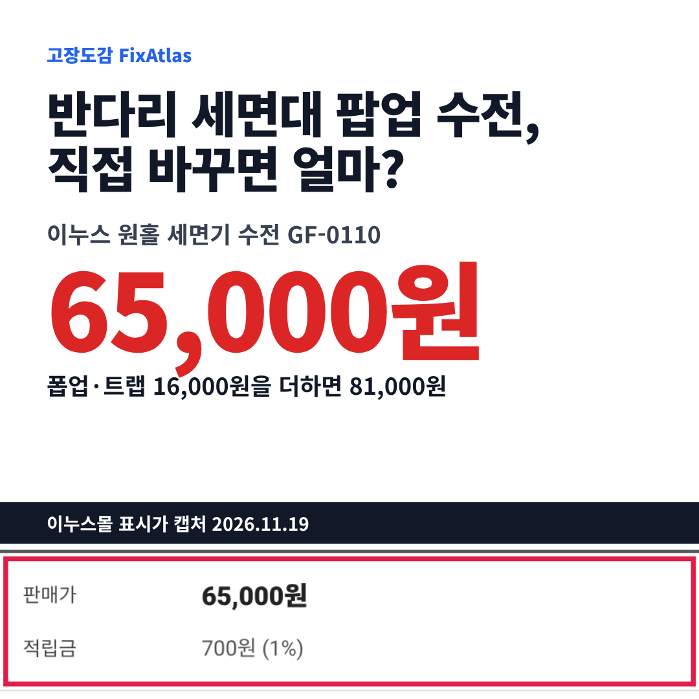
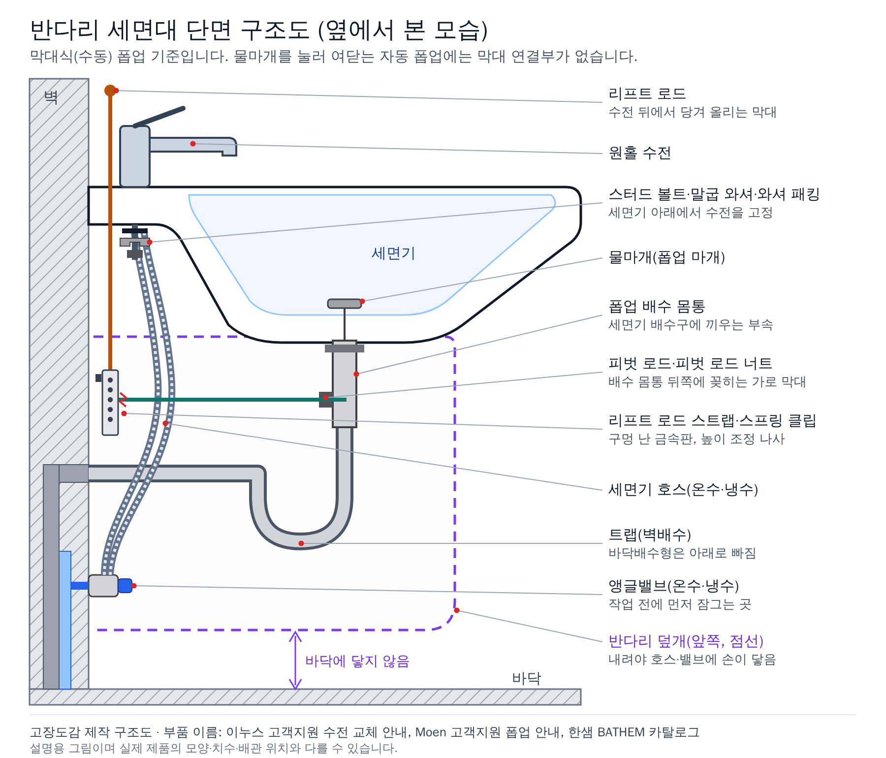
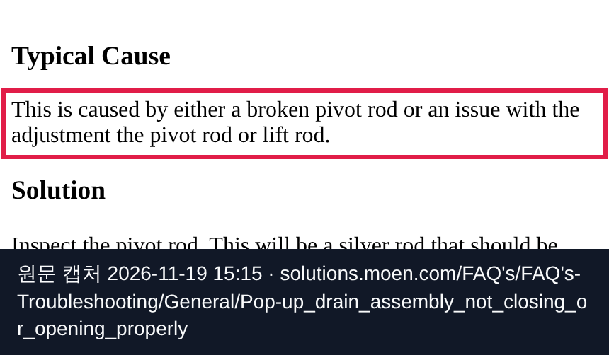
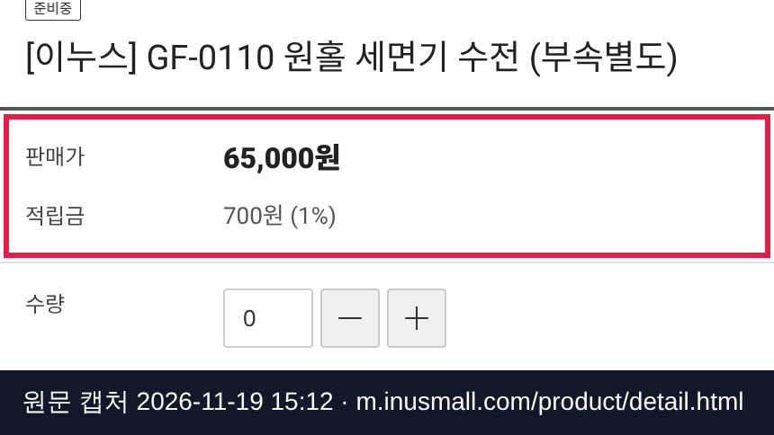
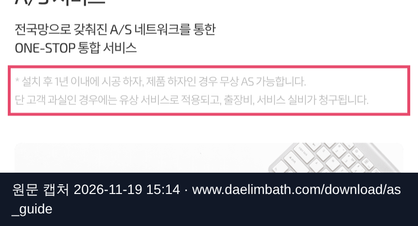

# 반다리 세면대 팝업 수전 교체, 직접 하면 얼마입니까? 부품 8만 1천 원부터

반다리 세면대(다리가 바닥까지 내려오지 않는 세면대)의 수전과 팝업(배수구 마개 부속)을 직접 바꾸면 부품값은 8만 1천 원부터입니다.
이누스몰 표시가로 원홀 세면기 수전이 65,000원, 팝업과 트랩이 한 몸인 벽배수용 부속이 16,000원입니다.

> 광고·제휴 없이 작성한 글입니다.

| 한눈에 보기 | 내용 |
|---|---|
| 난이도 | 보통: 반다리 덮개 안쪽의 좁은 공간에서 너트를 풀어야 합니다 |
| 시간 | 제조사가 공개한 기준이 없습니다. 작업 내내 세면대 물을 잠가 둡니다 |
| 직접 하면 | 부품 81,000원부터, 멍키스패너가 없으면 3,000원 추가 |
| 기사에게 맡기면 | 부품값에 방문비와 공임이 붙습니다. 한샘 서비스센터 방문점검비는 평일 주간 50,000원이고 다른 곳은 공개 기준이 없습니다 |
| 등급 | 노랑: 내 집이면 직접 해도 되지만 세입자는 집주인에게 먼저 알리고 동의를 받아야 합니다 |

출처: 이누스몰·다이소몰 상품 페이지, 한샘 서비스센터 「AS유/무상 기준」(2026년 11월 19일 기준)

이 글은 화장실 반다리 세면대의 세면 수전과 팝업 교체만 다룹니다.
세면기 도기 교체와 벽 속 배관 공사는 다루지 않습니다.

## 반다리와 팝업은 무엇을 말합니까?

반다리는 세면기 아래에 달린 짧은 다리(덮개)로, 바닥까지 내려오지 않습니다.
한샘 욕실 카탈로그에서 같은 폭(W520)의 긴다리형 PB-70은 높이가 H800, 반다리형 PB-70H는 H500입니다.

다리가 바닥에 닿지 않으니 세면기 무게는 벽 고정부가 받습니다.
반다리 덮개가 수전 호스와 앵글밸브, 배수 트랩을 가리고 있다면 덮개부터 내려야 손이 닿습니다.

팝업(폽업이라고도 씁니다)은 세면기 배수구에 끼운 배수 부속입니다.
물마개를 올리고 내려 물을 받거나 뺍니다.
수전 뒤의 막대를 당겨 여닫는 수동 팝업(막대식)과 물마개를 눌러 여닫는 자동 팝업이 있습니다.

구조도의 부품 이름은 이누스 고객지원의 수전 교체 안내와 Moen 고객지원의 팝업 안내를 따랐습니다.
반다리 덮개는 앞쪽에 있어 점선으로 그렸습니다.
Moen은 미국 수전 제조사이므로 국내 제품은 막대와 클립 모양이 다를 수 있습니다.

## 세면대 팝업 고장, 막대 조정만으로 고칠 수 있습니까?

| 증상 | 먼저 볼 곳 | 해결 범위 |
|---|---|---|
| 팝업 마개가 안 올라옴, 안 내려감(수동 팝업) | 피벗 로드가 부러졌는지, 리프트 로드 높이 | 막대 조정 또는 팝업 교체 |
| 마개를 닫아도 물이 빠짐(자동 팝업) | 물마개와 고무 패킹 | 물마개만 교체 |
| 수전을 잠가도 물이 똑똑 떨어짐 | 수전 안의 카트리지 | 카트리지 또는 수전 교체 |
| 수전 몸통이나 연결부에서 샘 | 새는 위치 | 위치에 따라 다름 |
| 수전과 팝업이 모두 낡음 | 세면기 구멍 수와 배수 방향 | 수전·팝업 전체 교체 |

Moen 고객지원은 막대식 팝업이 안 열리거나 안 닫히는 원인을 두 가지로 봅니다.
배수구 뒤쪽에 꽂힌 피벗 로드가 부러졌거나, 피벗 로드와 리프트 로드(당겨 올리는 세로 막대)의 조정이 어긋난 경우입니다.

피벗 로드가 멀쩡하면 물마개를 끝까지 연 상태에서 리프트 로드 스트랩 나사를 풀고 막대 높이를 다시 맞춥니다.
리프트 로드 스트랩은 구멍이 여러 개 난 금속판이고 피벗 로드는 스프링 클립으로 이 구멍에 연결됩니다.

자동 팝업에는 이 막대가 없습니다.
마개가 새는 정도라면 물마개만 갈아 끼우는 길이 있습니다.
한샘몰은 자사 세면대용 자동팝업 물마개를 6,000원에 올려 두었습니다(일시품절 표시).

물이 수전 쪽에서 새면 원인부터 나눕니다.
이누스는 수전을 잠가도 물이 떨어지면 "수전 내부 카트리지의 불량일 가능성이 높습니다"라고 안내합니다.
이 경우 수전 전체 대신 카트리지만 바꾸는 방법도 있으니 모델명을 확인해 제조사에 부품을 문의하십시오.

몸통이나 연결부 누수는 "발생 부위에 따라 원인과 해결 방법이 다를 수 있습니다"라는 것이 이누스의 설명입니다.
새는 위치를 사진으로 남겨 두면 기사에게 설명하기 쉽습니다.

## 원홀과 투홀, 우리 세면대에는 어떤 수전이 맞습니까?

이누스의 수전 선택 안내는 세면기 수전 구멍이 1개이면 원홀 수전, 3개이면 4인치 수전으로 나눕니다.
판매 목록에서 '투홀'로 부르는 수전을 고를 때도 상품명의 '4인치'와 세면기 구멍 개수부터 맞춰 보십시오.

가격도 다릅니다.
이누스몰 표시가로 원홀 세면기 수전은 65,000~140,000원이고 4인치 세면 수전 GF-0213은 71,000원입니다.

팝업·트랩 부속은 배수 방향을 맞춰야 합니다.
이누스 I-트랩은 벽으로 빠지는 벽배수용이 16,000원, 바닥으로 빠지는 바닥배수용이 18,000원입니다.

다만 이누스몰은 2026년 6월 공지에서 쇼핑몰 시스템 문제로 구매가 어렵다며 네이버 브랜드스토어 구매를 안내합니다.
위 가격은 공식몰에 표시된 값이고 실제 구매가는 판매처마다 다를 수 있습니다.

## 설치한 지 1년이 안 됐다면 AS부터 받아야 합니까?

보증기간 안이면 AS가 먼저입니다.
대림바스와 이누스, 한샘은 모두 설치 후 1년을 무상 보증 기간으로 안내합니다.

이누스와 한샘은 지정 서비스센터가 아닌 사람이 수리해 생긴 고장을 유상 수리로 분류합니다.
보증기간 안의 수전에 직접 손대기 전에 설치한 곳이나 제조사에 먼저 연락하십시오.

## 이럴 땐 멈추고 기사를 부르십시오

- 앵글밸브를 시계 방향으로 끝까지 돌려도 물이 멈추지 않거나 녹슬어 돌아가지 않을 때. 공동주택이면 관리사무소에 세대 밸브 차단을 문의하십시오.
- 세면기 도기에 금이 갔을 때. 이누스는 유약면에 살짝 금이 간 정도가 아니면 수리가 어렵다고 안내합니다.
- 트랩 아래 벽이나 바닥 배수관 연결부에서 물이 샐 때. 벽 속 배관 문제일 수 있어 부속 교체로 끝나지 않습니다.
- 세면기나 반다리를 살짝 밀었을 때 벽에서 흔들릴 때. 무거운 도기가 떨어질 수 있으니 수전보다 고정부를 먼저 고쳐야 합니다.
- 수전 아래 스터드 볼트가 녹으로 굳어 공구를 걸어도 돌지 않을 때. 힘을 더 주면 도기가 깨질 수 있습니다.

## 준비물

| 준비물 | 쓰는 곳 | 구하는 방법 |
|---|---|---|
| 새 세면 수전(원홀 또는 4인치) | 세면기 구멍 수에 맞춥니다. 수도용 위생안전기준 인증 표시를 확인합니다 | 살 것 |
| 팝업·트랩 부속(벽배수 또는 바닥배수) | 기존 배수 방향과 같은 것을 고릅니다. 팝업이 멀쩡하면 생략합니다 | 살 것 |
| 멍키스패너 | 호스 끝 육각 너트와 트랩 너트를 풉니다 | 다이소로 충분(멍키스패너 200, 3,000원) |
| 세면대 렌치(원홀 렌치) | 세면기 아래 깊숙한 스터드 볼트 너트에 손이 닿지 않을 때 씁니다 | 살 것 또는 빌릴 것 |
| 손전등 | 반다리 안쪽을 비춥니다 | 집에 있음 |
| 대야·수건 | 호스와 트랩에 남은 물을 받습니다 | 집에 있음 |
| 휴대폰 카메라 | 분해 전 연결 상태를 찍어 둡니다. 세입자에게는 원래 상태의 증거가 됩니다 | 집에 있음 |

출처: 다이소몰 「멍키스패너 200」(2026년 11월 19일 기준), 수도법 제14조

물에 닿는 수전과 팝업은 인증 표시부터 봅니다.
수도법 제14조는 물에 접촉하는 수도용 제품을 위생안전기준 인증을 받은 것만 팔게 하고 인증 사실을 제품과 포장에 표시하도록 정합니다.
이누스 GF-0110 상세 이미지에도 '수도용 위생안전기준 인증' 표시가 있습니다.

## 반다리 세면대 수전과 팝업은 어떤 순서로 바꿉니까?

아래 방법은 이누스 고객지원의 수전 교체 안내와 Moen 고객지원의 팝업 조정 안내를 바탕으로 합니다.
셀프 교체라면 시작 전에 새 수전의 호스 길이가 앵글밸브까지 닿는지 먼저 비교하십시오.

1. 반다리 덮개를 분리합니다. 나사가 보이면 풀어서 내리되 고정 방식이 보이지 않으면 억지로 당기지 마십시오.
2. 세면기 아래 앵글밸브 두 개(온수·냉수)를 잠급니다. 수전 손잡이를 열어 물이 더 나오지 않는지 확인합니다.
3. 호스, 막대, 트랩이 어떻게 이어져 있는지 사진으로 남깁니다.
4. 호스 끝 육각 너트를 멍키스패너로 시계 반대 방향으로 돌려 앵글밸브에서 뗍니다. 남은 물이 나오니 대야를 받칩니다.
5. 막대식 팝업이면 리프트 로드 스트랩 나사를 풀고 스프링 클립을 빼서 막대 연결을 풉니다.
6. 세면기 아래에서 수전을 잡고 있는 스터드 볼트를 풀고 말굽 와셔와 와셔 패킹을 차례로 뺍니다. 그다음 세면기 위에서 수전을 들어 올립니다.
7. 팝업과 트랩을 바꿀 때는 새 부속 설명서의 순서를 따릅니다. 떼어 낸 트랩에는 고인 물과 이물질이 있으니 대야 위에서 다룹니다.
8. 새 수전을 위에서 끼우고 아래에서 와셔 패킹, 말굽 와셔, 스터드 볼트 순서로 고정합니다. 호스는 손으로 먼저 돌려 끼운 뒤 공구로 조입니다.
9. 물마개를 끝까지 연 상태에서 리프트 로드 높이를 맞추고 스트랩 나사를 조입니다. 피벗 로드는 스프링 클립으로 스트랩 구멍에 연결합니다.
10. 앵글밸브를 천천히 열고 호스 양 끝과 수전 아래를 마른 휴지로 훑어 젖는 곳이 없는지 봅니다. 물마개를 닫아 물을 받았다가 열어 빼면서 마개가 끝까지 여닫히는지, 트랩에서 물이 떨어지지 않는지 확인합니다.
11. 다음 날 같은 자리를 마른 휴지로 한 번 더 훑습니다. 젖은 곳이 없을 때 반다리 덮개를 다시 고정합니다.

## 직접 하면 얼마, 기사를 부르면 얼마입니까?

| 항목 | 직접 | 기사(제조사 AS) |
|---|---|---|
| 수전 | 65,000원부터(이누스몰 원홀 표시가) | 부품값 별도 청구 |
| 팝업·트랩 | 16,000원(벽배수), 18,000원(바닥배수) | 부품값 별도 청구 |
| 공구 | 없음(집에 있을 때), 3,000원(멍키스패너를 새로 살 때) | 없음 |
| 방문비·공임 | 없음 | 한샘 방문점검비 50,000원(평일 주간), 60,000원(휴일·야간)에 기술료 별도. 다른 제조사·설비업체는 공개 기준 없음 |
| 합계 | 81,000~84,000원 | 부품값에 50,000원 이상(한샘 제품, 보증 1년 경과) |

출처: 이누스몰·다이소몰 상품 페이지, 한샘 서비스센터 「AS유/무상 기준」, 이누스 서비스센터 「서비스요금 안내」(2026년 11월 19일 기준). 합계는 고장도감 계산입니다.

한샘 서비스센터는 방문점검비, 기술료, 자재비 세 가지를 더해 청구합니다.
점검만 받고 수리를 취소해도 "방문 점검이 완료된 경우 기본 청구됩니다"라는 조건이 붙습니다.

이누스는 출장비, 수리비, 부품비를 더해 청구하고 출장비는 지역별로 다르다고만 밝혔습니다.
동네 설비업체의 수전 교체 공임은 공개된 기준이 아직 없는 상태입니다.
받은 견적을 제보해 주시면 같은 작업 제보가 모였을 때 표에 더하겠습니다.

공구를 새로 사면 직접 하는 쪽의 이점이 줄어듭니다.
세면대 렌치까지 사야 하거나 굳은 앵글밸브 때문에 결국 기사를 부르면 공구값과 방문비가 모두 듭니다.

한샘은 분해하지 않는 간단한 조정도 유상 조건에 넣습니다.
막대 높이만 어긋난 팝업이라면 기사를 부르기 전에 직접 조정해 볼 이유가 여기 있습니다.

## 세입자라면 수전 교체 비용은 집주인 몫입니까?

민법 제623조는 임대인이 계약 기간 동안 집을 "사용, 수익에 필요한 상태"로 유지할 의무를 진다고 정합니다.
다만 판례는 집주인 몫에 한계를 둡니다.
대법원 2010다89876 판결에 따르면 세입자가 큰돈 들이지 않고 손쉽게 고칠 수 있는 사소한 고장은 임대인의 수선의무 밖입니다.

낡아서 물이 새는 수전은 이 기준으로 집주인에게 수리를 요구할 수 있는지 따져 볼 수 있습니다.
반면 물마개 하나처럼 값싸고 손쉬운 교체는 사소한 수선으로 볼 여지가 있습니다.

어느 쪽이든 먼저 알리십시오.
민법 제634조는 임차물에 수리가 필요하면 임차인이 지체 없이 임대인에게 통지하도록 합니다.

집주인 동의 없이 바꾸면 이사 나갈 때 원상회복 문제가 생길 수 있습니다.
민법 제654조가 임대차에 준용하는 제615조는 빌린 물건을 돌려줄 때 원상에 회복하도록 정합니다.
떼어 낸 수전과 팝업은 버리지 말고 보관하십시오.

집주인이 수리를 미뤄 세입자가 고쳤다면 민법 제626조의 필요비 상환을 청구할 수 있습니다.
영수증과 집주인에게 알린 문자를 함께 남겨 두십시오.

## 수리비 다툼은 어떻게 판단됐습니까?

머니투데이(2026년 6월 27일)에 따르면 분쟁조정위원회는 마루 찍힘 사례에서 사용 연수와 자재 특성을 따져 통상 손상으로 판단하고 원상회복 의무가 없다고 결정한 바 있습니다.
같은 보도에서 변호사는 입주 때 집 상태를 사진이나 동영상으로 기록해 두라고 조언합니다.
수전을 바꾸기 전에 찍은 사진이 바로 그 기록입니다.

임대인의 수선의무를 다룬 판결도 있습니다.
대법원은 2012년 6월 14일 가구전시장 바닥 결로 사건에서 임대인의 수선의무를 다시 따지라며 임차인이 진 원심 판결 부분을 파기했습니다.

## 반다리 덮개는 어떻게 붙어 있었습니까?

반다리 덮개의 고정 방식은 제품마다 달라 공개된 설명서가 드뭅니다.
직접 바꿔 보셨다면 덮개가 나사로 붙어 있었는지, 걸쇠나 접착 방식이었는지 댓글로 알려 주십시오.

기사를 불렀다면 받은 견적과 영수증 금액을 보내 주십시오.
업체 공임이 공개 자료에 없어 비용표의 빈칸을 제보로 채우려 합니다.

[세면대 수전 교체 비용 제보하기](site:/submit-repair#cta-bottom)

## 출처

- 이누스몰 [GF-0110 원홀 세면기 수전](https://inusmall.com/product/detail.html?product_no=97), [세면수전 목록](https://inusmall.com/product/list.html?cate_no=34), [I-트랩 벽배수](https://inusmall.com/product/detail.html?product_no=482), [I-트랩 바닥배수](https://inusmall.com/product/detail.html?product_no=483), [공지 「욕실 상품 구매 안내」](https://inusmall.com/article/%EA%B3%B5%EC%A7%80%EC%82%AC%ED%95%AD/1/3825/) (2026년 11월 19일 기준)
- 이누스 서비스센터 [서비스요금 안내](https://cs.inusbath.com/ISDS/view/view.do?pageCd=resGuid), 간단조치 [세면기 수전 교체](https://cs.inusbath.com/ISDS/bbt/bbt00004V.do?pageCd=BBM00007&boardSeq=7411&boardMstCd=BBM00007), [물이 똑똑 떨어질 때](https://cs.inusbath.com/ISDS/bbt/bbt00004V.do?pageCd=BBM00007&boardSeq=7416&boardMstCd=BBM00007), [수전 누수](https://cs.inusbath.com/ISDS/bbt/bbt00004V.do?pageCd=BBM00007&boardSeq=7415&boardMstCd=BBM00007), [세면기 금](https://cs.inusbath.com/ISDS/bbt/bbt00004V.do?pageCd=BBM00007&boardSeq=7410&boardMstCd=BBM00007), [배수가 느릴 때](https://cs.inusbath.com/ISDS/bbt/bbt00004V.do?pageCd=BBM00007&boardSeq=7409&boardMstCd=BBM00007)
- 한샘 서비스센터 [AS유/무상 기준](https://as.hanssem.com/reserve/ServiceChargeInfomation/view.as), 한샘몰 [욕실 세면대용 자동팝업 물마개](https://store.hanssem.com/goods/683422), [BATHEM 욕실 카탈로그(PDF)](https://image2.hanssem.com/company/doc/scm/scm_catalog_BASTEM_250519.pdf)
- 대림바스 [AS/설치가이드](https://www.daelimbath.com/download/as_guide)
- Moen 고객지원 [Pop-up drain assembly not closing or opening properly](https://solutions.moen.com/FAQ's/FAQ's-Troubleshooting/General/Pop-up_drain_assembly_not_closing_or_opening_properly)
- 다이소몰 [멍키스패너 200](https://www.daisomall.co.kr/pd/pdr/SCR_PDR_0001?pdNo=57411)
- 국가법령정보센터 [민법](https://www.law.go.kr/LSW/lsInfoP.do?lsiSeq=284415) 제615조·제623조·제626조·제634조·제654조, [수도법](https://www.law.go.kr/LSW/lsInfoP.do?lsiSeq=284311) 제14조, [대법원 2010다89876 판결](https://www.law.go.kr/LSW/precInfoP.do?precSeq=164196)
- 머니투데이 [6년 산 전셋집서 "시트지 들떠, 150만원 청구"...전셋값 오르자 분쟁 급증](https://www.mt.co.kr/estate/2026/06/27/2026062414343360002) (2026년 6월 27일)

> 만든 방법: AI 도구로 초안을 쓰고 출처의 숫자·문구를 원문과 자동 대조했습니다. 마지막 대조일은 2026-11-19입니다. AI 사용 범위는 [방법론의 AI 사용 원칙](site:/methodology#ai)에 정리했습니다.

구조도는 고장도감이 직접 그린 설명용 그림이며 실제 제품의 모양과 치수는 다를 수 있습니다.

바로잡기: 숫자나 문구가 원문과 다르면 댓글로 알려 주십시오. 원문을 다시 확인해 고치고 수정 이력에 남기겠습니다.

쓴 사람: [[판단: 바이라인 — 실명과 활동명 중 무엇으로, 어떤 소개로 드러낼지 정하기. AI 초안: "고장도감 운영자 ○○. 가전 수리비를 공식 자료와 사용자 제보로 비교해 기록합니다." 정한 문장은 AI가 모든 글에 넣음]]

수정 이력: 2026-11-19 반다리 세면대 수전·팝업 교체 가이드 첫 원고
